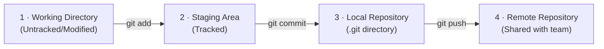
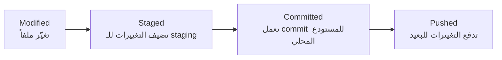
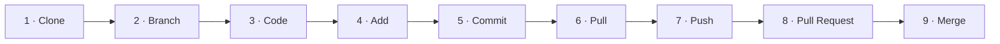
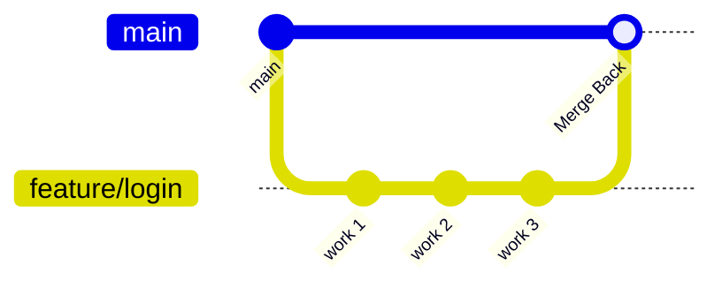
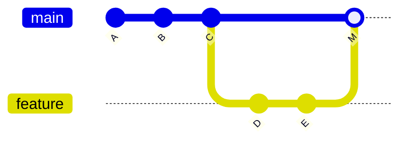
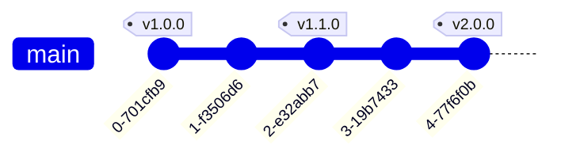
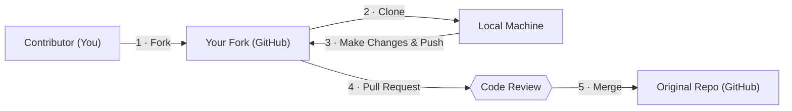
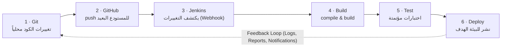
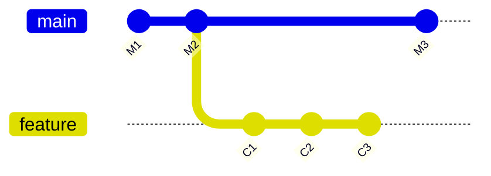
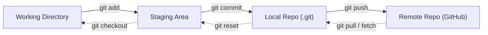

### 📑 فهرس الصفحات المتاحة

- [[#Introduction to Git (Page 2) 🌱|2 · Introduction to Git]]
- [[#Git Architecture (Page 3) 🏗️|3 · Git Architecture]]
- [[#Installation & Configuration (Page 4) ⚙️|4 · Installation & Configuration]]
- [[#Essential Git Commands (Page 5) ⌨️|5 · Essential Git Commands]]
- [[#Complete Git Workflow (Page 6) ⚙️|6 · Complete Git Workflow]]
- [[#Branching (Page 7) 🌿|7 · Branching]]
- [[#Merge vs Rebase (Page 8) ⚖️|8 · Merge vs Rebase]]
- [[#Remote Repository (Page 9) ☁️|9 · Remote Repository]]
- [[#Undo & Recovery (Page 10) 🗑️🔄|10 · Undo & Recovery]]
- [[#Stash, Tags & .gitignore (Page 11) 📁🏷️|11 · Stash, Tags & .gitignore]]
- [[#GitHub Collaboration (Page 12) 🐙|12 · GitHub Collaboration]]
- [[#Git for QA Engineers (Page 13) 🐞|13 · Git for QA Engineers]]
- [[#Git with CI/CD (Page 14) ♾️|14 · Git with CI/CD]]
- [[#Common Git Errors (Page 15) ⚠️|15 · Common Git Errors]]
- [[#Advanced Git (Page 16) 🎓|16 · Advanced Git]]
- [[#Git Interview Questions (Page 17) ❓💡|17 · Git Interview Questions]]
- [[#Git Best Practices (Page 18) 🛡️⭐|18 · Git Best Practices]]
- [[#Ultimate Git Cheat Sheet (Page 19) 📋⭐|19 · Ultimate Git Cheat Sheet]]

🏷️ وسوم سريعة: #git #cheatsheet #interview-prep

---

## Introduction to Git (Page 2) 🌱

### 1) ما هو Git؟ (What is Git?)
Git هو ==نظام تحكم بالإصدارات موزّع (Distributed Version Control System - DVCS)== يُستخدم لتتبع التغييرات في الكود المصدري أثناء تطوير البرمجيات.

> [!success] لماذا Git؟ 💡
> - تتبّع كل تغيير (Track every change).
> - العمل مع الفريق بسهولة.
> - الرجوع إلى أي إصدار سابق.
> - إنشاء فروع وميزات (branches & features).
> - آمن، سريع، وموثوق.

### 2) ما هو Version Control؟
نظام ==يسجّل التغييرات على الملفات عبر الزمن== حتى تتمكن من استرجاع إصدارات محددة لاحقاً.
`v1 → v2 → v3` ⏳ (over Time)

### 3) Git vs GitHub

| Git | GitHub |
| --- | --- |
| أداة (نظام تحكم بالإصدارات) | منصة (خدمة سحابية) |
| يعمل على جهازك المحلي | يستضيف مستودعات Git |
| قائم على سطر الأوامر | واجهة ويب |
| يدير تاريخ الكود | تعاون ومشاركة |

### 4) لماذا Git مهم؟ ⭐
- كل مطوّر ومختبر يجب أن يعرف ==Git==.
- مهارة ==معيارية في الصناعة== (Industry standard).
- أساسي لـ==التعاون== (collaboration).
- يساعد في ==النسخ الاحتياطي والتتبع== وإدارة الكود بكفاءة.

### 5) الفوائد الرئيسية لـ Git
- **Collaboration 👥** — عدة مطورين يعملون معاً دون الكتابة فوق كود بعضهم.
- **Safety 🛡️** — التاريخ الكامل للتغييرات محفوظ، يمكنك الاستعادة في أي وقت.
- **Speed ⚡** — Git خفيف وسريع جداً في عملياته.
- **Branching 🌿** — أنشئ فروعاً لميزات جديدة دون التأثير على الكود الرئيسي.
- **Backup 📦** — كودك آمن دائماً في المستودعات البعيدة.
- **Open Source 🏅** — مجاني ومفتوح المصدر ويستخدمه الملايين حول العالم.

> [!quote] تذكّر 📌
> Git يساعدك على ==تتبع التغييرات والتعاون وإدارة الكود== مثل المطور المحترف.

---

## Git Architecture (Page 3) 🏗️

> [!info] نظرة عامة
> Git يعمل كـ==نظام من 4 طبقات== حيث تنتقل تغييراتك خطوة بخطوة من جهازك إلى الخادم البعيد.

### الطبقات الأربع (4-Layer System)



- **Working Directory** — حيث تعمل على الملفات. (Untracked/Modified)
- **Staging Area** — التغييرات مُضافة وجاهزة للـ commit. (Tracked)
- **Local Repository** — التغييرات مُcommit ومحفوظة محلياً. (`.git` directory)
- **Remote Repository** — خادم بعيد مثل GitHub، GitLab، Bitbucket إلخ. (Shared with team)

### ⭐ دورة حياة Git (Git Lifecycle)



### 💡 تشبيه بسيط (Easy Analogy)
- Working Directory → مكتبك (Your Desk)
- Staging Area → الحافظة (Your Clipboard)
- Local Repository → خزانتك (Your Locker)
- Remote Repository → خزانتك السحابية (Team Storage)

### الأوامر المهمة في التدفق
- `git status` → فحص الحالة الحالية
- `git add <file>` → النقل إلى الـ staging area
- `git commit -m "message"` → الحفظ محلياً
- `git push origin <branch>` → الدفع إلى البعيد

> [!tip] نصيحة 📌
> فكّر دائماً: ==Modify → Add → Commit → Push== — هذا هو قلب Git!

---

## Installation & Configuration (Page 4) ⚙️

### 1) تثبيت Git (Install Git)
نزّل وثبّت Git من الموقع الرسمي.

> [!info] الموقع الرسمي
> https://git-scm.com/downloads — (Windows / macOS / Linux)
> اتبع معالج التثبيت (installation wizard) لنظام تشغيلك.

> [!info] بديل رسومي (GUI) 🖱️
> لو مش مرتاح للـ CLI في البداية: [Gitnuro](https://github.com/JetpackDuba/Gitnuro) — عميل Git ==مفتوح المصدر ومجاني== (Windows / macOS / Linux).
> ممتاز لفهم الـ branches والـ diffs بصريًا — لكن ==أتقن الـ CLI أولًا==، هو أساس الشغل الحقيقي والـ CI/CD.

### 2) التحقق من التثبيت (Check Git Installation)
```bash
git --version
# git version 2.44.0.windows.1
```

> [!tip] نصيحة 💡
> إذا ظهر "command is not found"، أعد تشغيل الـ terminal.

### 3) إعداد الاسم والبريد (Configure Username & Email)
```bash
git config --global user.name "Your Name"               # يضبط اسم المستخدم
git config --global user.email "youremail@example.com"  # يضبط البريد
```

> [!note]
> هذه التفاصيل ستُ==رفق مع كل الـ commits== الخاصة بك.

### 4) عرض الإعدادات الحالية (View Current Configuration)
```bash
git config --list   # يعرض كل إعدادات الـ configuration العامة
```

> [!tip] تذكّر ⭐
> استخدم `--global` لتطبيق الإعدادات على ==كل المستودعات== في نظامك.
> استخدم `--local` لـ==مستودع محدد==.

### 5) الفرع الافتراضي (Default Branch)
اسم الفرع الافتراضي في Git يتغير من `master` إلى `main`.
```bash
git config --global init.defaultBranch main
# يضبط اسم الفرع الافتراضي
# المستودعات الجديدة ستبدأ بـ 'main'
```

### 6) فحص قيم الإعدادات (Check Configuration Values)

| الفحص | الأمر | الناتج |
| --- | --- | --- |
| اسم المستخدم | `git config user.name` | Your Name |
| البريد | `git config user.email` | youremail@example.com |
| الفرع الافتراضي | `git config init.defaultBranch` | main |
| كل الإعدادات | `git config --list` | يعرض كل قيم الإعدادات |

> [!success] أفضل ممارسة 📌
> اضبط Git بشكل صحيح ==دائماً قبل بدء أي مشروع== — يوفر الوقت ويتجنب أخطاء الـ commits.

---

## Essential Git Commands (Page 5) ⌨️

### 1) `git init`
تهيئة مستودع Git جديد في مشروعك.
```bash
git init
# Initialized empty Git repository in my-project/.git/
```

### 2) `git clone`
استنساخ مستودع بعيد موجود إلى جهازك المحلي.
```bash
git clone <url>
# Cloning into 'repo'...
# remote: Enumerating objects: 120, done.
# Receiving objects: 100%
```

### 3) `git status`
يعرض الحالة الحالية للـ working directory والـ staging area.
```bash
git status
# On branch main
# Changes not staged for commit:
#   modified:   app.js
# Untracked files:
#   test.js
```

### 4) `git add`
يضيف التغييرات من الـ working directory إلى الـ staging area.
```bash
git add <file>
git add .
# (لا يوجد output) — ينقل التغييرات إلى الـ staging area
```

### 5) `git commit`
يعمل commit للتغييرات المُجهّزة إلى المستودع المحلي.
```bash
git commit -m "Your message"
# [main a1b2c3d] Your message
#  1 file changed, 5 insertions(+)
#  create mode 100644 app.js
```

### 6) `git log`
يعرض تاريخ الـ commits.
```bash
git log --oneline
# a1b2c3d (HEAD -> main) Your message
# 4be5f6g Second commit
# h7i8j9k Initial commit
```

### 7) `git diff`
يعرض الفروقات بين التغييرات — مفيد لمراجعة ما عدّلته.

| المقارنة | الأمر | الناتج |
| --- | --- | --- |
| Working Directory vs Staging | `git diff` | `- old line` / `+ new line` |
| Staged vs Last Commit | `git diff --staged` | `- old line` / `+ new line` |
| Between Commits/Branches | `git diff <a>..<b>` | `- old line` / `+ new line` |

> [!quote] تذكّر 📌
> `add` → ينقل التغييرات إلى الـ staging.
> `commit` → يحفظ التغييرات نهائياً محلياً.
> `push` → يرسل التغييرات إلى البعيد.

> [!tip] نصيحة 💡
> افحص الحالة كثيراً باستخدام `git status`.
> اعمل commits ==صغيرة وذات معنى==.
> اكتب رسائل commit ==واضحة==.

---

## Complete Git Workflow (Page 6) ⚙️

> [!info] نظرة عامة
> هنا سير عمل Git الكامل من البداية للنهاية الذي تتبعه في أي مشروع حقيقي.



> [!success] 1) Clone
> انسخ المستودع البعيد إلى جهازك المحلي.
> ```bash
> git clone <url>
> ```

> [!success] 2) Branch
> أنشئ فرعاً جديداً لميزتك أو إصلاحك.
> ```bash
> git checkout -b feature/login
> ```

> [!success] 3) Code
> أجرِ التغييرات في ملفاتك.
> ```js
> // Edit, Add or Update your code
> ```

> [!success] 4) Add
> أضف تغييراتك من الـ working directory إلى الـ staging area.
> ```bash
> git add .
> ```

> [!success] 5) Commit
> اعمل commit للتغييرات المُجهّزة إلى المستودع المحلي.
> ```bash
> git commit -m "Your message"
> ```

> [!success] 6) Pull
> اسحب أحدث التغييرات من المستودع البعيد.
> ```bash
> git pull origin main
> ```

> [!success] 7) Push
> ادفع تغييراتك المُcommit إلى البعيد.
> ```bash
> git push origin feature/login
> ```

> [!success] 8) Pull Request
> أنشئ Pull Request لمراجعة تغييراتك.
> ```text
> // Open PR on GitHub, GitLab, Bitbucket etc.
> ```

> [!success] 9) Merge
> بعد المراجعة والموافقة، ادمج الـ PR.
> ```text
> // Changes are merged into main branch
> ```

> [!tip] نقاط مفتاحية ⭐
> اعمل دائماً على ==فرع منفصل==.
> اسحب ==أحدث التغييرات== قبل الـ push.
> اكتب ==رسائل commit ذات معنى==.
> ==راجع== قبل إنشاء Pull Request.

> [!tip] نصائح 💡
> Commits صغيرة، رسائل واضحة.
> أبقِ فرعك محدّثاً.
> ==لا push مباشرة إلى فرع `main` أبداً==.

---

## Branching (Page 7) 🌿

> [!info] نظرة عامة
> الفروع تساعدك على العمل على ميزات أو إصلاحات أو تجارب جديدة ==دون التأثير على الكود الرئيسي==.

### 1) إنشاء فرع (Create Branch)
```bash
git branch <branch-name>   # ينشئ فرعاً جديداً
# مثال:
git branch feature/login
```

### 2) تبديل فرع (Switch Branch)
```bash
git switch <branch-name>   # التبديل إلى فرع
# مثال:
git switch feature/login
```

### 3) إنشاء وتبديل (Create & Switch)
```bash
git switch -c <branch-name>   # إنشاء وتبديل معاً
# مثال:
git switch -c feature/login
```

### 4) إعادة تسمية فرع (Rename Branch) — `-m` → move
```bash
git branch -m <new-name>   # إعادة تسمية الفرع الحالي
# مثال:
git branch -m feature/auth
```

### 5) حذف فرع (Delete Branch)
```bash
git branch -d <branch-name>   # حذف فرع مدموج
# مثال:
git branch -d feature/login

git branch -D <branch-name>   # حذف قوي (غير مدموج)
# مثال:
git branch -D temp-branch
```

> [!tip] نصيحة 💡
> استخدم `-d` للحذف ==الآمن== فقط إذا كان مدموجاً.
> استخدم `-D` للحذف ==الإجباري== للفروع غير المدموجة. ✅

### 6) اتفاقيات تسمية الفروع

| النوع | البادئة | الغرض | أمثلة |
| --- | --- | --- | --- |
| Feature | `feature/` | تطوير ميزة جديدة | `feature/login` , `feature/payment` |
| Bug Fix | `bugfix/` | إصلاحات الأخطاء | `bugfix/header-issue` , `bugfix/typo` |
| Hotfix | `hotfix/` | إصلاحات عاجلة بالإنتاج | `hotfix/critical-login` , `hotfix/payment` |
| Release | `release/` | تحضير الإصدار | `release/v1.0.0` , `release/v2.1.0` |
| Chore | `chore/` | صيانة / dependencies / مهام | `chore/update-deps` , `chore/docs` |

> [!success] أفضل ممارسة ⭐
> استخدم أحرفاً ==صغيرة (lowercase)==.
> استخدم الشَرطة (`-`) وليس الشرطة السفلية (`_`).
> أبقِ الاسم ==قصيراً وواضحاً وذات معنى==.
> اتبع معايير الفريق.

### 7) عرض الفروع (View Branches)
```bash
git branch                 # عرض الفروع المحلية
git branch -r              # عرض الفروع البعيدة
git branch -a              # عرض الكل (محلية + بعيدة)
git branch --show-current  # اسم الفرع الحالي فقط — مفيد جدًا في السكربتات
```

### 8) مثال سير عمل الفروع

(Create Branch → Work & Commit → Merge Back)

> [!quote] تذكّر 📌
> الفروع ==خفيفة الوزن وقوية للغاية== — تجعل التعاون سلساً وآمناً. ✅

---

## Merge vs Rebase (Page 8) ⚖️

> [!info] نظرة عامة
> كلاهما يُستخدم لدمج التغييرات، لكن التاريخ الذي ينشئانه ==مختلف==.

### 1) MERGE 🔀
يدمج التواريخ عبر إنشاء ==merge commit جديد==.

```bash
git merge feature   # يدمج feature في main
```

### 2) REBASE 🔁
يعيد تطبيق commits فوق آخر commit.
`main: A → B → C` ثم تُعاد التطبيقات: `D' → E'` فوق الأحدث.
```bash
git rebase main   # نقل commits الـ feature إلى آخر main
```

> [!note] مفتاح الرموز
> `A, B, C` = commits على main · `D, E` = commits الـ feature (قبل rebase) · `D', E'` = commits الـ feature (بعد rebase) · `M` = merge commit

### 3) الفروقات الأساسية

| الجانب | Merge | Rebase |
| --- | --- | --- |
| التاريخ | يحفظ التاريخ كاملاً مع merge commit. | ينشئ تاريخاً خطياً نظيفاً. |
| الـ Commits | الـ commits الأصلية محفوظة. | ينشئ commits جديدة (IDs مختلفة). |
| الوضوح | قد يصبح التاريخ فوضوياً مع كثرة الـ merges. | التاريخ يبدو نظيفاً وسهل القراءة. |
| التعاون | آمن للفروع المشتركة. | تجنّب rebase على الفروع المشتركة. |
| التعارضات | تُحل التعارضات مرة واحدة أثناء الدمج. | قد تظهر التعارضات عدة مرات. |
| حالة الاستخدام | دمج الميزات، الفروع طويلة العمر. | تحديث فروع الميزات، قبل الـ PR. |

### 4) المزايا

> [!success] Merge
> آمن وسهل للفرق.
> يحفظ تاريخ المشروع كاملاً.
> جيد للفروع الطويلة.
> مثالي للإصدارات والتكامل. ✅

> [!success] Rebase
> يُبقي التاريخ نظيفاً وخطياً.
> أسهل للقراءة والفهم.
> يزيل merge commits غير الضرورية.
> رائع لفروع الميزات. ✅

> [!tip] نصيحة 💡
> فكّر في الـ Merge بأنه "==حفظ التاريخ==" والـ Rebase بأنه "==إعادة كتابة التاريخ==". ✅

### 5) متى تستخدم كلاً منهما؟

> [!question] استخدم MERGE عندما:
> - تعمل على فروع فريق/مشتركة.
> - الفرع عام (public).
> - تريد التاريخ الكامل.
> - ميزات طويلة الأمد.

> [!question] استخدم REBASE عندما:
> - تعمل على فرع ميزتك الخاص.
> - الفرع غير مشترك.
> - قبل إنشاء Pull Request.
> - تريد تاريخاً نظيفاً. ✅

### 6) ممارسات الشركات
==لا rebase أبداً== على `main` أو `develop` أو فروع الـ release.

> [!warning] انتبه
> اعمل rebase لفرع ميزتك مع آخر main دائماً قبل الـ PR.
> استخدم ==merge commit (أو squash)== عند دمج الـ PR.
> اتبع سياسة سير عمل Git الخاصة بالفريق. ✅

> [!quote] تذكّر 📌
> ==Rebase يعيد كتابة التاريخ== — استخدمه بحذر.
> ==Merge يحفظ التاريخ== — استخدمه بأمان.

---

## Remote Repository (Page 9) ☁️

> [!info] نظرة عامة
> المستودعات البعيدة تتيح لك ==مشاركة الكود==، ==التعاون مع الآخرين==، و==الحفاظ على مشروعك آمناً في السحابة==.

### 1) Push ⬆️
يرسل commits المحلية إلى المستودع البعيد.
```bash
git push <remote> <branch>   # push للـ commits المحلية
```

### 2) Pull ⬇️
يجلب ويدمج التغييرات من البعيد إلى المحلي.
```bash
git pull <remote> <branch>   # fetch + merge
```

### 3) Fetch 📥
ينزّل التغييرات من البعيد لكن ==لا يدمج تلقائياً==.
```bash
git fetch <remote>   # تحديث فروع التتبع البعيدة
```

### 4) Origin 🏠
الاسم الافتراضي للمستودع البعيد الذي استنسخت منه.
```bash
git remote -v   # عرض المستودعات البعيدة
```

### 5) Upstream Branches 🔗
الفروع البعيدة التي تتتبعها وتزامنها فروعك المحلية.
```bash
git branch -vv   # عرض معلومات التتبع
```

### ⭐ كيف تعمل معاً


### فحص الـ Remotes (Check Remotes)
```bash
git remote -v
# origin  https://github.com/user/repo.git  (fetch)
# origin  https://github.com/user/repo.git  (push)
```

> [!note]
> `origin` هو اسم الـ remote الافتراضي.

### 6) إضافة / حذف / إعادة تسمية Remote

| الإجراء | الأمر | الوصف |
| --- | --- | --- |
| Add Remote | `git remote add <name> <url>` | إضافة مستودع بعيد جديد. |
| Remove Remote | `git remote remove <name>` | حذف remote موجود. |
| Rename Remote | `git remote rename <old> <new>` | إعادة تسمية remote. |

### 7) مثال سير عمل شائع
1. **Work** — تغييرات الكود
2. **Push** — `git push origin feature/login`
3. **Teammate** — زميلك يجري تغييرات ويدفعها
4. **Pull/Fetch** — `git pull origin feature/login`
5. **Merge** — دمج والبقاء محدّثاً

### 8) فروع التتبع البعيدة (Upstream)
`feature/login` (محلي) ← Tracking commits ← `origin/feature/login` (بعيد/origin)

> [!note]
> عندما تضبط upstream، يعرف فرعك المحلي ==أي فرع بعيد يتتبع==.

> [!tip] نصائح 💡
> اسحب ==pull دائماً قبل الـ push==.
> استخدم أسماء فروع ذات معنى.
> اضبط ==upstream== عند إنشاء فرع جديد.
> أبقِ مستودعك المحلي متزامناً مع البعيد.

> [!quote] تذكّر 📌
> Push → رفع عملك إلى البعيد.
> Pull → جلب أحدث التغييرات ودمجها.
> Fetch → تنزيل دون دمج.
> Origin → اسم الـ remote الافتراضي.

---

## Undo & Recovery (Page 10) 🗑️🔄

> [!info] نظرة عامة
> Git يمنحك أدوات قوية لـ==التراجع عن الأخطاء== و==استعادة مشروعك بأمان==.

### 1) `git restore`
يتجاهل التغييرات في الـ working directory أو يلغي staging لملف.
```bash
git restore <file>          # تجاهل التغييرات في working dir
git restore --staged <file> # إلغاء stage لملف
```

> [!question]- متى تستخدمه؟
> عندما تريد تجاهل تغييرات محلية غير مُcommit.

### 2) `git reset`
ينقل HEAD إلى commit محدد ويحدّث الـ staging والـ working directory حسب الوضع.
```bash
git reset --soft <commit>   # الإبقاء على التغييرات staged
git reset --mixed <commit>  # الإبقاء على التغييرات unstaged
git reset --hard <commit>   # تجاهل كل التغييرات
```

> [!note] الوضع الافتراضي
> `git reset HEAD~1` بدون أي flag = `--mixed` (الافتراضي) — يتراجع عن الـ commit ==ويلغي الـ staging== مع إبقاء التغييرات في الملفات.

> [!question]- متى تستخدمه؟
> عندما تحتاج للتراجع عن commits. ==استخدمه بحذر!== ⚠️

### 3) `git revert`
ينشئ commit جديداً يلغي تغييرات commit سابقة.
```bash
git revert <commit>
# تراجع آمن
# (لا يغيّر التاريخ)
```

> [!question]- متى تستخدمه؟
> عندما تريد التراجع عن commits على ==فروع مشتركة/عامة==. ✅

### 4) `git checkout`
تبديل الفروع أو استعادة ملفات من commit محدد.
```bash
git checkout <branch>            # تبديل فرع
git checkout <commit> -- <file>  # استعادة ملف من commit
```

> [!question]- متى تستخدمه؟
> عند تبديل الفروع أو استعادة ملف من commit محدد. ✅

### 5) `git reflog`
يعرض سجلاً لكل حركات HEAD. يساعد على استعادة commits مفقودة.
```bash
git reflog   # عرض الـ reflog
```

> [!example] مثال على المخرجات
> ```text
> a1b2c3d  HEAD@{0}: reset: moving to a1b2c3d
> 4be5f6g  HEAD@{1}: commit: add login test
> h7i8j9k  HEAD@{2}: commit: initial commit
> ```

> [!question]- متى تستخدمه؟
> عندما تفقد commits بسبب reset أو تريد العودة لحالات قديمة. ✅

### ⚖️ مقارنة سريعة

| الأمر | ماذا يفعل | يؤثر على التاريخ؟ |
| --- | --- | --- |
| restore | تجاهل التغييرات | لا |
| reset | نقل HEAD | نعم (hard) / لا (soft/mixed) |
| revert | تراجع عبر commit جديد | لا |
| checkout | تبديل / استعادة | لا |
| reflog | عرض تاريخ الحركات | لا |

### 💡 متى تستخدم كلاً منها؟
- تجاهل تغييرات → `git restore` — عندما أجريت تغييرات دون commit.
- التراجع عن commits محلية → `git reset` — عندما الـ commits محلية وغير مدفوعة.
- التراجع عن commits مشتركة → `git revert` — عندما الـ commits مدفوعة بالفعل.
- تبديل / استعادة ملفات → `git checkout` — عند تبديل الفروع أو استعادة ملفات محددة.
- استعادة commits مفقودة → `git reflog` — عندما تُفقد commits بسبب reset أو مشاكل أخرى.

> [!success] أفضل الممارسات ⭐
> تجنّب `git reset --hard` على الفروع المشتركة.
> ==تحقق مرتين دائماً== قبل تجاهل التغييرات.
> استخدم `git revert` (بدلاً من reset) على الفروع العامة.
> ==`reflog` صديقك الأفضل في الاستعادة!==

> [!tip] نصيحة 💡
> قبل أي تراجع كبير، أنشئ ==فرع نسخ احتياطي==:
> ```bash
> git branch backup-<date>
> ```
> السلامة أولاً! (Better safe than sorry) ✅

---

## Stash, Tags & .gitignore (Page 11) 📁🏷️

> [!info] نظرة عامة
> ميزات Git هذه تساعدك على ==حفظ عملك مؤقتاً==، ==وضع علامات على نقاط مهمة في التاريخ==، و==تجاهل الملفات غير الضرورية==.

### 1) Stash (حفظ العمل) 💾
Stash يتيح لك حفظ تغييراتك غير المُcommit وتنظيف الـ working directory.
التدفق: `Uncommitted Changes` → `Stash (Saved)` → `Clean Working Directory ✅`

```bash
git stash        # حفظ التغييرات الحالية
git stash list   # عرض كل الـ stashes
git stash pop    # تطبيق آخر stash وحذفه
git stash apply  # تطبيق آخر stash (مع الإبقاء عليه)
git stash drop   # حذف stash
```

**Stash باسم وصفي (Named Stash)**
```bash
git stash push -m "temp"   # حفظ التغييرات مع اسم — الطريقة الحديثة ✅
git stash save "temp"      # الطريقة القديمة (deprecated — ما زالت تعمل)
git stash list             # تظهر الأسماء بجانب كل stash
git stash pop stash@{1}    # تطبيق stash محدد برقمه (مش الأخير فقط)
```

> [!tip] نصائح 💡
> استخدم stash قبل تبديل الفروع.
> استخدم `stash pop` للتطبيق والحذف في نفس الوقت.
> استخدم ==`push -m`== بدل `save` — الأسماء بتفرق جدًا لما يتراكم عندك عدة stashes.

> [!example] مثال على المخرجات
> ```text
> $ git stash
> Saved working directory and index state WIP
> on feature/login: abc1234 Fix login UI
> ```

### 2) Tags (نقاط الإصدار) 🏷️
الـ Tags تُستخدم لوضع علامات على نقاط محددة في التاريخ، عادةً للإصدارات.

```bash
git tag                           # عرض كل الـ tags
git tag <tagname>                 # إنشاء lightweight tag
git tag -a <tagname> -m "message" # إنشاء annotated tag
git push origin <tagname>         # دفع tag
git push origin --tags            # دفع كل الـ tags
```

> [!example] مثال
> ```bash
> git tag v1.0.0
> git tag -a v1.1.0 -m "Release v1.1.0"
> git tag
> # v1.0.0
> # v1.1.0
> git push origin v1.1.0
> ```

> [!tip] تذكّر ⭐
> استخدم ==annotated tags== للإصدارات المهمة — فهي تخزن الرسالة والتاريخ والمؤلف والمزيد.

### 3) .gitignore (تجاهل الملفات) 📄
ملف `.gitignore` يخبر Git بأي ملفات أو مجلدات يتجاهلها. الملفات المتجاهلة ==لن تُتتبع==.

> [!example] مثال `.gitignore`
> ```gitignore
> # Logs
> *.log
> # Node modules
> node_modules/
> # Environment files
> .env
> # OS generated files
> .DS_Store
> # Build output
> dist/
> build/
> # IDE files
> .vscode/
> *.iml
> ```

```bash
git status                  # الملفات المتجاهلة لن تظهر
git add .                   # تُضاف الملفات غير المتجاهلة فقط
git check-ignore -v <file>  # التحقق من سبب تجاهل ملف
```

> [!tip] نصائح 💡
> ضع `.gitignore` في ==جذر المستودع==.
> اعمل commit لـ `.gitignore` ليتبع الجميع نفس القواعد.
> أضف ignores شائعة للـ logs والـ builds والـ dependencies والأسرار وملفات IDE وOS.

### 4) إزالة ملف من التتبع دون حذفه (Untrack Files) 🗂️
ملف `.gitignore` يتجاهل الملفات ==غير المتتبعة فقط== — لو الملف اتعمل له commit قبل كده، إضافته لـ `.gitignore` ==لن توقف تتبعه==. الحل: `git rm --cached`.

```bash
# ملف واحد — يُزال من التتبع فقط ويبقى على القرص
git rm --cached file.py

# مجلد كامل
git rm -r --cached folder_name/

# معاينة أولًا (dry-run — لا ينفذ أي شيء)
git rm -r --cached -n folder_name/

git status                            # راجع ما سيحدث
git commit -m "Remove from repo only"
git push
```

> [!warning] انتبه ⚠️
> `--cached` = إزالة من الـ index فقط — الملف ==يبقى موجودًا محليًا==.
> بدون `--cached` سيُحذف الملف ==من القرص فعليًا==!
> بعد الخطوات دي أضف الملف/المجلد إلى `.gitignore` عشان ما يرجعش يُتتبع تاني.

> [!danger] لو الملف فيه أسرار 🔒
> `git rm --cached` يوقف التتبع لكن ==السر يبقى في تاريخ الـ commits==!
> لازم تنظيف التاريخ (`git filter-repo` أو BFG) + ==تدوير (rotate) الأسرار فورًا==.

> [!tip] حالة استخدام شائعة
> `.env` أو ملف config اتعمل له commit بالغلط → `.gitignore` + `git rm --cached` + commit. ✅

> [!quote] ملخص سريع 📋
> Stash: حفظ العمل غير المُcommit — استخدمه قبل تبديل الفروع.
> Tags: علامات على نقاط مهمة — تُستخدم للإصدارات.
> .gitignore: تجاهل الملفات غير الضرورية — يُبقي المستودع نظيفاً.
> Untrack: `git rm --cached` — إيقاف تتبع ملف مع إبقائه محليًا.

---

## GitHub Collaboration (Page 12) 🐙

> [!info] نظرة عامة
> GitHub يجعل التعاون سهلاً عبر ==Forks== و==Pull Requests== و==Code Reviews==.

### سير العمل التعاوني (5 خطوات)

> [!success] 1) Fork
> أنشئ نسختك الخاصة من مستودع شخص آخر.
> `Original Repository` ⤵ `Your Fork (on GitHub)`
> انقر "Fork" على GitHub.

> [!success] 2) Clone
> استنسخ مستودعك الـ forked إلى جهازك المحلي.
> ```bash
> git clone <your-fork-url>
> ```

> [!success] 3) Pull Request (PR)
> اقترح تغييراتك من الـ fork إلى المستودع الأصلي.
> انقر "New Pull Request" على GitHub.
> قارن وصِف تغييراتك.

> [!success] 4) Code Review
> الفريق يراجع الـ PR، يقترح تغييرات، ويوافق عليه. (Approve ✅ / Changes Requested ❌)
> راجع الكود سطراً بسطر.
> Comment، Suggest، Approve.

> [!success] 5) Merge
> بمجرد الموافقة، تُدمج تغييراتك في المستودع الرئيسي.
> انقر "Merge Pull Request".
> التغييرات تدخل إلى الفرع الرئيسي.



### ⭐ نقاط مفتاحية
- Fork → نسختك الشخصية على GitHub.
- Clone → تنزيل الـ fork إلى جهازك.
- PR → اقتراح تغييرات على المستودع الأصلي.
- Review → نقاش وتحسين جماعي.
- Merge → التغييرات النهائية في المستودع الرئيسي.

### ✅ أفضل الممارسات
- أبقِ الـ fork ==محدّثاً== مع الأصل دائماً.
- أنشئ أسماء فروع ==ذات معنى==.
- أبقِ الـ PRs ==صغيرة ومركّزة==.

> [!warning] انتبه
> اكتب وصف PR ==واضحاً==، وكن ==متجاوباً== أثناء مراجعات الكود.

> [!tip] نصائح 💡
> زامن الـ fork: `git fetch upstream && git merge upstream/main`
> اعمل ==squash للـ commits== قبل الـ PR لتاريخ نظيف.
> ==اختبر تغييراتك دائماً== قبل فتح PR.

> [!quote] تذكّر 📌
> Collaborate → Communicate → Review → Improve.
> الكود العظيم ==جهد جماعي==! ✅

---

## Git for QA Engineers (Page 13) 🐞🎭

> [!info] نظرة عامة
> Git أداة قوية لمهندسي QA لإدارة كود الأتمتة، والتعاون مع الفرق، والحفاظ على أطر اختبار ==مستقرة ومُصدّرة وموثوقة==.

### 1) Selenium Workflow 🖥️
`Write Tests (Selenium)` → `Commit & Push to Repo` → `Run in CI (Jenkins / GitHub Actions)`
```bash
git checkout -b feature/login-test   # إنشاء فرع الميزة
git add .                            # stage للتغييرات
git commit -m "Add login test"       # commit
git push origin feature/login-test   # push
```

### 2) Playwright Workflow 🎭
`Write Tests (Playwright)` → `Commit & Push to Repo` → `Run in CI / Cloud (Parallel)`
```bash
git checkout -b feature/signup-pw    # إنشاء فرع الميزة
git add .                            # stage للتغييرات
git commit -m "Add signup test"      # commit
git push origin feature/signup-pw    # push
```

### 3) API Automation Workflow ☁️
`Write API Tests` → `Commit & Push to Repo` → `Validate in CI & Reports`
```bash
git checkout -b feature/api-auth     # إنشاء فرع الميزة
git add .                            # stage للتغييرات
git commit -m "Add auth API test"    # commit
git push origin feature/api-auth     # push
```

### 4) Framework Versioning 🔖
حافظ على إصدارات مختلفة من أطر الأتمتة باستخدام فروع وtags لـ Git.
`main` (Latest Stable) ← `release/v2.0` ← `feature/new-report`
```bash
git checkout -b release/v2.0          # إنشاء فرع إصدار
git tag -a v2.0.0 -m "Release v2.0.0" # إنشاء tag للإصدار
git push origin release/v2.0 --tags   # دفع الفرع والـ tag
```

> [!success] أفضل الممارسات ⭐
> حافظ على فرع main نظيفاً.
> أنشئ فروع ==release== للإصدارات المستقرة.
> استخدم ==tags== للإصدارات الرئيسية.
> ==لا commit مباشرة إلى main أبداً==.
> أبقِ بيانات الاختبار والـ configs والوثائق في version control.

> [!example] أمثلة Tags 🏷️
> `v1.0.0` — Initial Framework
> `v1.1.0` — Added API Module
> `v2.0.0` — Added Playwright Support

### 5) هيكل مشروع QA Automation النموذجي 📁
```text
qa-automation-framework/
├── tests/
│   └── pages/
├── api/
├── utils/
├── configs/
├── reports/
├── .github/
├── .gitignore
└── README.md
```

| المسار | الغرض |
| --- | --- |
| `tests/` | كل سكربتات الاختبار |
| `pages/` | Page Object / Components |
| `api/` | فئات اختبارات API / payloads |
| `utils/` | methods وhelpers قابلة لإعادة الاستخدام |
| `configs/` | إعدادات البيئات |
| `reports/` | تقارير الاختبار المُولّدة |
| `.github/` | سير عمل CI/CD وactions |
| `.gitignore` | تجاهل الملفات غير المرغوبة |
| `README.md` | وثائق المشروع |

> [!tip] نصائح 💡
> Commit تغييرات ==صغيرة وذات معنى==.
> اكتب رسائل commit ==واضحة==.
> استخدم ==الفروع== للميزات الجديدة أو إصلاحات الأخطاء.
> ==راجع== قبل الدمج.
> أتمت عبر ==CI== لبناءات موثوقة.

> [!quote] تذكّر 📌
> Git يساعد فرق QA على تعاون أفضل. 🧡
> Version control يضمن الأمان والاستقرار. 🛡️
> عادات Git الجيدة تحسّن جودة الكود والإنتاجية. 🚀
> ==اختباراتك هي منتجك — عاملها جيداً!== 👥

---

## Git with CI/CD (Page 14) ♾️

> [!info] نظرة عامة
> Git يعمل جنباً إلى جنب مع أدوات CI/CD لأتمتة ==البناء والاختبار والنشر== لأطر الأتمتة لدينا.

### خط الأنابيب (Pipeline)


### ⭐ كيف يعمل
1. المطور يعمل ==commit== للكود في Git المحلي.
2. الكود يُ==push== إلى GitHub.
3. Jenkins (خادم CI) يُ==trigger==.
4. Jenkins يسحب الكود وي==بني== المشروع.
5. تُنفَّذ ==الاختبارات المؤتمتة== (Selenium / Playwright / API).
6. إذا نجحت الاختبارات، يُ==نشر== الـ build إلى البيئة الهدف.

> [!info] ما هو الـ Webhook؟ 🔗
> إشعار HTTP يرسله GitHub ==تلقائيًا عند كل push== إلى خادم الـ CI (Jenkins مثلًا) — بدل ما الخادم يسأل باستمرار (polling).
> الإعداد: GitHub → Repository → **Settings → Webhooks → Add webhook**
> - ==Payload URL==: عنوان Jenkins (مثل `http://jenkins:8080/github-webhook/`)
> - ==Content type==: `application/json`
> - ==Secret==: رمز مشترك يتحقق به الخادم أن الطلب فعلاً من GitHub (HMAC).

> [!warning] الـ Secret سرّ حقيقي 🔒
> لا تضعه في الملاحظات أو الكود أو الـ commits أبدًا — مكانه إعدادات الـ webhook وJenkins credentials فقط.

> [!example] تفاصيل مراحل الـ Pipeline
> Git: كتابة الكود، Commit
> GitHub: Push للكود، Trigger Webhook
> Jenkins: Pull للكود، Checkout، تنفيذ الـ Pipeline
> Build: Compile، Package، Prepare
> Test: تشغيل الاختبارات، توليد التقارير
> Deploy: نشر إلى QA / UAT / Prod

> [!example] مثال: Jenkins Pipeline (Declarative)
> ```groovy
> pipeline {
>     agent any                      // تشغيل على أي agent متاح
>     stages {
>         stage('Checkout') {        // سحب الكود من GitHub
>             steps {
>                 checkout scm
>             }
>         }
>         stage('Build') {           // بناء المشروع
>             steps {
>                 sh 'mvn clean install'
>             }
>         }
>         stage('Test') {            // تشغيل الاختبارات المؤتمتة
>             steps {
>                 sh 'mvn test'
>             }
>         }
>         stage('Deploy') {          // نشر للبيئة الهدف
>             steps {
>                 sh 'echo "Deploying to QA"'
>             }
>         }
>     }
> }
> ```

### ✅ الفوائد
- ==يؤتمت== البناء والاختبار والنشر.
- يضمن ==جودة الكود== مع كل commit.
- ==feedback سريع== للمطورين.
- يقلل ==الجهد اليدوي== والأخطاء البشرية.
- يمكّن ==التسليم المستمر (continuous delivery)==.

> [!tip] نصائح 💡
> أبقِ الـ pipeline ==سريعاً وموثوقاً==.
> ==Fail early, fail fast==.
> أبقِ بيانات الاختبار والـ configs في ==version control==.
> استخدم ==الفروع والـ tags== لإصدارات مستقرة.
> راجع ==الـ logs والتقارير== دائماً.

### 🛠️ أدوات شائعة
- Git → Version Control
- GitHub → Code Hosting
- Jenkins → CI/CD Automation
- Maven → Build Tool
- Selenium / Playwright / REST Assured → أدوات اختبار

> [!quote] تذكّر 📌
> ممارسات Git الجيدة + Pipeline قوي لـ CI/CD = ==تسليم أتمتة موثوق==! 🚀

---

## Common Git Errors (Page 15) ⚠️🔧

> [!info] نظرة عامة
> الأخطاء واردة! هنا أكثر أخطاء Git شيوعاً، ولماذا تحدث، وكيف تصلحها بسرعة.

### 1) `error: Your local changes to the following files would be overwritten by merge.`

> [!bug] الرسالة
> ```text
> $ git pull
> error: Your local changes would be overwritten by merge
> ```

> [!question] لماذا تحدث؟
> لديك تغييرات غير مُcommit وتحاول pull لتغييرات جديدة.

> [!success] الإصلاح السريع 🛠️
> احفظ أو اعمل commit لتغييراتك قبل الـ pull.
> ```bash
> git add .
> git commit -m "WIP: saving changes"
> git pull
> ```

### 2) `error: failed to push some refs to 'origin'.`

> [!bug] الرسالة
> ```text
> $ git push origin main
> error: failed to push some refs to 'origin'
> ```

> [!question] لماذا تحدث؟
> الفرع البعيد يحتوي commits جديدة لا تملكها محلياً. (You ❌← Remote)

> [!success] الإصلاح السريع 🛠️
> اسحب أحدث التغييرات ثم ادفع مجدداً.
> ```bash
> git pull origin main --rebase
> git push origin main
> ```

### 3) `fatal: refusing to merge unrelated histories.`

> [!bug] الرسالة
> ```text
> $ git pull origin main
> fatal: refusing to merge unrelated histories
> ```

> [!question] لماذا تحدث؟
> تدمج مستودعين ==لا يملكان تاريخاً مشتركاً==. (Repo A ❌ Repo B)

> [!success] الإصلاح السريع 🛠️
> اسمح بالتواريخ غير المرتبطة ==(استخدمها بحذر)==.
> ```bash
> git pull origin main --allow-unrelated-histories
> ```

### 4) `error: Please commit your changes or stash them before you merge.`

> [!bug] الرسالة
> ```text
> $ git merge feature/login
> error: Please commit your changes or stash them before you merge.
> ```

> [!question] لماذا تحدث؟
> لديك تغييرات غير مُcommit في الـ working directory.

> [!success] الإصلاح السريع 🛠️
> اعمل commit أو stash لتغييراتك.
> ```bash
> git add .
> git commit -m "Save changes"
> # أو
> git stash
> git merge feature/login
> ```

### 5) `fatal: not a git repository (or any of the parent directories).`

> [!bug] الرسالة
> ```text
> $ git status
> fatal: not a git repository (or any of the parent directories)
> ```

> [!question] لماذا تحدث؟
> أنت لست داخل مستودع Git. (No `.git` folder)

> [!success] الإصلاح السريع 🛠️
> انتقل إلى المستودع الصحيح أو هيّئ Git.
> ```bash
> cd /path/to/your/repo
> # أو
> git init    # إذا كان مستودعاً جديداً
> ```

### 6) Merge conflict 💥

> [!bug] الرسالة
> ```text
> CONFLICT (content): Merge conflict in utils/login.ts
> ```

> [!question] لماذا تحدث؟
> ==نفس الأسطر تغيّرت في كلا الفرعين==.

> [!success] الإصلاح السريع 🛠️
> حل التعارضات يدوياً ثم اعمل commit.
> ```bash
> git add .
> git commit -m "Resolve merge conflicts"
> ```

### 💡 نصائح عامة
- اعمل commit لتغييرات ==ذات معنى== دائماً.
- اسحب أحدث التغييرات قبل بدء العمل.
- استخدم ==الفروع== للميزات الجديدة / إصلاحات الأخطاء.
- ==اقرأ رسائل الأخطاء بعناية== — إنها ترشدك!

### ⭐ أوامر إنقاذ سريعة
```bash
git status                 # فحص الحالة الحالية
git stash                  # حفظ التغييرات مؤقتاً
git stash pop              # إعادة تطبيق التغييرات المخزنة
git reset --hard HEAD      # تجاهل التغييرات المحلية
git log --oneline --graph  # عرض تاريخ نظيف
```

> [!quote] تذكّر 📌
> عادات Git الجيدة ==توفر الوقت==، ==تمنع الأخطاء==، و==تُبقي فريقك سعيداً==! ✅

---

## Advanced Git (Page 16) 🎓

> [!info] نظرة عامة
> أوامر Git المتقدمة تساعدك على ==التلاعب بالتاريخ (history)==، ==تنظيف الـ commits==، و==التعافي من الأخطاء== مثل المحترفين!

### 1) Cherry-pick 🍒
تطبيق commit معيّن من فرع (branch) إلى فرع آخر.

(ثم: Cherry-pick للـ `C2` فوق `M3` في فرع main)

> [!example] مثال
> ```bash
> git cherry-pick <commit-hash>
> # يطبّق الـ commit على الفرع الحالي
> ```

> [!tip] حالة استخدام
> التقاط إصلاح خطأ (bug fix) من فرع آخر ==دون دمج الفرع بالكامل==.

### 2) Interactive Rebase 🔁
تحرير، إعادة ترتيب، squash، أو حذف commits.
قبل: `A — B — C — D (main)` ⬇️ `git rebase -i HEAD~4` بعد: `A' — C — D (main)`

> [!example] مثال (`rebase -i`)
> ```text
> pick   A   Add login
> squash B   Fix typo
> drop   C   WIP commit
> reword D   Update README
> # احفظ واخرج ليُطبَّق
> ```

> [!tip] حالات استخدام
> تنظيف تاريخ commits فوضوي.
> دمج commits العمل الجزئي (WIP).
> إعادة ترتيب الـ commits قبل الدمج.

### 3) Squash 🗜️
دمج عدة commits في commit واحد.
قبل: `A — B — C — D` ⬇️ `git rebase -i` (squash للـ B, C, D) بعد: commit واحد (squashed)

> [!example] مثال
> ```text
> pick   A   Add base structure
> squash B   Add utils
> squash C   Add helpers
> squash D   Add tests
> # النتيجة: commitان فقط: A و D'
> ```

> [!tip] نصيحة
> حافظ على تاريخ نظيف وسهل الفهم ==قبل الـ push== إلى المستودع المشترك.

### 4) Amend ✏️
تعديل آخر commit (الرسالة أو المحتوى).
قبل: `... — ... — M3 (HEAD)` ⬇️ `git commit --amend` بعد: `... — ... — M3' (HEAD)`

> [!example] أمثلة
> ```bash
> git commit --amend            # تعديل آخر commit
> git commit --amend --no-edit  # تحديث التغييرات المُضافة (staged) فقط
> ```

> [!tip] حالات استخدام
> إصلاح رسالة آخر commit.
> إضافة ملفات منسية إلى آخر commit.

### 5) Reflog Recovery 🛟
استعادة commits أو فروع أو تغييرات مفقودة.

> [!question] ما هو Reflog؟
> سجل لكل حركات HEAD في مستودعك المحلي.
> يساعد على استعادة commits مفقودة بعد ==reset== أو ==rebase== أو ==checkout==.

كيف يعمل: Reset / Rebase / Checkout (خطأ) ⬇️ استخدم reflog للعثور على الـ commit السابق.

> [!example] مثال على قائمة Reflog
> ```text
> a1b2c3d  HEAD@{0}: checkout: moving
> 4e5f6g   HEAD@{1}: rebase: finished
> k7l8j9k  HEAD@{2}: commit: Added tests
> l0m1n2o  HEAD@{3}: commit: Login feature
> p3q4r5s  HEAD@{4}: checkout: moving
> ```

> [!example] مثال استعادة
> ```bash
> git reflog                    # عرض الـ reflog
> git checkout k7l8j9k          # الانتقال إلى commit مفقود
> git branch recover k7l8j9k    # إنشاء فرع
> git checkout recover          # التبديل إليه
> ```

### 6) Force Push الآمن — `--force-with-lease` 🛡️
بعد `rebase` على فرعك الشخصي يتغير التاريخ، فيرفض الـ push العادي — هنا تحتاج force. لكن فيه طريقة ==أأمن بكثير==:

```bash
git push --force-with-lease origin <branch_name>
```

| الأمر | السلوك |
| --- | --- |
| `git push --force` | يستبدل البعيد ==دائمًا== — قد يمحو commits زملائك! ❌ |
| `git push --force-with-lease` | يستبدل البعيد ==فقط لو لم يدفع أحد غيرك== منذ آخر fetch — وإلا يفشل بأمان ✅ |

> [!tip] القاعدة ⭐
> بعد rebase على ==فرعك الخاص== → `--force-with-lease` دائمًا بدل `--force`.
> ==لا force push أبدًا== على `main` أو الفروع المشتركة.

### 7) تنظيف الفروع (Branch Cleanup) 🧹
السيناريو: فروع كثيرة متراكمة فوق بعضها، وشغلك كله على الفرع الحالي.

> [!danger] قبل أي حذف ⚠️
> خذ ==نسخة احتياطية== أولًا.
> ==لا تحذف الفرع الحالي== قبل دمجه في `main` أو التأكد من حفظ عمله.
> `git branch -D` يحذف ==حتى لو غير مدموج== — العمل يضيع!

**الخطوة 0 — اعرف فرعك الحالي وخذ نسخة أمان:**
```bash
git branch --show-current        # اسم الفرع الحالي
git branch backup-$(date +%F)    # فرع نسخة احتياطية بتاريخ اليوم
```

**الخطوة 1 — معاينة ثم حذف الفروع المحلية (ما عدا `main` والفرع الحالي):**
```bash
current=$(git branch --show-current)

# معاينة أولًا — ماذا سيُحذف؟ (بدون تنفيذ)
git for-each-ref --format='%(refname:short)' refs/heads \
  | grep -vE "^(main|$current)$"

# الحذف الفعلي بعد التأكد
git for-each-ref --format='%(refname:short)' refs/heads \
  | grep -vE "^(main|$current)$" \
  | xargs -r -I {} git branch -D {}
```

**الخطوة 2 — الفروع البعيدة (اختياري):**
```bash
git for-each-ref --format='%(refname:short)' refs/remotes/origin \
  | sed 's#^origin/##' \
  | grep -vE "^(HEAD|main|$current)$" \
  | xargs -r -I {} git push origin --delete {}

git fetch --prune    # تنظيف المراجع البعيدة القديمة محليًا
```

**الخطوة 3 — لو الهدف إبقاء `main` فقط: ==ادمج أولًا ثم احذف==:**
```bash
current=$(git branch --show-current)
git checkout main
git merge --no-ff "$current"       # دمج مع الحفاظ على أثر الفرع
git push origin main
git branch -D "$current"
git push origin --delete "$current"
```

> [!success] الترتيب الموصى به ⭐
> 1. Backup → 2. احذف كل الفروع ما عدا `main` والفرع الحالي → 3. ==اختبر المشروع== → 4. قرر: دمج إلى `main` أو إبقاء الفرع كفرع عمل رئيسي.

> [!tip] مفاهيم في الأوامر دي 💡
> `git fetch --prune` → يحذف مراجع `origin/*` اللي اتحذفت من البعيد.
> `git merge --no-ff` → ينشئ merge commit حتى لو fast-forward ممكن — يحفظ أثر الفرع في التاريخ.
> `xargs -r` → لا ينفذ الأمر لو القائمة فارغة (حماية إضافية).
> ==المعاينة قبل الحذف== عادة دائمة — نفس فكرة `git rm -n`.

> [!success] أفضل الممارسات
> ==لا تعِد كتابة التاريخ العام (public history) أبداً==.
> استخدم interactive rebase على الفروع المحلية فقط.
> احتفظ بنسخة احتياطية من العمل المهم دائماً.
> استخدم `reflog` عندما تُفسد الأمور.

> [!danger] منطقة الخطر
> تجنّب: `git push --force` (على الفروع المشتركة) — استخدم `--force-with-lease` عند الضرورة.
> كن حذراً مع: `rebase`، `reset`، `cherry-pick`.
> ==فكّر مرتين، commit مرة واحدة!== ✅

> [!quote] تذكّر
> Advanced Git = قوة ⚡ استخدمه بحكمة وحافظ على مستودعك نظيفاً وآمناً!

---

## Git Interview Questions (Page 17) ❓💡

> [!info] نظرة عامة
> أهم أسئلة مقابلات Git للمبتدئين والمتقدمين، بإجابات موجزة وسهلة التذكر.

### ⭐ أسئلة المبتدئين

> [!faq]- س1: ما هو Git؟
> Git هو ==نظام تحكم بالإصدارات موزّع (distributed VCS)== يُستخدم لتتبع التغييرات في الكود المصدري.

> [!faq]- س2: ما هو المستودع (Repository)؟
> المستودع (repo) هو موقع تخزين يُحفظ فيه مشروعك ==وكامل تاريخه==.

> [!faq]- س3: ما الفرق بين Git و GitHub؟
> Git أداة (VCS)، بينما GitHub منصة سحابية لاستضافة مستودعات Git والتعاون.

> [!faq]- س4: ما الفرق بين `git add` و `git commit`؟
> `git add` ينقل التغييرات إلى الـ staging، و`git commit` يحفظ التغييرات المُجهّزة في المستودع.

> [!faq]- س5: ماذا يفعل `git status`؟
> يعرض الحالة الحالية للتغييرات في ==working directory== و==staging area==.

> [!faq]- س6: ما هو الفرع (Branch)؟
> الفرع خط تطوير مستقل، يتيح العمل على ميزات دون التأثير على الكود الرئيسي.

> [!faq]- س7: كيف تدمج فرعاً؟
> انتقل إلى الفرع الهدف ثم نفّذ:
> ```bash
> git checkout main
> git merge feature-branch
> ```

> [!faq]- س8: ما الغرض من `git pull`؟
> يجلب التغييرات من المستودع البعيد ==ويدمجها== في الفرع الحالي.

### ⭐ أسئلة المتقدمين

> [!faq]- س1: ما الفرق بين `git fetch` و `git pull`؟
> Fetch ينزّل التغييرات من البعيد ==دون دمج==. بينما Pull = fetch + merge.

> [!faq]- س2: ما هو rebase ولماذا يُستخدم؟
> Rebase يعيد تطبيق commits فوق commit أساس آخر، فيُبقي التاريخ ==نظيفاً وخطياً (linear)==.

> [!faq]- س3: ما الفرق بين merge و rebase؟
> Merge ينشئ commit جديداً (يحفظ التاريخ). Rebase يعيد كتابة التاريخ (خطي وأنظف).

> [!faq]- س4: ما هو cherry-pick؟
> تطبيق commit معيّن من فرع إلى آخر.
> `A — B — C` ⤍ (pick C) ⤍ `X — Y`

> [!faq]- س5: ما هو stash؟
> Stash يحفظ ==تغييراتك غير المُcommit مؤقتاً== لتتمكن من تبديل الفروع أو العمل على شيء آخر.

> [!faq]- س6: كيف تتراجع عن آخر commit؟
> إن لم يُدفع بعد: `git reset --soft HEAD~1`
> إن دُفع: `git revert HEAD`

> [!faq]- س7: ما هو `git reflog`؟
> سجل لكل الإجراءات (commits، resets، checkouts). مفيد لاستعادة commits مفقودة.

> [!faq]- س8: كيف تستعيد فرعاً محذوفاً؟
> استخدم reflog للعثور على آخر commit ثم نفّذ:
> ```bash
> git reflog
> git checkout -b branch-name commit-hash
> ```

> [!faq]- س9: كيف تزيل ملفًا من المستودع دون حذفه محليًا؟
> `git rm --cached <file>` ثم commit — يوقف التتبع فقط. أضفه لـ `.gitignore` بعدها. (لو فيه أسرار: نظّف التاريخ وغيّرها!)

> [!faq]- س10: ما الفرق بين `--force` و`--force-with-lease`؟
> `--force` يستبدل البعيد دائمًا وقد يمحو عمل الآخرين. `--force-with-lease` ==يفشل بأمان== لو دفع شخص آخر منذ آخر fetch — الأأمن بعد rebase.

### ⚙️ أوامر سريعة

| المهمة | الأمر |
| --- | --- |
| تهيئة مستودع | `git init` |
| استنساخ مستودع | `git clone <url>` |
| إضافة ملفات | `git add .` |
| Commit | `git commit -m "msg"` |
| Push | `git push origin <branch>` |
| Pull | `git pull origin <branch>` |
| فرع جديد | `git branch <name>` |
| تبديل فرع | `git checkout <branch>` |
| الحالة | `git status` |
| السجل | `git log --oneline --graph` |

### ✅ أفضل الممارسات
- اكتب رسائل commit ==واضحة وذات معنى==.
- Commit تغييرات ==صغيرة وذرية (atomic)==.
- اسحب أحدث التغييرات قبل بدء العمل.
- استخدم ==فروع الميزات (feature branches)== للعمل الجديد.
- راجع الكود قبل الدمج.
- أبقِ فرع `main` مستقراً دائماً.

### 💡 نصائح
- استخدم `.gitignore` لتجاهل الملفات غير الضرورية.
- استخدم `stash` بدلاً من commit للعمل الجزئي (WIP).
- فضّل `rebase` للفروع الشخصية.
- احتفظ ==بنسخ احتياطية== للعمل المهم.
- استخدم أسماء فروع ==ذات معنى==.

> [!quote] تذكّر 📌
> مهارات Git الجيدة تُظهر احترافيتك وتجعل تعاون الفريق سلساً.
> تاريخ نظيف، commits نظيفة، فريق سعيد! 🔒
> تدرّب يومياً، أتقن Git، عزّز مسيرتك المهنية! 🚀

---

## Git Best Practices (Page 18) 🛡️⭐

> [!info] نظرة عامة
> عادات Git الجيدة = ==تاريخ نظيف==، ==فريق سعيد==، ==ومشاريع ناجحة==!

### 1) معايير الـ Commit 📏
- اكتب رسائل commit ==واضحة وموجزة وذات معنى==.
- استخدم ==زمن المضارع==: "Add login test" وليس "Added...".
- تغيير ==منطقي واحد== لكل commit.
- أشر إلى ==issues / ticket IDs== عند الإمكان.
- تجنّب commits غامضة مثل "fix" أو "update latest".

> [!example] مثال Conventional Commits
> ```text
> feat(login):      add remember me checkbox
> fix(api):         handle 500 error gracefully
> test(playwright): add test for reset password
> docs(readme):     update setup instructions
> ```

> [!tip] نصيحة
> رسائل الـ commit الجيدة تجعل مراجعة الكود وتصحيح الأخطاء ==أسهل بكثير==!

### 2) استراتيجية الفروع 🌿
- استخدم نموذج تفريع ==متسقاً==.
- أبقِ فرع `main` ==مستقراً دائماً==.
- أنشئ فروع ميزات ==قصيرة العمر==.
- ==احذف== الفروع بعد الدمج.
- استخدم أسماء فروع ==وصفية==.

> [!example] التدفق الموصى به (Git Flow مبسّط)
> ```mermaid
> gitGraph
>     commit id: "base"
>     branch feature/login
>     commit id: "login 1"
>     commit id: "login 2"
>     checkout main
>     merge feature/login
>     branch hotfix/bug-123
>     commit id: "fix"
>     checkout main
>     merge hotfix/bug-123
>     branch release/v1.0
>     commit id: "prep"
> ```
> الفروع: `main` ← `feature/login` ← `hotfix/bug-123` ← `release/v1.0`

> [!success] أفضل ممارسة 📌
> اسحب أحدث التغييرات قبل بدء العمل ==وقبل إنشاء Pull Request==.

### 3) أفضل ممارسات الأمان 🔒
- ==لا commit للبيانات الحساسة أبداً== (كلمات مرور، مفاتيح، tokens).
- استخدم `.gitignore` لاستبعاد الأسرار والملفات الكبيرة.
- استخدم ==متغيرات البيئة (environment variables)== لبيانات الاعتماد.
- فعّل ==2FA== على منصات استضافة Git.
- راجع ==صلاحيات الوصول== بانتظام.

> [!tip] نصيحة
> الأمان في Git مسؤولية الجميع!

### 4) تعاون الفريق 👥
- اسحب أحدث التغييرات قبل بدء العمل.
- تواصل بوضوح في ==Pull Requests (PR)==.
- ==راجع الكود== بعناية وقدّم ملاحظات بنّاءة.
- أبقِ الـ PRs ==صغيرة ومركّزة==.
- حل ==التعارضات (conflicts)== محلياً واختبر قبل الدمج.
- أضف ==tags للإصدارات== وحافظ على سجلات التغيير (changelogs).

### ✅ افعل / ❌ لا تفعل

> [!success] افعل
> Commit تغييرات صغيرة ومنطقية.
> اكتب رسائل commit ذات معنى.
> استخدم فروع الميزات.
> راجع الكود قبل الدمج.
> حافظ على نظافة المستودع. 👍

> [!failure] لا تفعل
> لا commit مباشرة إلى `main`.
> لا push لكود معطوب.
> لا تتجاهل `.gitignore`.
> لا commit للأسرار.
> لا تترك فروعاً قديمة (stale). 👎

### 📚 مرجع سريع

| المهمة | الأمر |
| --- | --- |
| فحص الحالة | `git status` |
| إضافة تغييرات | `git add .` |
| Commit | `git commit -m "<msg>"` |
| Push | `git push origin <branch>` |
| Pull | `git pull origin <branch>` |
| إنشاء فرع | `git checkout -b <branch>` |
| تبديل فرع | `git checkout <branch>` |
| دمج فرع | `git merge <branch>` |

> [!quote] تذكّر 📌
> الممارسات المتسقة تبني مشاريع أفضل وفرقاً أقوى! ✅

> [!tip] القاعدة الذهبية ⭐
> ==Commit Often, Commit Smart, Collaborate Better, Ship Faster!== 🚀

> [!tip] نصيحة أخيرة 💡
> تاريخ Git النظيف هدية لنفسك المستقبلية ولزملائك. ✅

---

## Ultimate Git Cheat Sheet (Page 19) 📋⭐

> [!info] نظرة عامة
> كل أوامر Git الأساسية، سير العمل، دورة الحياة، تقنيات الاستعادة، وأفضل الممارسات ==في صفحة واحدة==!

### 1) الأوامر الأساسية ⚙️

| المهمة | الأمر |
| --- | --- |
| تهيئة مستودع | `git init` |
| استنساخ مستودع | `git clone <url>` |
| فحص الحالة | `git status` |
| إضافة ملف | `git add <file>` |
| إضافة كل الملفات | `git add .` |
| Commit | `git commit -m "message"` |
| عرض السجل | `git log --oneline --graph` |
| عرض التغييرات | `git diff` |
| تبديل فرع | `git checkout <branch>` |
| إنشاء فرع | `git branch <name>` |
| تبديل فرع (حديث) | `git switch <branch>` |
| دمج فرع | `git merge <branch>` |
| سحب تغييرات | `git pull origin <branch>` |
| دفع تغييرات | `git push origin <branch>` |
| تخزين مؤقت | `git stash` |
| قائمة الـ stash | `git stash list` |
| تطبيق stash | `git stash apply` |
| حذف فرع | `git branch -d <branch>` |
| دفع قوي | `git push --force` |
| دفع قوي آمن | `git push --force-with-lease` |

### 2) سير عمل Git 🚀
1. Clone → 2. Code → 3. Add → 4. Commit → 5. Push
- استنسخ المستودع.
- أجرِ التغييرات في الكود.
- أضف التغييرات إلى الـ staging.
- Commit برسالة ذات معنى.
- Push إلى المستودع البعيد.

### 3) دورة حياة Git 🔄


### 4) استراتيجية الفروع 🌿
- `main` / `master` — كود الإنتاج المستقر.
- `develop` — فرع تكامل الميزات.
- `feature/*` — تطوير ميزة جديدة.
- `hotfix/*` — إصلاحات عاجلة للإنتاج.
- `release/*` — تحضير الإصدار.

### 5) أوامر متقدمة ⭐
- Cherry-pick — تطبيق commit معيّن من فرع آخر.
- Rebase — إعادة تطبيق commits فوق أساس آخر.
- Interactive Rebase — تحرير/ترتيب/squash للـ commits (`git rebase -i`).
- Squash — دمج عدة commits في واحد.
- Amend Last Commit — تعديل آخر commit.
- Rename Branch — `git branch -m <new-name>`
- Delete Remote Branch — `git push origin --delete <branch>`
- Set Upstream — `git push -u origin <branch>`
- Safe Force Push — `git push --force-with-lease origin <branch>`
- Untrack File (keep local) — `git rm --cached <file>`
- Show Current Branch — `git branch --show-current`
- Prune Stale Remotes — `git fetch --prune`
- Named Stash — `git stash push -m "msg"`

> [!tip] نصيحة 💡
> استخدم ==الإكمال بـ Tab== و==`git --help`== للمساعدة!

### 6) الاستعادة والتراجع 🛟
- تغييرات دون commit (مع إبقاء staging): `git reset --soft HEAD~1`
- إلغاء staging لملف: `git reset`
- تجاهل تغييرات ملف: `git checkout -- <file>`
- Reset (إزالة تغييرات): `git reset --hard HEAD~1`
- Revert لـ commit: `git revert <commit-hash>`
- عرض reflog: `git reflog`
- العثور على commits/reset/checkout مفقودة من التاريخ.

### 7) سيناريوهات شائعة 💡
- بدء مشروع جديد: `git init`
- استنساخ مشروع موجود: `git clone <url>`
- إنشاء وتبديل فرع: `git switch -c feature/login`
- عمل + إضافة + commit: `git add . && git commit -m "Add login page"`
- Push للفرع: `git push -u origin feature/login`
- تحديث المستودع المحلي: `git pull origin develop`
- دمج ميزة إلى develop: `git merge feature/login`
- حذف فرع الميزة: `git branch -d feature/login`
- إصلاح ودفع مجدداً: `git add .` ثم `git commit -m "Fix bug"` ثم `git push`

### 8) أفضل الممارسات 🏅
- Commit تغييرات صغيرة ومنطقية ==بانتظام==.
- اكتب رسائل commit واضحة وموجزة.
- استخدم أسماء فروع ذات معنى.
- اسحب أحدث التغييرات قبل بدء العمل.
- ==لا commit للبيانات الحساسة أو الأسرار أبداً==.
- راجع الكود قبل الدمج (PR).
- أبقِ فرع `main` مستقراً دائماً.
- استخدم `.gitignore` لتجاهل الملفات غير الضرورية.
- احذف الفروع المدموجة بانتظام.
- احتفظ بنسخ احتياطية للعمل/stash المهم عند الحاجة.

### 9) Aliases مفيدة (أمثلة) `</>`
```bash
alias gs='git status'             # status
alias ga='git add .'              # add all
alias gc='git commit -m "msg"'    # commit
alias gp='git push'               # push
alias gl='git log --oneline'      # log
alias gco='git checkout'          # checkout
alias gb='git branch'             # branch
# أضفها إلى ~/.bashrc أو ~/.zshrc
```

### 10) مثال `.gitignore` (Node.js) 📁
```gitignore
node_modules/
dist/
.env
*.log
coverage/
.DS_Store
Thumbs.db
*.local
```

### 11) دليل رسائل الـ Commit ✏️
```text
<type>(<scope>): <short description>
Types: feat, fix, docs, style, refactor, test, chore, perf
Example: feat(login): add login API test
```

### 12) تذكّر 📌
- تاريخ نظيف = فريق سعيد! ✅
- Commit كثيراً، push بأمان! ✅
- فكّر قبل الـ force push. ✅
- أتمت ما تكرره. ✅

> [!quote] الخلاصة 💡
> Git قوي، لكن ==مع القوة العظيمة تأتي مسؤولية عظيمة==. استخدم Git بحكمة وحافظ على نظافة مستودعك!