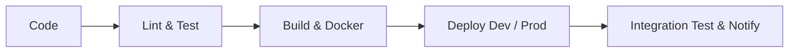
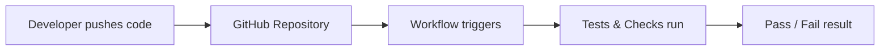
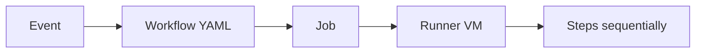
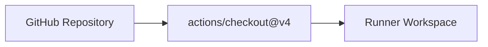
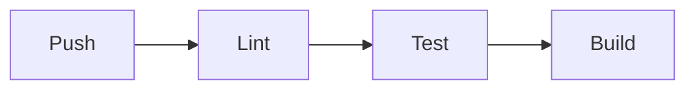
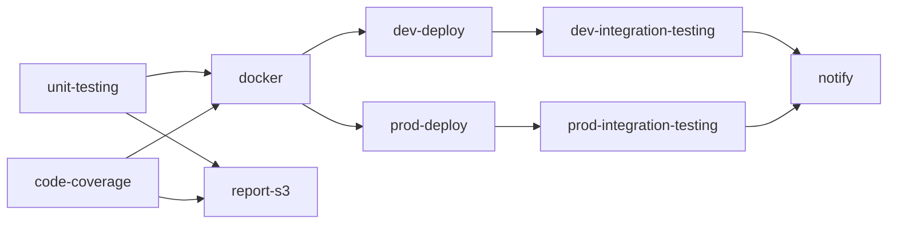
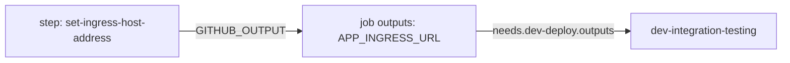
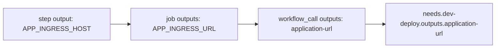

# GitHub Actions — المرجع الشامل

مرجع عملي يبدأ من أساسيات التكامل المستمر (CI) بمشروع Python بسيط، وينتقل إلى التحكم المتقدم في الـ Pipelines، ثم يبني خط إنتاج كامل لمشروع Solar System (Node.js، MongoDB، Docker، Kubernetes، AWS S3، وSelf-Hosted Runners). كل مثال Workflow كامل محفوظ كما هو داخل قائمة مطوية لتسهيل المراجعة.



## الفهرس

### القسم الأول: الأساسيات وأول Pipeline (مشروع Python)
- [[#1. ما هو GitHub Actions والتكامل المستمر (CI)؟]]
- [[#2. كيف يعمل الـ Pipeline ومكوناته الأساسية]]
- [[#3. تجهيز أول مشروع CI وهيكل المستودع]]
- [[#4. كتابة أول ملف Workflow بصيغة YAML]]
- [[#5. الـ GitHub-Hosted Runners والبيئة المؤقتة]]
- [[#6. سحب كود المستودع باستخدام actions/checkout]]
- [[#7. إعداد Python وتثبيت الاعتماديات]]
- [[#8. تشغيل الاختبارات الآلية بـ pytest ورموز الخروج]]
- [[#9. كسر الـ Pipeline وتحليل الفشل]]
- [[#10. فحص جودة الكود قبل الاختبار باستخدام Ruff]]

### القسم الثاني: التحكم المتقدم (مفاهيم موحّدة)
- [[#11. تشغيل عدة Jobs بالتوازي والتسلسل (needs)]]
- [[#12. الـ Artifacts ومشاركة الملفات بين الـ Jobs]]
- [[#13. المتغيرات والأسرار والصلاحيات (Variables, Secrets & Permissions)]]
- [[#14. المشغّلات والفلاتر وتخطي التشغيل (Triggers, Filters & Skip CI)]]
- [[#15. منع التعارض والحد الزمني (Concurrency & Timeout)]]
- [[#16. الاختبار على بيئات متعددة (Matrix Strategy)]]
- [[#17. السياقات والتنفيذ الشرطي للـ Jobs (Contexts & if)]]

### القسم الثالث: مشروع Solar System المتكامل والـ Self-Hosted Runners
- [[#18. أساسيات CI لمشروع Node.js]]
- [[#19. تجاهل فشل خطوة (continue-on-error)]]
- [[#20. الشروط مع نتيجة الخطوات (Step Contexts)]]
- [[#21. تسريع الـ Pipeline بالتخزين المؤقت (Caching: pip & npm)]]
- [[#22. بناء ورفع صور Docker إلى DockerHub و GHCR]]
- [[#23. اختبارات الوحدة مع Service Container]]
- [[#24. تشغيل الـ Job داخل حاوية (Container Jobs)]]
- [[#25. حقن القيم في ملفات Kubernetes (Replace Tokens & GITHUB_ENV)]]
- [[#26. تمرير المخرجات بين الـ Jobs واختبار التكامل (Job Outputs)]]
- [[#27. إعادة استخدام الـ Workflows (Reusable Workflows)]]
- [[#28. أرشفة التقارير على AWS S3]]
- [[#29. الإشعارات عبر Slack و Telegram و Discord]]
- [[#30. الـ Self-Hosted Runners]]
- [[#المراجع]]

---

## القسم الأول: الأساسيات وأول Pipeline (مشروع Python)

### 1. ما هو GitHub Actions والتكامل المستمر (CI)؟

GitHub Actions خدمة أتمتة مدمجة داخل GitHub تتيح تشغيل Workflows مباشرة في المستودع لفحص الكود، تشغيل الاختبارات، بناء التطبيقات، والنشر على السيرفرات تلقائيًا.

**التكامل المستمر (Continuous Integration)** يعني فحص الكود آليًا مع كل تغيير يُرفع للمستودع لاكتشاف الأخطاء مبكرًا قبل دمجها في الفرع الرئيسي (`main`)، بحيث يبقى الكود في حالة قابلة للعمل دائمًا.

| الفحص اليدوي (بدون GitHub Actions) | الفحص الآلي (مع GitHub Actions) |
| --- | --- |
| تشغّل الاختبارات بنفسك على جهازك | يعمل تلقائيًا عند كل Push أو Pull Request |
| بطيء وسهل نسيانه | ينفّذ نفس الخطوات في بيئة ثابتة كل مرة |
| قد يختلف التنفيذ من مطوّر لآخر | يكشف الأخطاء مبكرًا ويظهر نتيجتها في المستودع |
| قد يُدمج كود معطوب في `main` | يحمي الفرع الرئيسي ويثبّت جودة الإصدارات |



---

### 2. كيف يعمل الـ Pipeline ومكوناته الأساسية

| المكون | الوظيفة |
| --- | --- |
| Event | الحدث الذي يشغّل الـ Workflow، مثل `push` أو `pull_request` أو `workflow_dispatch`. |
| Workflow | ملف YAML يصف خط العمل الكامل ويضم Job واحدة أو أكثر. |
| Job | مجموعة خطوات تعمل على نفس الـ Runner. تعمل الـ Jobs بالتوازي افتراضيًا أو بالتسلسل عند ربطها بـ `needs`. |
| Runner | جهاز افتراضي مؤقت يوفره GitHub (`ubuntu-latest`, `windows-latest`, `macos-latest`) لتنفيذ الـ Job. |
| Step | مهمة فردية داخل الـ Job (أمر Shell أو Action)، وتعمل الخطوات بالتسلسل واحدة تلو الأخرى. |
| Action | كود جاهز وقابل لإعادة الاستخدام ينفذ مهمة محددة مثل `actions/checkout` أو `actions/setup-python`. |



> [!warning] أخطاء شائعة في البداية
> - الخلط بين الـ Jobs والـ Steps، فالخطوات تعمل بالتسلسل داخل Job واحدة بينما تعمل الـ Jobs بالتوازي على Runners منفصلة.
> - كتابة اسم فرع خاطئ مثل `master` بدلًا من `main`.
> - نسيان تثبيت الاعتماديات أو رفع مخرجات البناء (Artifacts).

---

### 3. تجهيز أول مشروع CI وهيكل المستودع

توضع جميع ملفات الـ Workflows داخل المسار ==`.github/workflows/`== في جذر المستودع بامتداد `.yml` أو `.yaml`، ويمكن إضافة أكثر من ملف في نفس المجلد.

```text
python-ci-app/
├── .github/
│   └── workflows/
│       └── ci.yml          # ملف الـ Workflow
├── app.py                  # كود تطبيق Python
├── test_app.py             # الاختبارات الآلية (pytest)
├── requirements.txt        # حزم Python المطلوبة
└── README.md               # وصف المشروع
```

إنشاء المشروع ورفعه لأول مرة:

```bash
mkdir python-ci-app
cd python-ci-app
git init
git remote add origin [https://github.com/](https://github.com/)<username>/python-ci-app.git
git add .
git commit -m "Initial commit: Add project files"
git push -u origin main
```

---

### 4. كتابة أول ملف Workflow بصيغة YAML

تعتمد صيغة YAML على المسافات البادئة (Indentation) لتحديد البنية، لذا أي خطأ في المسافات يوقف تشغيل الملف.

| المفتاح | المعنى |
| --- | --- |
| `name` | اسم الـ Workflow كما يظهر في تبويب Actions. |
| `on` | الحدث الذي يشغّل الـ Workflow. |
| `jobs` | تعريف المهام التي ستعمل داخل الـ Workflow. |
| `runs-on` | نوع الـ Runner الذي ستعمل عليه الـ Job. |
| `steps` | قائمة الخطوات المتسلسلة داخل الـ Job. |
| `run` | تنفيذ أمر Shell مباشرة على الـ Runner. |

> [!example]- Workflow كامل: أول ملف ci.yml
> ```yaml
> name: My First Workflow
>
> on:
>   push:
>     branches: [ main ]
>
> jobs:
>   build:
>     runs-on: ubuntu-latest
>     steps:
>       - name: Print a message
>         run: echo "Hello from GitHub Actions!"
> ```

بعد رفع الملف إلى فرع `main`، افتح تبويب **Actions** لمشاهدة السجل والتأكد من طباعة `Hello from GitHub Actions!`.

---

### 5. الـ GitHub-Hosted Runners والبيئة المؤقتة

الـ Runner جهاز افتراضي نظيف ينشئه GitHub عند بدء الـ Job ويدمّره فور انتهائها. لا يُحفظ أي شيء تثبته عليه للتشغيل التالي، وهذا يمنع مشكلة "يعمل على جهازي فقط" ويجعل كل بناء قابلًا للتكرار.

صورة `ubuntu-latest` تأتي بأدوات شائعة مثبتة مسبقًا مثل Git و Python و Node.js و Docker و Java، لكن أي حزم خاصة بمشروعك يجب تثبيتها داخل الـ Workflow في كل تشغيل.

> [!example]- Workflow كامل: فحص بيئة الـ Runner
> ```yaml
> name: Check Runner
> runs-on: ubuntu-latest
> steps:
>   - name: Show runner OS
>     run: uname -a
>   - name: Check Python version
>     run: python --version
>   - name: Check Node.js version
>     run: node --version
> ```

مثال لمخرجات السجل:

```console
$ uname -a
Linux runner-xyz 6.5.0-1021-azure x86_64

$ python --version
Python 3.11.6

$ node --version
v20.11.1
```

---

### 6. سحب كود المستودع باستخدام actions/checkout

لأن الـ Runner يبدأ كجهاز فارغ، لا تكون ملفات مستودعك موجودة عليه تلقائيًا. خطوة `actions/checkout@v4` تنسخ ملفات المستودع إلى مجلد العمل (Workspace) حتى تتمكن الخطوات اللاحقة من قراءتها أو اختبارها.



بدون هذه الخطوة ستفشل محاولة تشغيل أي ملف برسالة `No such file or directory`. الترتيب الصحيح دائمًا: سحب الكود ← إعداد البيئة وتثبيت الحزم ← تشغيل الاختبارات أو البناء.

> [!example]- Workflow كامل: سحب الكود وعرض ملفات مجلد العمل
> ```yaml
> name: Checkout Example
> on:
>   push:
>     branches: [ main ]
> jobs:
>   build:
>     runs-on: ubuntu-latest
>     steps:
>       - name: Checkout repository code
>         uses: actions/checkout@v4
>       - name: Show files in workspace
>         run: |
>           pwd
>           ls -la
> ```

---

### 7. إعداد Python وتثبيت الاعتماديات

أكشن `actions/setup-python@v5` يثبّت إصدار Python المحدد الذي يعتمد عليه مشروعك بدل الاعتماد على الإصدار الافتراضي للـ Runner الذي قد يتغير مع الوقت.

فرق مهم: **أدوات الـ Runner** (مثل Git و Docker و curl) موجودة مسبقًا، أما **اعتماديات التطبيق** (مثل `pytest` و `requests` في `requirements.txt`) فتُثبّت داخل الـ Workflow عبر `pip install -r requirements.txt`.

> [!example]- Workflow كامل: إعداد Python وتثبيت الحزم
> ```yaml
> name: Python CI
> on: [push]
> jobs:
>   build:
>     runs-on: ubuntu-latest
>     steps:
>       - name: Check out code
>         uses: actions/checkout@v4
>       - name: Set up Python
>         uses: actions/setup-python@v5
>         with:
>           python-version: '3.11'
>       - name: Install dependencies
>         run: pip install -r requirements.txt
> ```

للتحقق من الإصدار والحزم المثبتة داخل السجل يمكن إضافة هاتين الخطوتين:

```yaml
- name: Verify Python version
  run: |
    python --version
    pip --version
- name: List installed packages
  run: |
    pip list
```

---

### 8. تشغيل الاختبارات الآلية بـ pytest ورموز الخروج

ملف التطبيق `app.py`:

```python
def add(a, b):
    return a + b
```

ملف الاختبار `test_app.py`:

```python
import pytest

def test_add():
    assert add(2, 3) == 5
    assert add(0, 0) == 0
```

أمر `pytest -v` يشغّل الاختبارات ويعرض تفاصيل كل اختبار. يعتمد GitHub Actions على **رمز الخروج (Exit Code)** لتحديد النتيجة:
- **0 (نجاح):** كل الاختبارات نجحت وتكمل الخطوات التالية.
- **قيمة غير الصفر (فشل):** فشل اختبار واحد على الأقل، فيتوقف الـ Job ويُعلَّم كـ Failed.

> [!example]- Workflow كامل: تشغيل اختبارات pytest
> ```yaml
> name: Python CI
> on: [push]
> jobs:
>   test:
>     runs-on: ubuntu-latest
>     steps:
>       - name: Check out code
>         uses: actions/checkout@v4
>       - name: Set up Python
>         uses: actions/setup-python@v5
>         with:
>           python-version: '3.11'
>       - name: Install dependencies
>         run: pip install -r requirements.txt
>       - name: Run tests with pytest
>         run: pytest -v
> ```

---

### 9. كسر الـ Pipeline وتحليل الفشل

عند حدوث فشل في تبويب Actions، افتح الـ Job ثم الخطوة الحمراء لتحديد نوع المشكلة:

| نوع الفشل | السبب | أين يكون الإصلاح؟ |
| --- | --- | --- |
| فشل اختبار (Test Failure) | الكود يعمل لكن نتيجته تخالف ما يتوقعه الاختبار (مثل كتابة `a - b` بدل `a + b`). | تعديل منطق الكود في التطبيق (`app.py`) ثم إعادة الرفع. |
| خطأ إعداد (Configuration Error) | خطأ في صيغة YAML أو اسم Action أو إصدار Python أو فشل تثبيت حزمة. | تعديل ملف الـ Workflow (`ci.yml`) نفسه. |

مثال لمخرجات فشل الاختبار عند تغيير `add` إلى طرح:

```console
$ pytest -v
test_app.py::test_add FAILED                     [100%]
E   assert add(2, 3) == 5
E    +  where -1 = add(2, 3)
1 failed in 0.04s
```

بعد إعادة الدالة إلى `return a + b` ورفع التعديل (`git commit -m "Fix add function" && git push`)، يعمل الـ Workflow تلقائيًا وتتحول النتيجة إلى نجاح.

---

### 10. فحص جودة الكود قبل الاختبار باستخدام Ruff

**Ruff** أداة سريعة لفحص وتنسيق كود Python (بديل أسرع لـ flake8 و pylint). وضع فحص الجودة قبل تشغيل الاختبارات يكتشف المشاكل الأسلوبية والـ Imports غير المستخدمة مبكرًا قبل استهلاك وقت الاختبارات.

- **فشل الـ Linting (Ruff):** الكود قد يعمل فعليًا، لكنه يحتوي مخالفة جودة مثل `import os` غير مستخدم (`F401`).
- **فشل الاختبار (pytest):** مشكلة وظيفية في منطق البرنامج نفسه.

> [!example]- Workflow كامل: فحص الجودة بـ Ruff قبل الاختبارات
> ```yaml
> name: Python CI
> on: [push]
> jobs:
>   test:
>     runs-on: ubuntu-latest
>     steps:
>       - name: Check out code
>         uses: actions/checkout@v4
>       - name: Set up Python
>         uses: actions/setup-python@v5
>         with:
>           python-version: '3.11'
>       - name: Install dependencies
>         run: pip install -r requirements.txt
>       - name: Install Ruff
>         run: pip install ruff
>       - name: Run Ruff checks
>         run: ruff check .
>       - name: Run tests
>         run: pytest -q
> ```

---

## القسم الثاني: التحكم المتقدم (مفاهيم موحّدة)

### 11. تشغيل عدة Jobs بالتوازي والتسلسل (needs)

تقسيم الـ Pipeline إلى Jobs منفصلة (مثل فحص الجودة، ثم الاختبار، ثم البناء أو النشر) يعزل كل مهمة ويجعل تتبع الأخطاء أوضح.

- **بالتوازي (الوضع الافتراضي):** أي Jobs بدون `needs` تبدأ في نفس اللحظة على Runners منفصلة، وهذا يقلل زمن التنفيذ عندما لا تعتمد المهام على بعضها.
- **بالتسلسل (عبر `needs`):** الـ Job التي تحدد `needs` لا تبدأ إلا بعد نجاح الـ Job المطلوبة. إذا فشلت الـ Job الأولى، يتم تخطي (Skip) التابع لها تلقائيًا.



> [!warning] الـ Jobs لا تتشارك الملفات تلقائيًا
> كل Job تعمل على جهاز افتراضي جديد ونظيف، لذا الملفات التي تنشئها في job البناء (مثل `dragon.txt`) تختفي بانتهائها ولن تراها job الاختبار. لنقل الملفات بين الـ Jobs تحتاج إلى [[#12. الـ Artifacts ومشاركة الملفات بين الـ Jobs|Artifacts]].

**الكود الأساسي:**

```yaml
test_job_2:
  needs: build_job_1          # ينتظر نجاح job واحدة
  runs-on: ubuntu-latest

deploy_job_3:
  needs: [test_job_2, build_job_1]   # ينتظر نجاح الاثنين معًا
  runs-on: ubuntu-latest
```

> [!example]- Workflow كامل: تشغيل Jobs بالتسلسل لمشروع Python (Lint → Test → Build)
> ```yaml
> name: Python CI
> on: [push]
> jobs:
>   lint:
>     runs-on: ubuntu-latest
>     steps:
>       - uses: actions/checkout@v4
>       - uses: actions/setup-python@v5
>         with:
>           python-version: '3.11'
>       - run: pip install ruff
>       - run: ruff check .
>   test:
>     needs: lint   # run after lint is successful
>     runs-on: ubuntu-latest
>     steps:
>       - uses: actions/checkout@v4
>       - uses: actions/setup-python@v5
>         with:
>           python-version: '3.11'
>       - run: pip install -r requirements.txt
>       - run: pytest -q
>   build:
>     needs: test   # run after test is successful
>     runs-on: ubuntu-latest
>     steps:
>       - uses: actions/checkout@v4
>       - run: pip install build
>       - run: python -m build   # create package/artifact
> ```

> [!example]- Workflow كامل: تشغيل Jobs بالتوازي (Generate ASCII Artwork)
> ```yaml
> name: Generate ASCII Artwork
> on: push
> jobs:
>   build_job_1:
>     runs-on: ubuntu-latest
>     steps:
>       - name: Install Cowsay Program
>         run: sudo apt-get install cowsay -y
>       - name: Execute Cowsay CMD
>         run: cowsay -f dragon "Run for cover, I'm a DRAGON ... RAWR" >> dragon.txt
>       - name: Sleep for 30 seconds
>         run: sleep 30
>   test_job_2:
>     runs-on: ubuntu-latest
>     steps:
>       - name: Sleep for 10 seconds
>         run: sleep 10
>       - name: Test File Exists
>         run: grep -i "dragon" dragon.txt
>   deploy_job_3:
>     runs-on: ubuntu-latest
>     steps:
>       - name: Read File
>         run: cat dragon.txt
>       - name: Deploy
>         run: echo Deploying .... .. .
> ```

> [!example]- Workflow كامل: تشغيل Jobs بالتسلسل عبر needs (Generate ASCII Artwork)
> ```yaml
> name: Generate ASCII Artwork
> on: push
> jobs:
>   build_job_1:
>     runs-on: ubuntu-latest
>     steps:
>       - name: Install Cowsay Program
>         run: sudo apt-get install cowsay -y
>       - name: Execute Cowsay CMD
>         run: cowsay -f dragon "Run for cover, I'm a DRAGON ... RAWR" >> dragon.txt
>       - name: Sleep for 30 seconds
>         run: sleep 30
>   test_job_2:
>     needs: build_job_1
>     runs-on: ubuntu-latest
>     steps:
>       - name: Sleep for 10 seconds
>         run: sleep 10
>       - name: Test File Exists
>         run: grep -i "dragon" dragon.txt
>   deploy_job_3:
>     needs: [test_job_2, build_job_1]
>     runs-on: ubuntu-latest
>     steps:
>       - name: Read File
>         run: cat dragon.txt
>       - name: Deploy
>         run: echo Deploying .... .. .
> ```

---

### 12. الـ Artifacts ومشاركة الملفات بين الـ Jobs

الـ **Artifact** هو ملف أو مجلد ينتج عن عملية البناء أو الاختبار (مثل حزمة Python بصيغة `.whl` أو تقارير الاختبارات) وتريد حفظه لتنزيله لاحقًا من تبويب Actions أو تمريره إلى Job أخرى.

1. `actions/upload-artifact@v4`: يرفع الملف أو المجلد باسم محدد (`name`) ومسار (`path`).
2. `actions/download-artifact@v4`: ينزّل الملف بنفس الاسم داخل مجلد العمل في الـ Job اللاحقة.
3. مدة الاحتفاظ الافتراضية **90 يومًا**، ويمكن تقليصها عبر `retention-days` داخل خطوة الرفع أو من إعدادات المستودع (`Settings → Actions → General → Artifact retention`).

| المقارنة | Build Artifact | Dependency Cache |
| --- | --- | --- |
| ماذا يخزّن؟ | مخرجات البناء أو التقارير (`.whl`, `.zip`, تقارير XML) | الحزم والمكتبات المحمّلة (`pip`, `npm`) |
| الغرض | التوزيع أو النشر أو النقل بين الـ Jobs | تسريع التشغيلات المستقبلية فقط |
| التنزيل اليدوي | متاح من صفحة الـ Run في Actions | داخلي للـ Runner فقط ولا يُنزّل يدويًا |
| الإدارة | ترفعه صراحةً وتحدد مدة بقائه (`retention-days`) | يُدار تلقائيًا عبر مفاتيح الكاش |

**الكود الأساسي:**

```yaml
# رفع ملف أو مجلد
- uses: actions/upload-artifact@v4
  with:
    name: dragon-text-file
    path: dragon.txt
    retention-days: 7

# تنزيله في Job أخرى
- uses: actions/download-artifact@v4
  with:
    name: dragon-text-file
```

لإنشاء حزمة Python واختبارها بعد تنزيل الـ Artifact محليًا:

```bash
# بناء الحزمة داخل مجلد dist/
python -m build --wheel

# بعد تنزيل الـ Artifact وفك ضغطه
pip install dist/*.whl
python -c "import myapp; print('Package works!')"
```

> [!example]- Workflow كامل: بناء حزمة Python ورفعها كـ Artifact
> ```yaml
> name: Build and Upload Artifact
> on: [push]
> jobs:
>   build:
>     runs-on: ubuntu-latest
>     steps:
>       - name: Checkout code
>         uses: actions/checkout@v4
>       - name: Set up Python
>         uses: actions/setup-python@v5
>         with:
>           python-version: '3.11'
>       - name: Install build tool
>         run: pip install build
>       - name: Build package
>         run: python -m build --wheel
>       - name: Upload build artifact
>         uses: actions/upload-artifact@v4
>         with:
>           name: python-package
>           path: dist/
> ```

> [!example]- Workflow كامل: نقل الملفات بين الـ Jobs عبر Upload و Download (Generate ASCII Artwork)
> ```yaml
> name: Generate ASCII Artwork
> on: push
> jobs:
>   build_job_1:
>     runs-on: ubuntu-latest
>     steps:
>       - name: Install Cowsay Program
>         run: sudo apt-get install cowsay -y
>       - name: Execute Cowsay CMD
>         run: cowsay -f dragon "Run for cover, I'm a DRAGON ... RAWR" >> dragon.txt
>       - uses: actions/upload-artifact@v4
>         with:
>           name: dragon-text-file
>           path: dragon.txt
>   test_job_2:
>     needs: build_job_1
>     runs-on: ubuntu-latest
>     steps:
>       - uses: actions/download-artifact@v4
>         with:
>           name: dragon-text-file
>       - name: Test File Exists
>         run: grep -i "dragon" dragon.txt
>   deploy_job_3:
>     needs: test_job_2
>     runs-on: ubuntu-latest
>     steps:
>       - uses: actions/download-artifact@v4
>         with:
>           name: dragon-text-file
>       - name: Read File
>         run: cat dragon.txt
>       - name: Deploy
>         run: echo Deploying .... .. .
> ```

---

### 13. المتغيرات والأسرار والصلاحيات (Variables, Secrets & Permissions)

بدل تكرار القيم الثابتة أو كتابة كلمات المرور داخل الكود، يوفّر GitHub Actions ثلاث آليات لتمرير القيم:

| النوع | مكان التعريف | مكشوف في Logs؟ | الاستخدام |
| --- | --- | --- | --- |
| `env` | داخل ملف الـ YAML | نعم | قيم غير حساسة على مستوى Workflow أو Job أو Step |
| `vars` | Settings → Variables | نعم | قيم غير حساسة تتغير بين البيئات (`${{ vars.NAME }}`) |
| `secrets` | Settings → Secrets | ==لا (masked)== | كلمات مرور، مفاتيح API، وتوكنات (`${{ secrets.NAME }}`) |

**قاعدة أولوية `env`:** عند تعريف نفس المتغير في أكثر من مستوى، **الأقرب يفوز** (`Step > Job > Workflow`). وداخل أوامر Shell يمكن قراءته مباشرة عبر `$NAME`.

**توكن `GITHUB_TOKEN` ومبدأ أقل صلاحية (Least Privilege):**
- `GITHUB_TOKEN` توكن مدمج يولّده GitHub تلقائيًا لكل تشغيل وتنتهي صلاحيته بنهايته؛ يُستخدم للتفاعل مع المستودع (قراءة الكود، رفع Packages، إنشاء PRs).
- استخدم مفتاح `permissions` لتحديد أقل صلاحية يحتاجها الـ Workflow فقط (مثل `contents: read` لاختبارات الـ CI، أو `packages: write` عند الرفع على GHCR).

> [!warning] قواعد أمان أساسية
> - لا تطبع قيمة أي Secret في السجلات (مثل `echo $API_KEY`) ولا تكتبها داخل الكود.
> - تعامل بحذر مع الـ Pull Requests القادمة من مساهمين خارجيين غير موثوقين؛ امنح workflows الخاصة بـ `pull_request` صلاحيات قراءة فقط (`contents: read`) حتى لا تُسرق الأسرار أو يُعدَّل المستودع.

**مثال: استدعاء API خارجي باستخدام Secret:**

```yaml
- name: Call an external API
  env:
    API_KEY: ${{ secrets.MY_API_KEY }}
  run: |
    curl -H "Authorization: Bearer $API_KEY" \
      [https://api.example.com/data](https://api.example.com/data)
```

> [!example]- Workflow كامل: صلاحيات القراءة فقط للـ CI (Python CI)
> ```yaml
> name: Python CI
> on: [push, pull_request]
> permissions:
>   contents: read  # read-only access
> jobs:
>   test:
>     runs-on: ubuntu-latest
>     steps:
>       - uses: actions/checkout@v4
>       - name: Run tests
>         run: python -m pytest -q
> ```

> [!example]- Workflow كامل: المستويات الثلاثة للمتغيرات مع vars و secrets
> ```yaml
> name: Variables and Secrets
> on: workflow_dispatch
> env:
>   CONTAINER_REGISTRY: docker.io
>   IMAGE_NAME: github-actions-nginx
> jobs:
>   docker:
>     runs-on: ubuntu-latest
>     env:
>       IMAGE_TAG: latest
>     steps:
>       - name: Docker Build
>         env:
>           BUILD_LABEL: build-step
>         run: |
>           echo "$BUILD_LABEL"
>           echo docker build -t ${{ env.CONTAINER_REGISTRY }}/${{ vars.DOCKER_USERNAME }}/${{ env.IMAGE_NAME }}:${{ env.IMAGE_TAG }}
>       - name: Docker Login
>         run: echo docker login --username=${{ vars.DOCKER_USERNAME }} --password=${{ secrets.DOCKER_PASSWORD }}
>       - name: Docker Publish
>         run: echo docker push ${{ env.CONTAINER_REGISTRY }}/${{ vars.DOCKER_USERNAME }}/${{ env.IMAGE_NAME }}:${{ env.IMAGE_TAG }}
> ```

---

### 14. المشغّلات والفلاتر وتخطي التشغيل (Triggers, Filters & Skip CI)

المشغّل (`on:`) يحدد متى يبدأ الـ Workflow، ويمكن الجمع بين أكثر من مشغّل في ملف واحد:

| الحدث | متى يعمل؟ | الاستخدام الشائع |
| --- | --- | --- |
| `push` | عند رفع Commit إلى فرع محدد | تشغيل اختبارات الـ CI تلقائيًا |
| `pull_request` | عند فتح أو تحديث أو إعادة فتح PR | فحص التعديلات قبل الدمج في `main` |
| `workflow_dispatch` | تشغيل يدوي عبر زر **Run workflow** في تبويب Actions | التجربة أو النشر عند الطلب |
| `schedule` | بجدول زمني عبر تعبير `cron` (**بتوقيت UTC دائمًا**) | نسخ احتياطي ليلي أو فحص دوري (أقل فاصل 5 دقائق) |

**قراءة تعبير `cron` (مثال `"15 4,5 * * *"`):**

| الدقيقة (0–59) | الساعة (0–23) | يوم الشهر (1–31) | الشهر (1–12) | يوم الأسبوع (0–6) |
| --- | --- | --- | --- | --- |
| `15` | `4,5` | `*` | `*` | `*` |

النتيجة: يعمل يوميًا الساعة ==4:15 و 5:15 صباحًا بتوقيت UTC== (يمكن توليد التعبيرات عبر [crontab.guru](https://crontab.guru/)).

**فلاتر الأحداث (Event Filters):**
- `branches` أو `branches-ignore`: لتحديد الفروع (لا يمكن الجمع بينهما في نفس الحدث؛ وضع `branches: [main]` يستبعد تلقائيًا كل الفروع الأخرى).
- `paths` أو `paths-ignore`: لتجاهل ملفات لا تستحق تشغيل الـ CI مثل `README.md` و `docs/**`.
- `types`: لتحديد نوع النشاط تحت `pull_request` مثل `opened` و `closed`.

**تخطي التشغيل من رسالة الـ Commit (Skip CI):**
أضف إحدى الكلمات التالية إلى رسالة الـ Commit لمنع تشغيل أحداث `push` و `pull_request` (لا تؤثر على `workflow_dispatch` أو `schedule`):
`[skip ci]` — `[ci skip]` — `[no ci]` — `[skip actions]` — `[actions skip]`

```bash
git commit -m "docs: fix typo in README [skip ci]"
git push
```

> [!example]- Workflow كامل: الجمع بين push و pull_request و workflow_dispatch
> ```yaml
> name: My First Pipeline
> on:
>   push:
>     branches: [ main ]
>   pull_request:
>     branches: [ main ]
>   workflow_dispatch:
> jobs:
>   build:
>     runs-on: ubuntu-latest
>     steps:
>       - name: Print a message
>         run: echo "Hello from GitHub Actions!"
> ```

> [!example]- Workflow كامل: التشغيل المجدول (schedule / cron)
> ```yaml
> name: Generate ASCII Artwork
> on:
>   schedule:
>     - cron: "15 4,5 * * *"
> jobs:
>   build_job_1:
>     runs-on: ubuntu-latest
>     steps:
>       - name: Install Cowsay Program
>         run: sudo apt-get install cowsay -y
>       - name: Execute Cowsay CMD
>         run: cowsay -f dragon "Run for cover, I'm a DRAGON ... RAWR" >> dragon.txt
>       - uses: actions/upload-artifact@v4
>         with:
>           name: dragon-text-file
>           path: dragon.txt
>   test_job_2:
>     needs: build_job_1
>     runs-on: ubuntu-latest
>     steps:
>       - uses: actions/download-artifact@v4
>         with:
>           name: dragon-text-file
>       - name: Test File Exists
>         run: grep -i "dragon" dragon.txt
>   deploy_job_3:
>     needs: test_job_2
>     runs-on: ubuntu-latest
>     steps:
>       - uses: actions/download-artifact@v4
>         with:
>           name: dragon-text-file
>       - name: Read File
>         run: cat dragon.txt
>       - name: Deploy
>         run: echo Deploying .... .. .
> ```

> [!example]- Workflow كامل: التشغيل اليدوي فقط (workflow_dispatch)
> ```yaml
> name: Generate ASCII Artwork
> on: workflow_dispatch
> jobs:
>   build_job_1:
>     runs-on: ubuntu-latest
>     steps:
>       - name: Install Cowsay Program
>         run: sudo apt-get install cowsay -y
>       - name: Execute Cowsay CMD
>         run: cowsay -f dragon "Run for cover, I'm a DRAGON ... RAWR" >> dragon.txt
>       - uses: actions/upload-artifact@v4
>         with:
>           name: dragon-text-file
>           path: dragon.txt
>   test_job_2:
>     needs: build_job_1
>     runs-on: ubuntu-latest
>     steps:
>       - uses: actions/download-artifact@v4
>         with:
>           name: dragon-text-file
>       - name: Test File Exists
>         run: grep -i "dragon" dragon.txt
>   deploy_job_3:
>     needs: test_job_2
>     runs-on: ubuntu-latest
>     steps:
>       - uses: actions/download-artifact@v4
>         with:
>           name: dragon-text-file
>       - name: Read File
>         run: cat dragon.txt
>       - name: Deploy
>         run: echo Deploying .... .. .
> ```

> [!example]- Workflow كامل: فلاتر الفروع والمسارات ونوع النشاط (Event Filters)
> ```yaml
> name: Workflow Filters and Activities
> on:
>   # تشغيل يدوي من تبويب Actions
>   workflow_dispatch:
>   push:
>     # branches-ignore:
>     #   - feature/*      # feature/add-music , feature/updateImage
>     #   - test/**        # test/ui/index , test/checkout/payment
>     # ملاحظة: لم نستخدم branches-ignore لأننا نستخدم نمطًا موجبًا واحدًا (main)،
>     #         وهو يستبعد تلقائيًا كل الفروع الأخرى بما فيها feature/* و test/**.
>     #         كما أننا لا نستطيع الجمع بين branches و branches-ignore في نفس الحدث.
>     branches:
>       - main
>     paths-ignore:
>       - 'README.md'
>       - 'docs/**'            # كل مجلد التوثيق
>       - '**.md'              # أي ملف markdown في أي مكان
>       - '.github/CODEOWNERS'
>   pull_request:
>     types:
>       - opened
>       - closed
>     branches:
>       - main                 # PRs التي تستهدف main فقط
>     paths-ignore:
>       - 'README.md'          # يعمل فقط إذا كان الـ PR يعدّل ملفات غير README.md
> jobs:
>   hello:
>     runs-on: ubuntu-latest
>     steps:
>       - name: Print event type
>         run: echo "This step is executed for event type ${{ github.event_name }}"
> ```

---

### 15. منع التعارض والحد الزمني (Concurrency & Timeout)

**1) منع التزامن المتعارض (Concurrency):**
إذا رفع الفريق تعديلين متتاليين، قد تعمل نسختان من النشر في نفس اللحظة وتتسببان في تعارض. خاصية `concurrency` تجمع التشغيلات المتنافسة تحت اسم مجموعة واحد (`group`) وتُطبق على مستوى الـ Job أو الـ Workflow كله:
- `cancel-in-progress: true`: يلغي التشغيل الجاري فورًا ويبدأ الجديد.
- `cancel-in-progress: false`: يضع التشغيل الجديد في طابور انتظار حتى ينتهي الجاري.

**2) الحد الزمني (Timeout):**
الحد الافتراضي لأي Job في GitHub Actions هو **6 ساعات (360 دقيقة)**؛ أي أمر معلّق قد يستهلك رصيد الدقائق بلا فائدة. ضع `timeout-minutes` على مستوى الـ Job أو على مستوى خطوة معينة، وعند تجاوز المدة يُلغى التنفيذ ويُحتسب فشلًا.

> [!example]- Workflow كامل: تطبيق Concurrency على جوب النشر
> ```yaml
> name: Variables and Secrets
> on: workflow_dispatch
> env:
>   CONTAINER_REGISTRY: docker.io
>   IMAGE_NAME: github-actions-nginx
> jobs:
>   docker:
>     runs-on: ubuntu-latest
>     steps:
>       - name: Docker Build
>         run: echo docker build -t ${{ env.CONTAINER_REGISTRY }}/${{ vars.DOCKER_USERNAME }}/${{ env.IMAGE_NAME }}:latest
>       - name: Docker Login
>         run: echo docker login --username=${{ vars.DOCKER_USERNAME }} --password=${{ secrets.DOCKER_PASSWORD }}
>       - name: Docker Publish
>         run: echo docker push ${{ env.CONTAINER_REGISTRY }}/${{ vars.DOCKER_USERNAME }}/${{ env.IMAGE_NAME }}:latest
>   deploy:
>     needs: docker
>     concurrency:
>       group: production-deployment
>       cancel-in-progress: true
>     runs-on: ubuntu-latest
>     steps:
>       - name: Docker Run
>         run: |
>           echo docker run -d -p 8080:80 ${{ env.CONTAINER_REGISTRY }}/${{ vars.DOCKER_USERNAME }}/${{ env.IMAGE_NAME }}:latest
>           sleep 600s
> ```

> [!example]- Workflow كامل: تطبيق Timeout على الخطوة والـ Job
> ```yaml
> name: Variables and Secrets
> on: workflow_dispatch
> env:
>   CONTAINER_REGISTRY: docker.io
>   IMAGE_NAME: github-actions-nginx
> jobs:
>   docker:
>     runs-on: ubuntu-latest
>     steps:
>       - name: Docker Build
>         run: echo docker build -t ${{ env.CONTAINER_REGISTRY }}/${{ vars.DOCKER_USERNAME }}/${{ env.IMAGE_NAME }}:latest
>       - name: Docker Login
>         run: echo docker login --username=${{ vars.DOCKER_USERNAME }} --password=${{ secrets.DOCKER_PASSWORD }}
>       - name: Docker Publish
>         run: echo docker push ${{ env.CONTAINER_REGISTRY }}/${{ vars.DOCKER_USERNAME }}/${{ env.IMAGE_NAME }}:latest
>   deploy:
>     # timeout-minutes: 1    # بديل: حد زمني للـ Job كاملة
>     needs: docker
>     concurrency:
>       group: production-deployment
>       cancel-in-progress: true
>     runs-on: ubuntu-latest
>     steps:
>       - name: Docker Run
>         timeout-minutes: 1
>         run: |
>           echo docker run -d -p 8080:80 ${{ env.CONTAINER_REGISTRY }}/${{ vars.DOCKER_USERNAME }}/${{ env.IMAGE_NAME }}:latest
>           sleep 600s
> ```

---

### 16. الاختبار على بيئات متعددة (Matrix Strategy)

تولّد `strategy.matrix` نسخة متوازية من الـ Job لكل تركيبة من المتغيرات المعرّفة (مثل 3 أنظمة تشغيل × صورتين = 6 Jobs متوازية)، وتقرأ قيم التركيبة الحالية عبر `${{ matrix.<key> }}`.

| الخيار | الوظيفة |
| --- | --- |
| `exclude` | استبعاد تركيبة معينة لا تتوافق مع بعضها (مثل `alpine` على `windows-latest`) |
| `include` | إضافة تركيبة جديدة أو متغيرات إضافية لتركيبة قائمة |
| `fail-fast: false` | منع إلغاء بقية التركيبات عند فشل واحدة منها (الافتراضي `true`) |
| `max-parallel` | تحديد أقصى عدد من الـ Jobs يعمل في نفس اللحظة |

> [!example]- Workflow كامل: Matrix أساسي
> ```yaml
> name: Configuration Matrix
> on:
>   push:
>   workflow_dispatch:
> jobs:
>   deploy:
>     strategy:
>       matrix:
>         os: [ubuntu-latest, ubuntu-22.04, windows-latest]
>         images: [hello-world, alpine]
>     runs-on: ${{ matrix.os }}
>     steps:
>       - name: Echo Docker Details
>         run: docker info
>       - name: Run Image on ${{ matrix.os }}
>         run: docker run ${{ matrix.images }}
> ```

> [!example]- Workflow كامل: Matrix متقدم (exclude / include / fail-fast / max-parallel)
> ```yaml
> name: Configuration Matrix
> on:
>   push:
>   workflow_dispatch:
> jobs:
>   deploy:
>     strategy:
>       fail-fast: false
>       max-parallel: 2
>       matrix:
>         os: [ubuntu-latest, ubuntu-22.04, windows-latest]
>         images: [hello-world, alpine]
>         exclude:
>           - images: alpine
>             os: windows-latest
>         include:
>           - images: amd64/alpine
>             os: windows-latest
>     runs-on: ${{ matrix.os }}
>     steps:
>       - name: Echo Docker Details
>         run: docker info
>       - name: Run Image on ${{ matrix.os }}
>         run: docker run ${{ matrix.images }}
> ```

---

### 17. السياقات والتنفيذ الشرطي للـ Jobs (Contexts & if)

**السياقات (Contexts):** كائنات جاهزة يوفّرها GitHub أثناء التشغيل لقراءة معلومات ديناميكية عبر `${{ }}`، ويمكن طباعة أي سياق كاملًا للتشخيص باستخدام `toJson()`.

| السياق | ما يحتويه |
| --- | --- |
| `github` | بيانات المستودع، الحدث، الفرع (`github.ref`)، ورقم الـ Commit (`github.sha`) |
| `job` | حالة الـ Job الحالية والـ Services المرتبطة بها |
| `steps` | نتائج ومخرجات الخطوات السابقة (تتطلب إعطاء الخطوة `id`) |
| `runner` | نظام التشغيل والمعمارية ومسارات الـ Runner |
| `strategy` و `matrix` | إعدادات الـ Matrix وقيم التركيبة الحالية |
| `secrets` | الأسرار المعرّفة (تظهر مخفية في السجلات) |

**التنفيذ الشرطي على مستوى الـ Job (`if:`):**
تتحكم في تشغيل الـ Job بناءً على تعبير منطقي (لا تحتاج لكتابة `${{ }}` داخل `if`). إذا تحقق الشرط بـ `false`، تظهر الـ Job بحالة **Skipped** وليس Failed.
- للفرع الرئيسي فقط: `if: github.ref == 'refs/heads/main'`
- لفروع الميزات: `if: contains(github.ref, 'feature/')`

> [!example]- Workflow كامل: طباعة السياقات في السجل (Context Testing)
> ```yaml
> name: Context Testing
> on: push
> jobs:
>   dump_contexts_to_log:
>     runs-on: ubuntu-latest
>     steps:
>       - name: Dump GitHub context
>         env:
>           GITHUB_CONTEXT: ${{ toJson(github) }}
>         run: echo "$GITHUB_CONTEXT"
>       - name: Dump job context
>         env:
>           JOB_CONTEXT: ${{ toJson(job) }}
>         run: echo "$JOB_CONTEXT"
>       - name: Dump steps context
>         env:
>           STEPS_CONTEXT: ${{ toJson(steps) }}
>         run: echo "$STEPS_CONTEXT"
>       - name: Dump runner context
>         env:
>           RUNNER_CONTEXT: ${{ toJson(runner) }}
>         run: echo "$RUNNER_CONTEXT"
>       - name: Dump strategy context
>         env:
>           STRATEGY_CONTEXT: ${{ toJson(strategy) }}
>         run: echo "$STRATEGY_CONTEXT"
>       - name: Dump secrets context
>         env:
>           SECRET_CONTEXT: ${{ toJson(secrets) }}
>         run: echo "$SECRET_CONTEXT"
> ```

> [!example]- Workflow كامل: تشغيل جوب النشر على فرع main فقط
> ```yaml
> name: Variables and Secrets
> on: workflow_dispatch
> env:
>   CONTAINER_REGISTRY: docker.io
>   IMAGE_NAME: github-actions-nginx
> jobs:
>   docker:
>     timeout-minutes: 1
>     runs-on: ubuntu-latest
>     steps:
>       - name: Docker Build
>         run: echo docker build -t ${{ env.CONTAINER_REGISTRY }}/${{ vars.DOCKER_USERNAME }}/${{ env.IMAGE_NAME }}:latest
>       - name: Docker Login
>         run: echo docker login --username=${{ vars.DOCKER_USERNAME }} --password=${{ secrets.DOCKER_PASSWORD }}
>       - name: Docker Publish
>         run: echo docker push ${{ env.CONTAINER_REGISTRY }}/${{ vars.DOCKER_USERNAME }}/${{ env.IMAGE_NAME }}:latest
>   deploy:
>     if: github.ref == 'refs/heads/main'
>     needs: docker
>     concurrency:
>       group: production-deployment
>       cancel-in-progress: true
>     runs-on: ubuntu-latest
>     steps:
>       - name: Docker Run
>         timeout-minutes: 1
>         run: |
>           echo docker run -d -p 8080:80 ${{ env.CONTAINER_REGISTRY }}/${{ vars.DOCKER_USERNAME }}/${{ env.IMAGE_NAME }}:latest
>           sleep 600s
> ```


---

## القسم الثالث: مشروع Solar System المتكامل والـ Self-Hosted Runners

الخريطة النهائية لخط الإنتاج الذي يُبنى تدريجيًا في هذا القسم:



---

### 18. أساسيات CI لمشروع Node.js

مشروع **Solar System** مبني بـ Node.js و MongoDB. قبل كتابة الـ Workflow تحتاج لمعرفة الأوامر اليدوية التي سيشغّلها الـ Pipeline:

| الأمر | الوظيفة |
| --- | --- |
| `node -v` / `npm -v` | التحقق من الإصدارات المثبتة |
| `npm install` | تثبيت الحزم داخل `node_modules` حسب `package-lock.json` |
| `npm test` | تشغيل اختبارات Mocha وإخراج ملف `test-results.xml` |
| `npm run coverage` | إنشاء تقرير تغطية الكود في `coverage/cobertura-coverage.xml` |
| `npm start` | تشغيل التطبيق على المنفذ `3000` |

كود المشروع التطبيقي: [devops-directive-github-actions-course](https://github.com/sidpalas/devops-directive-github-actions-course).

---

### 19. تجاهل فشل خطوة (continue-on-error)

انخفاض نسبة تغطية الكود (Code Coverage) معلومة مفيدة للمراجعة، لكنها لا تستدعي إيقاف الـ Pipeline بالكامل.
- إضافة `continue-on-error: true` على **Step** تجعل فشلها يظهر كتحذير وتكمل بقية الخطوات وتنجح الـ Job.
- يمكن وضعها أيضًا على مستوى **Job** كاملة حتى لا يُفشل فشلها الـ Workflow.
- عند استخدام Matrix مع رفع Artifacts، يجب أن يكون اسم كل Artifact فريدًا داخل نفس التشغيل بإضافة متغيرات الـ Matrix إلى الاسم (`Mocha-Test-Result-${{ matrix.nodejs_version }}-${{ matrix.operating_system }}`).

**الكود الأساسي:**

```yaml
- name: Check Code Coverage
  continue-on-error: true   # فشل التغطية لا يوقف الـ Job
  run: npm run coverage
- name: Archive Test Result
  uses: actions/upload-artifact@v4
  with:
    name: Code-Coverage-Result
    path: coverage
    retention-days: 5       # حذف تلقائي بعد 5 أيام
```

> [!example]- Workflow كامل: أول تشغيل لمشروع Solar System مع Matrix و continue-on-error
> ```yaml
> name: Solar System Workflow
> on:
>   workflow_dispatch:
>   push:
>     branches:
>       - main
>       - 'feature/*'
> env:
>   MONGO_URI: 'mongodb://${{ secrets.USERNAME }}:${{ secrets.PASSWORD }}@cluster0.7x6u1mv.mongodb.net/superData'
>   MONGO_USERNAME: ${{ secrets.USERNAME }}
>   MONGO_PASSWORD: ${{ secrets.PASSWORD }}
> jobs:
>   unit-testing:
>     name: Unit Testing
>     strategy:
>       matrix:
>         nodejs_version: [18, 19, 20]
>         operating_system: [ubuntu-latest, macos-latest]
>     runs-on: ${{ matrix.operating_system }}
>     steps:
>       - name: Checkout Repo
>         uses: actions/checkout@v4
>       - name: Setup Node.js Version - ${{ matrix.nodejs_version }}
>         uses: actions/setup-node@v3
>         with:
>           node-version: ${{ matrix.nodejs_version }}
>       - name: Install Dependencies
>         run: npm install
>       - name: Unit Testing
>         run: npm test
>       - name: Archive Test Result
>         uses: actions/upload-artifact@v4
>         with:
>           name: Mocha-Test-Result-${{ matrix.nodejs_version }}-${{ matrix.operating_system }}
>           path: test-results.xml
>   code-coverage:
>     name: Code Coverage
>     runs-on: ubuntu-latest
>     steps:
>       - name: Checkout Repo
>         uses: actions/checkout@v4
>       - name: Setup Node.js Version - 18
>         uses: actions/setup-node@v3
>         with:
>           node-version: 18
>       - name: Install Dependencies
>         run: npm install
>       - name: Check Code Coverage
>         continue-on-error: true
>         run: npm run coverage
>       - name: Archive Test Result
>         uses: actions/upload-artifact@v4
>         with:
>           name: Code-Coverage-Result
>           path: coverage
>           retention-days: 5
> ```

---

### 20. الشروط مع نتيجة الخطوات (Step Contexts)

افتراضيًا، إذا فشلت خطوة الاختبار يتخطى GitHub كل الخطوات التي تليها، بما فيها خطوة رفع تقرير النتائج، رغم أنك تحتاج التقرير عند الفشل تحديدًا لتعرف السبب.

1. أعطِ خطوة الاختبار معرّفًا (`id`) للرجوع إليها لاحقًا.
2. اقرأ نتيجتها الفعلية عبر `steps.<id>.outcome` (`success` / `failure` / `cancelled` / `skipped`).
3. استخدم دوال الحالة: `failure()` عند فشل أي خطوة سابقة، `always()` للتشغيل في كل الحالات، و `success()` كوضع افتراضي.
4. الشرط `failure() && (outcome == 'failure' || outcome == 'success')` يضمن رفع التقرير فقط إذا نُفّذت خطوة الاختبار فعلًا، وليس إذا فشل `npm install` قبلها (حيث لا يوجد ملف تقرير أصلًا).

> [!tip] الفرق بين outcome و conclusion
> `outcome` يعطيك النتيجة الخام للخطوة قبل تطبيق `continue-on-error`، بينما `conclusion` يعطي النتيجة النهائية بعدها.

**الكود الأساسي:**

```yaml
- name: Unit Testing
  id: nodejs-unit-testing-step
  run: npm test
- name: Archive Test Result
  if: failure() && (steps.nodejs-unit-testing-step.outcome == 'failure' || steps.nodejs-unit-testing-step.outcome == 'success')
  uses: actions/upload-artifact@v4
  with:
    name: Mocha-Test-Result-${{ matrix.nodejs_version }}-${{ matrix.operating_system }}
    path: test-results.xml
```

> [!example]- Workflow كامل: رفع تقارير الاختبار عند الفشل عبر Step Contexts
> ```yaml
> name: Solar System Workflow
> on:
>   workflow_dispatch:
>   push:
>     branches:
>       - main
>       - 'feature/*'
> env:
>   MONGO_URI: 'mongodb://${{ secrets.USERNAME }}:${{ secrets.PASSWORD }}@cluster0.7x6u1mv.mongodb.net/superData'
>   MONGO_USERNAME: ${{ secrets.USERNAME }}
>   MONGO_PASSWORD: ${{ secrets.PASSWORD }}
> jobs:
>   unit-testing:
>     name: Unit Testing
>     strategy:
>       matrix:
>         nodejs_version: [18, 19, 20]
>         operating_system: [ubuntu-latest, macos-latest]
>     runs-on: ${{ matrix.operating_system }}
>     steps:
>       - name: Checkout Repo
>         uses: actions/checkout@v4
>       - name: Setup Node.js Version - ${{ matrix.nodejs_version }}
>         uses: actions/setup-node@v3
>         with:
>           node-version: ${{ matrix.nodejs_version }}
>       - name: Install Dependencies
>         run: npm install
>       - name: Unit Testing
>         id: nodejs-unit-testing-step
>         run: npm test
>       - name: Archive Test Result
>         if: failure() && (steps.nodejs-unit-testing-step.outcome == 'failure' || steps.nodejs-unit-testing-step.outcome == 'success')
>         uses: actions/upload-artifact@v4
>         with:
>           name: Mocha-Test-Result-${{ matrix.nodejs_version }}-${{ matrix.operating_system }}
>           path: test-results.xml
>   code-coverage:
>     name: Code Coverage
>     runs-on: ubuntu-latest
>     steps:
>       - name: Checkout Repo
>         uses: actions/checkout@v4
>       - name: Setup Node.js Version - 18
>         uses: actions/setup-node@v3
>         with:
>           node-version: 18
>       - name: Install Dependencies
>         run: npm install
>       - name: Check Code Coverage
>         continue-on-error: true
>         run: npm run coverage
>       - name: Archive Test Result
>         uses: actions/upload-artifact@v4
>         with:
>           name: Code-Coverage-Result
>           path: coverage
>           retention-days: 5
> ```

---

### 21. تسريع الـ Pipeline بالتخزين المؤقت (Caching: pip & npm)

إعادة تنزيل الحزم في كل تشغيل ومع كل نسخة Matrix يستهلك دقائق طويلة. الـ **Cache** يحفظ الاعتماديات ويعيد استخدامها تلقائيًا طالما لم يتغير ملف الحزم.

- **Cache Hit:** المفتاح مطابق لنسخة محفوظة؛ تُسترجع الحزم في ثوانٍ.
- **Cache Miss:** أول تشغيل أو بعد تعديل ملف الاعتماديات (`requirements.txt` أو `package-lock.json`)؛ تُنزّل الحزم من الإنترنت ثم يُحفظ كاش جديد بنهاية الـ Job.

**طريقتان عمليتان للكاش:**
1. **الكاش المدمج (مثال Python):** `actions/setup-python@v5` يدعم `cache: 'pip'` ويولّد المفتاح تلقائيًا من نظام التشغيل وإصدار Python وHash ملف `requirements.txt` (ونفس الفكرة متاحة في `actions/setup-node` عبر `cache: 'npm'` لتخزين `~/.npm`).
2. **الكاش اليدوي عبر `actions/cache@v4` (مثال Node.js):** يُوضع قبل `npm install` ويخزّن مجلد `node_modules` نفسه بمفتاح مخصص يجمع `runner.os` مع `hashFiles('package-lock.json')`.

> [!warning] تنبيه أمني للكاش
> لا تخزّن أي ملفات حساسة (مثل `.env` أو توكنات) داخل الـ Cache؛ خصصه للحزم الموثوقة فقط.

> [!example]- Workflow كامل: الكاش المدمج لـ Python عبر setup-python
> ```yaml
> name: Python CI
> on: [push]
> jobs:
>   test:
>     runs-on: ubuntu-latest
>     steps:
>       - name: Check out code
>         uses: actions/checkout@v4
>       - name: Set up Python (with caching)
>         uses: actions/setup-python@v5
>         with:
>           python-version: '3.11'
>           cache: 'pip'
>           cache-dependency-path: requirements.txt
>       - name: Install dependencies
>         run: pip install -r requirements.txt
>       - name: Run tests
>         run: pytest -q
> ```

> [!example]- Workflow كامل: الكاش اليدوي لـ node_modules في مشروع Solar System
> ```yaml
> name: Solar System Workflow
> on:
>   workflow_dispatch:
>   push:
>     branches:
>       - main
>       - 'feature/*'
> env:
>   MONGO_URI: 'mongodb://${{ secrets.USERNAME }}:${{ secrets.PASSWORD }}@cluster0.7x6u1mv.mongodb.net/superData'
>   MONGO_USERNAME: ${{ secrets.USERNAME }}
>   MONGO_PASSWORD: ${{ secrets.PASSWORD }}
> jobs:
>   unit-testing:
>     name: Unit Testing
>     strategy:
>       matrix:
>         nodejs_version: [18, 20]
>         operating_system: [ubuntu-latest, macos-latest]
>     runs-on: ${{ matrix.operating_system }}
>     steps:
>       - name: Checkout Repo
>         uses: actions/checkout@v4
>       - name: Setup Node.js Version - ${{ matrix.nodejs_version }}
>         uses: actions/setup-node@v3
>         with:
>           node-version: ${{ matrix.nodejs_version }}
>       - name: Cache NPM dependencies
>         uses: actions/cache@v4
>         with:
>           path: node_modules
>           key: ${{ runner.os }}-node_modules-${{ hashFiles('package-lock.json') }}
>       - name: Install Dependencies
>         run: npm install
>       - name: Unit Testing
>         id: nodejs-unit-testing-step
>         run: npm test
>       - name: Archive Test Result
>         if: failure() && (steps.nodejs-unit-testing-step.outcome == 'failure' || steps.nodejs-unit-testing-step.outcome == 'success')
>         uses: actions/upload-artifact@v4
>         with:
>           name: Mocha-Test-Result-${{ matrix.nodejs_version }}-${{ matrix.operating_system }}
>           path: test-results.xml
>   code-coverage:
>     name: Code Coverage
>     runs-on: ubuntu-latest
>     steps:
>       - name: Checkout Repo
>         uses: actions/checkout@v4
>       - name: Setup Node.js Version - 18
>         uses: actions/setup-node@v3
>         with:
>           node-version: 18
>       - name: Cache NPM dependencies
>         uses: actions/cache@v4
>         with:
>           path: node_modules
>           key: ${{ runner.os }}-node_modules-${{ hashFiles('package-lock.json') }}
>       - name: Install Dependencies
>         run: npm install
>       - name: Check Code Coverage
>         continue-on-error: true
>         run: npm run coverage
>       - name: Archive Test Result
>         uses: actions/upload-artifact@v4
>         with:
>           name: Code-Coverage-Result
>           path: coverage
>           retention-days: 5
> ```

---

### 22. بناء ورفع صور Docker إلى DockerHub و GHCR

بعد نجاح `unit-testing` و `code-coverage`، يبدأ جوب `docker` لبناء صورة التطبيق واختبارها محليًا قبل رفعها إلى DockerHub و GitHub Container Registry (GHCR).

1. `needs: [unit-testing, code-coverage]` يمنع بناء الصورة إذا فشلت الاختبارات.
2. `permissions: packages: write` إلزامي للرفع على GHCR باستخدام `GITHUB_TOKEN`.
3. البناء يتم على مرحلتين: أولًا بـ `push: false` لتشغيل الحاوية وفحص نقطة `/live` عبر `wget`، ثم بـ `push: true` للرفع بعد التأكد أن الصورة تعمل.
4. استخدام `${{ github.sha }}` كـ Tag يربط كل صورة بالـ Commit الذي أنتجها (ويجب أن تكون أسماء الصور بحروف صغيرة lowercase).

| Registry | العنوان | بيانات الدخول |
| --- | --- | --- |
| DockerHub | `docker.io` | `vars.DOCKERHUB_USERNAME` + `secrets.DOCKERHUB_TOKEN` |
| GHCR | `ghcr.io` | `github.repository_owner` + `secrets.GITHUB_TOKEN` |

> [!example]- Workflow كامل: بناء واختبار ورفع صورة Docker
> ```yaml
> name: Solar System Workflow
> on:
>   workflow_dispatch:
>   push:
>     branches:
>       - main
>       - 'feature/*'
> env:
>   MONGO_URI: 'mongodb://${{ secrets.USERNAME }}:${{ secrets.PASSWORD }}@cluster0.7x6u1mv.mongodb.net/superData'
>   MONGO_USERNAME: ${{ secrets.USERNAME }}
>   MONGO_PASSWORD: ${{ secrets.PASSWORD }}
> jobs:
>   unit-testing:
>     name: Unit Testing
>     strategy:
>       matrix:
>         nodejs_version: [18, 20]
>         operating_system: [ubuntu-latest, macos-latest]
>     runs-on: ${{ matrix.operating_system }}
>     steps:
>       - name: Checkout Repo
>         uses: actions/checkout@v4
>       - name: Setup Node.js Version - ${{ matrix.nodejs_version }}
>         uses: actions/setup-node@v3
>         with:
>           node-version: ${{ matrix.nodejs_version }}
>       - name: Cache NPM dependencies
>         uses: actions/cache@v4
>         with:
>           path: node_modules
>           key: ${{ runner.os }}-node_modules-${{ hashFiles('package-lock.json') }}
>       - name: Install Dependencies
>         run: npm install
>       - name: Unit Testing
>         id: nodejs-unit-testing-step
>         run: npm test
>       - name: Archive Test Result
>         if: failure() && (steps.nodejs-unit-testing-step.outcome == 'failure' || steps.nodejs-unit-testing-step.outcome == 'success')
>         uses: actions/upload-artifact@v4
>         with:
>           name: Mocha-Test-Result-${{ matrix.nodejs_version }}-${{ matrix.operating_system }}
>           path: test-results.xml
>   code-coverage:
>     name: Code Coverage
>     runs-on: ubuntu-latest
>     steps:
>       - name: Checkout Repo
>         uses: actions/checkout@v4
>       - name: Setup Node.js Version - 18
>         uses: actions/setup-node@v3
>         with:
>           node-version: 18
>       - name: Cache NPM dependencies
>         uses: actions/cache@v4
>         with:
>           path: node_modules
>           key: ${{ runner.os }}-node_modules-${{ hashFiles('package-lock.json') }}
>       - name: Install Dependencies
>         run: npm install
>       - name: Check Code Coverage
>         continue-on-error: true
>         run: npm run coverage
>       - name: Archive Test Result
>         uses: actions/upload-artifact@v4
>         with:
>           name: Code-Coverage-Result
>           path: coverage
>           retention-days: 5
>   docker:
>     name: Containerization
>     needs: [unit-testing, code-coverage]
>     permissions:
>       packages: write
>     runs-on: ubuntu-latest
>     steps:
>       - name: Checkout Repo
>         uses: actions/checkout@v4
>       - name: Dockerhub Login
>         uses: docker/login-action@v3
>         with:
>           username: ${{ vars.DOCKERHUB_USERNAME }}
>           password: ${{ secrets.DOCKERHUB_TOKEN }}
>       - name: GHCR Login
>         uses: docker/login-action@v3
>         with:
>           registry: ghcr.io
>           username: ${{ github.repository_owner }}
>           password: ${{ secrets.GITHUB_TOKEN }}
>       - name: Build and push
>         uses: docker/build-push-action@v6
>         with:
>           context: .
>           push: false
>           tags: ${{ vars.DOCKERHUB_USERNAME }}/solar-system:${{ github.sha }}
>       - name: Docker Image testing
>         run: |
>           docker images
>           docker run --name solar-system-app -d \
>             -p 3000:3000 \
>             -e MONGO_URI=$MONGO_URI \
>             -e MONGO_PASSWORD=$MONGO_PASSWORD \
>             -e MONGO_USERNAME=$MONGO_USERNAME \
>             ${{ vars.DOCKERHUB_USERNAME }}/solar-system:${{ github.sha }}
>           export IP=$(docker inspect -f '{{range .NetworkSettings.Networks}}{{.IPAddress}}{{end}}' solar-system-app)
>           echo $IP
>           echo Testing Image URL using wget
>           wget -q -O - [http://127.0.0.1:3000/live](http://127.0.0.1:3000/live) | grep live
>       - name: Container Registry push
>         uses: docker/build-push-action@v6
>         with:
>           context: .
>           push: true
>           tags: |
>             ${{ vars.DOCKERHUB_USERNAME }}/solar-system:${{ github.sha }}
>             ghcr.io/${{ github.repository_owner }}/solar-system:${{ github.sha }}
> ```

---

### 23. اختبارات الوحدة مع Service Container

بدل الاعتماد على كلاستر MongoDB Atlas الخارجي أثناء اختبارات الوحدة، نُشغّل حاوية MongoDB مؤقتة بجانب الـ Job عبر `services:` وتُدمَّر تلقائيًا بنهاية التشغيل.

1. الصورة `siddharth67/mongo-db:non-prod` تحتوي بيانات اختبار جاهزة.
2. ربط المنفذ `27017:27017` يسمح للخطوات على الـ Runner بالاتصال بها عبر `localhost:27017`.
3. تعريف `env` على مستوى الـ Job يتجاوز قيم `env` العامة للـ Workflow بحيث تتصل الاختبارات بالقاعدة المحلية.
4. قُلّصت الـ Matrix إلى `ubuntu-latest` فقط لأن Service Containers تعتمد على حاويات Linux ولا تعمل على macOS أو Windows.

**الكود الأساسي:**

```yaml
unit-testing:
  services:
    mongo-db:
      image: siddharth67/mongo-db:non-prod
      ports:
        - 27017:27017
  env:
    MONGO_URI: 'mongodb://localhost:27017/superData'
    MONGO_USERNAME: non-prod-user
    MONGO_PASSWORD: non-prod-password
```

> [!example]- Workflow كامل: اختبارات الوحدة باستخدام MongoDB Service Container
> ```yaml
> name: Solar System Workflow
> on:
>   workflow_dispatch:
>   push:
>     branches:
>       - main
>       - 'feature/*'
> env:
>   MONGO_URI: 'mongodb://${{ secrets.USERNAME }}:${{ secrets.PASSWORD }}@cluster0.7x6u1mv.mongodb.net/superData'
>   MONGO_USERNAME: ${{ secrets.USERNAME }}
>   MONGO_PASSWORD: ${{ secrets.PASSWORD }}
> jobs:
>   unit-testing:
>     name: Unit Testing
>     services:
>       mongo-db:
>         image: siddharth67/mongo-db:non-prod
>         ports:
>           - 27017:27017
>     env:
>       MONGO_URI: 'mongodb://localhost:27017/superData'
>       MONGO_USERNAME: non-prod-user
>       MONGO_PASSWORD: non-prod-password
>     strategy:
>       matrix:
>         nodejs_version: [18, 20]
>         operating_system: [ubuntu-latest]
>     runs-on: ${{ matrix.operating_system }}
>     steps:
>       - name: Checkout Repo
>         uses: actions/checkout@v4
>       - name: Setup Node.js Version - ${{ matrix.nodejs_version }}
>         uses: actions/setup-node@v3
>         with:
>           node-version: ${{ matrix.nodejs_version }}
>       - name: Cache NPM dependencies
>         uses: actions/cache@v4
>         with:
>           path: node_modules
>           key: ${{ runner.os }}-node_modules-${{ hashFiles('package-lock.json') }}
>       - name: Install Dependencies
>         run: npm install
>       - name: Unit Testing
>         id: nodejs-unit-testing-step
>         run: npm test
>       - name: Archive Test Result
>         if: failure() && (steps.nodejs-unit-testing-step.outcome == 'failure' || steps.nodejs-unit-testing-step.outcome == 'success')
>         uses: actions/upload-artifact@v4
>         with:
>           name: Mocha-Test-Result-${{ matrix.nodejs_version }}-${{ matrix.operating_system }}
>           path: test-results.xml
>   code-coverage:
>     name: Code Coverage
>     runs-on: ubuntu-latest
>     steps:
>       - name: Checkout Repo
>         uses: actions/checkout@v4
>       - name: Setup Node.js Version - 18
>         uses: actions/setup-node@v3
>         with:
>           node-version: 18
>       - name: Cache NPM dependencies
>         uses: actions/cache@v4
>         with:
>           path: node_modules
>           key: ${{ runner.os }}-node_modules-${{ hashFiles('package-lock.json') }}
>       - name: Install Dependencies
>         run: npm install
>       - name: Check Code Coverage
>         continue-on-error: true
>         run: npm run coverage
>       - name: Archive Test Result
>         uses: actions/upload-artifact@v4
>         with:
>           name: Code-Coverage-Result
>           path: coverage
>           retention-days: 5
>   docker:
>     name: Containerization
>     needs: [unit-testing, code-coverage]
>     permissions:
>       packages: write
>     runs-on: ubuntu-latest
>     steps:
>       - name: Checkout Repo
>         uses: actions/checkout@v4
>       - name: Dockerhub Login
>         uses: docker/login-action@v3
>         with:
>           username: ${{ vars.DOCKERHUB_USERNAME }}
>           password: ${{ secrets.DOCKERHUB_TOKEN }}
>       - name: GHCR Login
>         uses: docker/login-action@v3
>         with:
>           registry: ghcr.io
>           username: ${{ github.repository_owner }}
>           password: ${{ secrets.GITHUB_TOKEN }}
>       - name: Build and push
>         uses: docker/build-push-action@v6
>         with:
>           context: .
>           push: false
>           tags: ${{ vars.DOCKERHUB_USERNAME }}/solar-system:${{ github.sha }}
>       - name: Docker Image testing
>         run: |
>           docker images
>           docker run --name solar-system-app -d \
>             -p 3000:3000 \
>             -e MONGO_URI=$MONGO_URI \
>             -e MONGO_PASSWORD=$MONGO_PASSWORD \
>             -e MONGO_USERNAME=$MONGO_USERNAME \
>             ${{ vars.DOCKERHUB_USERNAME }}/solar-system:${{ github.sha }}
>           export IP=$(docker inspect -f '{{range .NetworkSettings.Networks}}{{.IPAddress}}{{end}}' solar-system-app)
>           echo $IP
>           echo Testing Image URL using wget
>           wget -q -O - [http://127.0.0.1:3000/live](http://127.0.0.1:3000/live) | grep live
>       - name: Container Registry push
>         uses: docker/build-push-action@v6
>         with:
>           context: .
>           push: true
>           tags: |
>             ${{ vars.DOCKERHUB_USERNAME }}/solar-system:${{ github.sha }}
>             ghcr.io/${{ github.repository_owner }}/solar-system:${{ github.sha }}
> ```

---

### 24. تشغيل الـ Job داخل حاوية (Container Jobs)

بدل تشغيل الخطوات على الـ Runner ثم تثبيت Node عبر `setup-node`، يمكنك تشغيل الـ Job بالكامل داخل حاوية `node:18` عبر مفتاح `container:` لتطابق بيئة الإنتاج دون خطوات تثبيت إضافية.

عندما تعمل الـ Job داخل حاوية ومعها `services:`، يضعهما GitHub على نفس شبكة Docker؛ لذا تتصل بقاعدة البيانات **باسم الحاوية** بدل `localhost` (وهنا ثبّتنا الاسم بـ `options: --name mongo`).

| وضع التشغيل | عنوان قاعدة البيانات |
| --- | --- |
| Job على الـ Runner + Service ([[#23. اختبارات الوحدة مع Service Container\|القسم 23]]) | `localhost:27017` |
| Job داخل Container + Service (هذا القسم) | `mongo:27017` |

**الكود الأساسي:**

```yaml
code-coverage:
  container:
    image: node:18
  services:
    mongo-db:
      image: siddharth67/mongo-db:non-prod
      options: --name mongo
  env:
    MONGO_URI: 'mongodb://mongo:27017/superData'
    MONGO_USERNAME: non-prod-user
    MONGO_PASSWORD: non-prod-password
```

> [!example]- Workflow كامل: تشغيل جوب Code Coverage داخل حاوية node:18
> ```yaml
> name: Solar System Workflow
> on:
>   workflow_dispatch:
>   push:
>     branches:
>       - main
>       - 'feature/*'
> env:
>   MONGO_URI: 'mongodb://${{ secrets.USERNAME }}:${{ secrets.PASSWORD }}@cluster0.7x6u1mv.mongodb.net/superData'
>   MONGO_USERNAME: ${{ secrets.USERNAME }}
>   MONGO_PASSWORD: ${{ secrets.PASSWORD }}
> jobs:
>   unit-testing:
>     name: Unit Testing
>     services:
>       mongo-db:
>         image: siddharth67/mongo-db:non-prod
>         ports:
>           - 27017:27017
>     env:
>       MONGO_URI: 'mongodb://localhost:27017/superData'
>       MONGO_USERNAME: non-prod-user
>       MONGO_PASSWORD: non-prod-password
>     strategy:
>       matrix:
>         nodejs_version: [18, 20]
>         operating_system: [ubuntu-latest]
>     runs-on: ${{ matrix.operating_system }}
>     steps:
>       - name: Checkout Repo
>         uses: actions/checkout@v4
>       - name: Setup Node.js Version - ${{ matrix.nodejs_version }}
>         uses: actions/setup-node@v3
>         with:
>           node-version: ${{ matrix.nodejs_version }}
>       - name: Cache NPM dependencies
>         uses: actions/cache@v4
>         with:
>           path: node_modules
>           key: ${{ runner.os }}-node_modules-${{ hashFiles('package-lock.json') }}
>       - name: Install Dependencies
>         run: npm install
>       - name: Unit Testing
>         id: nodejs-unit-testing-step
>         run: npm test
>       - name: Archive Test Result
>         if: failure() && (steps.nodejs-unit-testing-step.outcome == 'failure' || steps.nodejs-unit-testing-step.outcome == 'success')
>         uses: actions/upload-artifact@v4
>         with:
>           name: Mocha-Test-Result-${{ matrix.nodejs_version }}-${{ matrix.operating_system }}
>           path: test-results.xml
>   code-coverage:
>     name: Code Coverage
>     container:
>       image: node:18
>     services:
>       mongo-db:
>         image: siddharth67/mongo-db:non-prod
>         options: --name mongo
>     env:
>       MONGO_URI: 'mongodb://mongo:27017/superData'
>       MONGO_USERNAME: non-prod-user
>       MONGO_PASSWORD: non-prod-password
>     runs-on: ubuntu-latest
>     steps:
>       - name: Checkout Repo
>         uses: actions/checkout@v4
>       # لا نحتاج setup-node لأن Node موجود داخل صورة node:18
>       # - name: Setup Node.js Version - 18
>       #   uses: actions/setup-node@v3
>       #   with:
>       #     node-version: 18
>       - name: Cache NPM dependencies
>         uses: actions/cache@v4
>         with:
>           path: node_modules
>           key: ${{ runner.os }}-node_modules-${{ hashFiles('package-lock.json') }}
>       - name: Install Dependencies
>         run: npm install
>       - name: Check Code Coverage
>         continue-on-error: true
>         run: npm run coverage
>       - name: Archive Test Result
>         uses: actions/upload-artifact@v4
>         with:
>           name: Code-Coverage-Result
>           path: coverage
>           retention-days: 5
>   docker:
>     name: Containerization
>     needs: [unit-testing, code-coverage]
>     permissions:
>       packages: write
>     runs-on: ubuntu-latest
>     steps:
>       - name: Checkout Repo
>         uses: actions/checkout@v4
>       - name: Dockerhub Login
>         uses: docker/login-action@v3
>         with:
>           username: ${{ vars.DOCKERHUB_USERNAME }}
>           password: ${{ secrets.DOCKERHUB_TOKEN }}
>       - name: GHCR Login
>         uses: docker/login-action@v3
>         with:
>           registry: ghcr.io
>           username: ${{ github.repository_owner }}
>           password: ${{ secrets.GITHUB_TOKEN }}
>       - name: Build and push
>         uses: docker/build-push-action@v6
>         with:
>           context: .
>           push: false
>           tags: ${{ vars.DOCKERHUB_USERNAME }}/solar-system:${{ github.sha }}
>       - name: Docker Image testing
>         run: |
>           docker images
>           docker run --name solar-system-app -d \
>             -p 3000:3000 \
>             -e MONGO_URI=$MONGO_URI \
>             -e MONGO_PASSWORD=$MONGO_PASSWORD \
>             -e MONGO_USERNAME=$MONGO_USERNAME \
>             ${{ vars.DOCKERHUB_USERNAME }}/solar-system:${{ github.sha }}
>           export IP=$(docker inspect -f '{{range .NetworkSettings.Networks}}{{.IPAddress}}{{end}}' solar-system-app)
>           echo $IP
>           echo Testing Image URL using wget
>           wget -q -O - [http://127.0.0.1:3000/live](http://127.0.0.1:3000/live) | grep live
>       - name: Container Registry push
>         uses: docker/build-push-action@v6
>         with:
>           context: .
>           push: true
>           tags: |
>             ${{ vars.DOCKERHUB_USERNAME }}/solar-system:${{ github.sha }}
>             ghcr.io/${{ github.repository_owner }}/solar-system:${{ github.sha }}
> ```

---

### 25. حقن القيم في ملفات Kubernetes (Replace Tokens & GITHUB_ENV)

تحتوي ملفات Kubernetes Manifests على قيم تتغير حسب البيئة والتشغيل (الـ Namespace، عدد الـ Replicas، اسم الصورة، وعنوان الـ Ingress IP). بدل إنشاء نسخة منفصلة لكل بيئة، نضع **Tokens** داخل الملفات ونحقن القيم الحقيقية قبل النشر مباشرة.

1. كتابة متغير داخل `$GITHUB_ENV` (مثل `echo "INGRESS_IP=..." >> "$GITHUB_ENV"`) تجعله متاحًا **لكل الخطوات التالية داخل نفس الـ Job** فقط.
2. نجلب عنوان الـ Ingress IP أثناء التشغيل من خدمة `ingress-nginx-controller` عبر `kubectl ... -o jsonpath`.
3. يستبدل أكشن `cschleiden/replace-tokens@v1` كل توكن يطابق الصيغة `_{_NAME_}_` بالقيمة المقابلة له في بلوك `env:`.
4. خطوة `cat` في النهاية للتحقق من نجاح الاستبدال قبل التطبيق على الـ Cluster.

| التوكن داخل الملف | القيمة المحقونة |
| --- | --- |
| `_{_NAMESPACE_}_` | `${{ vars.NAMESPACE }}` |
| `_{_REPLICAS_}_` | `${{ vars.REPLICAS }}` |
| `_{_IMAGE_}_` | `solar-system:${{ github.sha }}` |
| `_{_INGRESS_IP_}_` | `${{ env.INGRESS_IP }}` (من الخطوة السابقة) |

> [!tip] الفرق بين GITHUB_ENV و GITHUB_OUTPUT
> - `$GITHUB_ENV`: لتمرير قيمة بين ==خطوات نفس الـ Job==.
> - `$GITHUB_OUTPUT`: لإخراج قيمة من الخطوة إلى ==خارج الـ Job== لاستخدامها في Job أخرى (انظر [[#26. تمرير المخرجات بين الـ Jobs واختبار التكامل (Job Outputs)|القسم التالي]]).

**الكود الأساسي:**

```yaml
- name: Save Ingress IP as Environment Variable
  run: |
    echo "INGRESS_IP=$(kubectl -n ingress-nginx get services ingress-nginx-controller -o jsonpath='{.status.loadBalancer.ingress[0].ip}')" >> "$GITHUB_ENV"
- name: Replace Tokens in Manifest files
  uses: cschleiden/replace-tokens@v1
  with:
    tokenPrefix: '_{_'
    tokenSuffix: '_}_'
    files: '["kubernetes/development/*.yaml"]'
  env:
    NAMESPACE: ${{ vars.NAMESPACE }}
    REPLICAS: ${{ vars.REPLICAS }}
    IMAGE: ${{ vars.DOCKERHUB_USERNAME }}/solar-system:${{ github.sha }}
    INGRESS_IP: ${{ env.INGRESS_IP }}
```

> [!example]- Workflow كامل: حقن القيم في ملفات Kubernetes وتجهيز جوب dev-deploy
> ```yaml
> name: Solar System Workflow
> on:
>   workflow_dispatch:
>   push:
>     branches:
>       - main
>       - 'feature/*'
> env:
>   MONGO_URI: 'mongodb://${{ secrets.USERNAME }}:${{ secrets.PASSWORD }}@cluster0.7x6u1mv.mongodb.net/superData'
>   MONGO_USERNAME: ${{ secrets.USERNAME }}
>   MONGO_PASSWORD: ${{ secrets.PASSWORD }}
> jobs:
>   unit-testing:
>     name: Unit Testing
>     services:
>       mongo-db:
>         image: siddharth67/mongo-db:non-prod
>         ports:
>           - 27017:27017
>     env:
>       MONGO_URI: 'mongodb://localhost:27017/superData'
>       MONGO_USERNAME: non-prod-user
>       MONGO_PASSWORD: non-prod-password
>     strategy:
>       matrix:
>         nodejs_version: [18, 20]
>         operating_system: [ubuntu-latest]
>     runs-on: ${{ matrix.operating_system }}
>     steps:
>       - name: Checkout Repo
>         uses: actions/checkout@v4
>       - name: Setup Node.js Version - ${{ matrix.nodejs_version }}
>         uses: actions/setup-node@v3
>         with:
>           node-version: ${{ matrix.nodejs_version }}
>       - name: Cache NPM dependencies
>         uses: actions/cache@v4
>         with:
>           path: node_modules
>           key: ${{ runner.os }}-node_modules-${{ hashFiles('package-lock.json') }}
>       - name: Install Dependencies
>         run: npm install
>       - name: Unit Testing
>         id: nodejs-unit-testing-step
>         run: npm test
>       - name: Archive Test Result
>         if: failure() && (steps.nodejs-unit-testing-step.outcome == 'failure' || steps.nodejs-unit-testing-step.outcome == 'success')
>         uses: actions/upload-artifact@v4
>         with:
>           name: Mocha-Test-Result-${{ matrix.nodejs_version }}-${{ matrix.operating_system }}
>           path: test-results.xml
>   code-coverage:
>     name: Code Coverage
>     container:
>       image: node:18
>     services:
>       mongo-db:
>         image: siddharth67/mongo-db:non-prod
>         options: --name mongo
>     env:
>       MONGO_URI: 'mongodb://mongo:27017/superData'
>       MONGO_USERNAME: non-prod-user
>       MONGO_PASSWORD: non-prod-password
>     runs-on: ubuntu-latest
>     steps:
>       - name: Checkout Repo
>         uses: actions/checkout@v4
>       - name: Cache NPM dependencies
>         uses: actions/cache@v4
>         with:
>           path: node_modules
>           key: ${{ runner.os }}-node_modules-${{ hashFiles('package-lock.json') }}
>       - name: Install Dependencies
>         run: npm install
>       - name: Check Code Coverage
>         continue-on-error: true
>         run: npm run coverage
>       - name: Archive Test Result
>         uses: actions/upload-artifact@v4
>         with:
>           name: Code-Coverage-Result
>           path: coverage
>           retention-days: 5
>   docker:
>     name: Containerization
>     needs: [unit-testing, code-coverage]
>     permissions:
>       packages: write
>     runs-on: ubuntu-latest
>     steps:
>       - name: Checkout Repo
>         uses: actions/checkout@v4
>       - name: Dockerhub Login
>         uses: docker/login-action@v3
>         with:
>           username: ${{ vars.DOCKERHUB_USERNAME }}
>           password: ${{ secrets.DOCKERHUB_TOKEN }}
>       - name: GHCR Login
>         uses: docker/login-action@v3
>         with:
>           registry: ghcr.io
>           username: ${{ github.repository_owner }}
>           password: ${{ secrets.GITHUB_TOKEN }}
>       - name: Build and push
>         uses: docker/build-push-action@v6
>         with:
>           context: .
>           push: false
>           tags: ${{ vars.DOCKERHUB_USERNAME }}/solar-system:${{ github.sha }}
>       - name: Docker Image testing
>         run: |
>           docker images
>           docker run --name solar-system-app -d \
>             -p 3000:3000 \
>             -e MONGO_URI=$MONGO_URI \
>             -e MONGO_PASSWORD=$MONGO_PASSWORD \
>             -e MONGO_USERNAME=$MONGO_USERNAME \
>             ${{ vars.DOCKERHUB_USERNAME }}/solar-system:${{ github.sha }}
>           export IP=$(docker inspect -f '{{range .NetworkSettings.Networks}}{{.IPAddress}}{{end}}' solar-system-app)
>           echo $IP
>           echo Testing Image URL using wget
>           wget -q -O - [http://127.0.0.1:3000/live](http://127.0.0.1:3000/live) | grep live
>       - name: Container Registry push
>         uses: docker/build-push-action@v6
>         with:
>           context: .
>           push: true
>           tags: |
>             ${{ vars.DOCKERHUB_USERNAME }}/solar-system:${{ github.sha }}
>             ghcr.io/${{ github.repository_owner }}/solar-system:${{ github.sha }}
>   dev-deploy:
>     name: Deploy to Development
>     needs: docker
>     runs-on: ubuntu-latest
>     steps:
>       - name: Checkout Repo
>         uses: actions/checkout@v4
>       - name: Install kubectl CLI
>         uses: azure/setup-kubectl@v4
>         with:
>           version: 'v1.26.0'
>       - name: Set Kubeconfig
>         uses: azure/k8s-set-context@v4
>         with:
>           method: kubeconfig
>           kubeconfig: ${{ secrets.KUBECONFIG }}
>       - name: Fetch Kubernetes Cluster Details
>         run: |
>           kubectl version --short
>           echo --------------------------------
>           kubectl get nodes
>       - name: Save Nginx Ingress Controller IP as a GITHUB Environment Variable
>         run: |
>           echo "INGRESS_IP=$(kubectl -n ingress-nginx get services ingress-nginx-controller -o jsonpath='{.status.loadBalancer.ingress[0].ip}')" >> "$GITHUB_ENV"
>       - name: Replace Tokens in Manifest files
>         uses: cschleiden/replace-tokens@v1
>         with:
>           tokenPrefix: '_{_'
>           tokenSuffix: '_}_'
>           files: '["kubernetes/development/*.yaml"]'
>         env:
>           NAMESPACE: ${{ vars.NAMESPACE }}
>           REPLICAS: ${{ vars.REPLICAS }}
>           IMAGE: ${{ vars.DOCKERHUB_USERNAME }}/solar-system:${{ github.sha }}
>           INGRESS_IP: ${{ env.INGRESS_IP }}
>       - name: Check files
>         run: |
>           cat kubernetes/development/*.yaml
> ```

---

### 26. تمرير المخرجات بين الـ Jobs واختبار التكامل (Job Outputs)

بعد النشر على Kubernetes نحتاج لاختبار رابط التطبيق (`/live`) من Job مستقلة. لأن كل Job تعمل على Runner منفصل، نُخرج رابط الـ Ingress عبر **Job Outputs** ونقرأه في Job الاختبار عبر `needs`. كما نفصل المسارات حسب الفرع: `feature/*` لبيئة Development و `main` لبيئة Production.



1. خطوة لها `id` تكتب القيمة في `$GITHUB_OUTPUT`.
2. مفتاح `outputs:` على مستوى الـ Job ينشر القيمة للخارج.
3. الـ Job التالية تقرأها بـ `${{ needs.dev-deploy.outputs.APP_INGRESS_URL }}` وتفحص الرابط عبر `curl` و `jq` و `grep`.
4. مفتاح `environment:` يربط الـ Job ببيئة محددة في GitHub (لإظهار رابط قابل للنقر، تفعيل الموافقات Approvals، وربط `vars` و `secrets` خاصة بكل بيئة).

> [!tip] إنشاء Secret بطريقة Idempotent في Kubernetes
> الأمر `kubectl create secret ... --dry-run=client -o yaml | kubectl apply -f -` يولّد الـ YAML محليًا ثم يطبّقه، فينشئ الـ Secret أول مرة ويحدّثه في التشغيلات التالية دون أن يفشل إذا كان موجودًا مسبقًا.

**الكود الأساسي:**

```yaml
dev-deploy:
  if: contains(github.ref, 'feature/')
  environment:
    name: development
    url: https://${{ steps.set-ingress-host-address.outputs.APP_INGRESS_HOST }}
  outputs:
    APP_INGRESS_URL: ${{ steps.set-ingress-host-address.outputs.APP_INGRESS_HOST }}
  steps:
    - name: Set App Ingress Host URL
      id: set-ingress-host-address
      run: |
        echo "APP_INGRESS_HOST=$(kubectl -n${{ vars.NAMESPACE }} get ingress -o jsonpath='{.items[0].spec.tls[0].hosts[0]}')" >> "$GITHUB_OUTPUT"

dev-integration-testing:
  needs: dev-deploy
  steps:
    - name: Test URL Output CURL and JQ
      env:
        URL: ${{ needs.dev-deploy.outputs.APP_INGRESS_URL }}
      run: curl https://$URL/live -s -k | jq -r .status | grep -i live
```

> [!example]- Workflow كامل: النشر على Dev و Prod مع Job Outputs واختبار التكامل
> ```yaml
> name: Solar System Workflow
> on:
>   workflow_dispatch:
>   push:
>     branches:
>       - main
>       - 'feature/*'
> env:
>   MONGO_URI: 'mongodb://${{ secrets.USERNAME }}:${{ secrets.PASSWORD }}@cluster0.7x6u1mv.mongodb.net/superData'
>   MONGO_USERNAME: ${{ secrets.USERNAME }}
>   MONGO_PASSWORD: ${{ secrets.PASSWORD }}
> jobs:
>   unit-testing:
>     name: Unit Testing
>     services:
>       mongo-db:
>         image: siddharth67/mongo-db:non-prod
>         ports:
>           - 27017:27017
>     env:
>       MONGO_URI: 'mongodb://localhost:27017/superData'
>       MONGO_USERNAME: non-prod-user
>       MONGO_PASSWORD: non-prod-password
>     strategy:
>       matrix:
>         nodejs_version: [18, 20]
>         operating_system: [ubuntu-latest]
>     runs-on: ${{ matrix.operating_system }}
>     steps:
>       - name: Checkout Repo
>         uses: actions/checkout@v4
>       - name: Setup Node.js Version - ${{ matrix.nodejs_version }}
>         uses: actions/setup-node@v3
>         with:
>           node-version: ${{ matrix.nodejs_version }}
>       - name: Cache NPM dependencies
>         uses: actions/cache@v4
>         with:
>           path: node_modules
>           key: ${{ runner.os }}-node_modules-${{ hashFiles('package-lock.json') }}
>       - name: Install Dependencies
>         run: npm install
>       - name: Unit Testing
>         id: nodejs-unit-testing-step
>         run: npm test
>       - name: Archive Test Result
>         if: failure() && (steps.nodejs-unit-testing-step.outcome == 'failure' || steps.nodejs-unit-testing-step.outcome == 'success')
>         uses: actions/upload-artifact@v4
>         with:
>           name: Mocha-Test-Result-${{ matrix.nodejs_version }}-${{ matrix.operating_system }}
>           path: test-results.xml
>   code-coverage:
>     name: Code Coverage
>     container:
>       image: node:18
>     services:
>       mongo-db:
>         image: siddharth67/mongo-db:non-prod
>         options: --name mongo
>     env:
>       MONGO_URI: 'mongodb://mongo:27017/superData'
>       MONGO_USERNAME: non-prod-user
>       MONGO_PASSWORD: non-prod-password
>     runs-on: ubuntu-latest
>     steps:
>       - name: Checkout Repo
>         uses: actions/checkout@v4
>       - name: Cache NPM dependencies
>         uses: actions/cache@v4
>         with:
>           path: node_modules
>           key: ${{ runner.os }}-node_modules-${{ hashFiles('package-lock.json') }}
>       - name: Install Dependencies
>         run: npm install
>       - name: Check Code Coverage
>         continue-on-error: true
>         run: npm run coverage
>       - name: Archive Test Result
>         uses: actions/upload-artifact@v4
>         with:
>           name: Code-Coverage-Result
>           path: coverage
>           retention-days: 4
>   docker:
>     name: Containerization
>     needs: [unit-testing, code-coverage]
>     permissions:
>       packages: write
>     runs-on: ubuntu-latest
>     steps:
>       - name: Checkout Repo
>         uses: actions/checkout@v4
>       - name: Dockerhub Login
>         uses: docker/login-action@v3
>         with:
>           username: ${{ vars.DOCKERHUB_USERNAME }}
>           password: ${{ secrets.DOCKERHUB_TOKEN }}
>       - name: GHCR Login
>         uses: docker/login-action@v3
>         with:
>           registry: ghcr.io
>           username: ${{ github.repository_owner }}
>           password: ${{ secrets.GITHUB_TOKEN }}
>       - name: Build and push
>         uses: docker/build-push-action@v6
>         with:
>           context: .
>           push: false
>           tags: ${{ vars.DOCKERHUB_USERNAME }}/solar-system:${{ github.sha }}
>       - name: Docker Image testing
>         run: |
>           docker images
>           docker run --name solar-system-app -d \
>             -p 3000:3000 \
>             -e MONGO_URI=$MONGO_URI \
>             -e MONGO_PASSWORD=$MONGO_PASSWORD \
>             -e MONGO_USERNAME=$MONGO_USERNAME \
>             ${{ vars.DOCKERHUB_USERNAME }}/solar-system:${{ github.sha }}
>           export IP=$(docker inspect -f '{{range .NetworkSettings.Networks}}{{.IPAddress}}{{end}}' solar-system-app)
>           echo $IP
>           echo Testing Image URL using wget
>           wget -q -O - [http://127.0.0.1:3000/live](http://127.0.0.1:3000/live) | grep live
>       - name: Container Registry push
>         uses: docker/build-push-action@v6
>         with:
>           context: .
>           push: true
>           tags: |
>             ${{ vars.DOCKERHUB_USERNAME }}/solar-system:${{ github.sha }}
>             ghcr.io/${{ github.repository_owner }}/solar-system:${{ github.sha }}
>   dev-deploy:
>     name: Deploy to Development
>     if: contains(github.ref, 'feature/')
>     needs: docker
>     environment:
>       name: development
>       url: https://${{ steps.set-ingress-host-address.outputs.APP_INGRESS_HOST }}
>     outputs:
>       APP_INGRESS_URL: ${{ steps.set-ingress-host-address.outputs.APP_INGRESS_HOST }}
>     runs-on: ubuntu-latest
>     steps:
>       - name: Checkout Repo
>         uses: actions/checkout@v4
>       - name: Install kubectl CLI
>         uses: azure/setup-kubectl@v4
>         with:
>           version: 'v1.26.0'
>       - name: Set Kubeconfig
>         uses: azure/k8s-set-context@v4
>         with:
>           method: kubeconfig
>           kubeconfig: ${{ secrets.KUBECONFIG }}
>       - name: Fetch Kubernetes Cluster Details
>         run: |
>           kubectl version --short
>           echo --------------------------------
>           kubectl get nodes
>       - name: Save Nginx Ingress Controller IP as a GITHUB Environment Variable
>         run: |
>           echo "INGRESS_IP=$(kubectl -n ingress-nginx get services ingress-nginx-controller -o jsonpath='{.status.loadBalancer.ingress[0].ip}')" >> "$GITHUB_ENV"
>       - name: Replace Tokens in Manifest files
>         uses: cschleiden/replace-tokens@v1
>         with:
>           tokenPrefix: '_{_'
>           tokenSuffix: '_}_'
>           files: '["kubernetes/development/*.yaml"]'
>         env:
>           NAMESPACE: ${{ vars.NAMESPACE }}
>           REPLICAS: ${{ vars.REPLICAS }}
>           IMAGE: ${{ vars.DOCKERHUB_USERNAME }}/solar-system:${{ github.sha }}
>           INGRESS_IP: ${{ env.INGRESS_IP }}
>       - name: Check files
>         run: |
>           cat kubernetes/development/*.yaml
>       - name: Create Mongo Secret
>         run: |
>           kubectl -n ${{ vars.NAMESPACE }} create secret generic mongo-db-creds \
>             --from-literal=MONGO_URI=${{ env.MONGO_URI }} \
>             --from-literal=MONGO_USERNAME=${{ env.MONGO_USERNAME }} \
>             --from-literal=MONGO_PASSWORD=${{ env.MONGO_PASSWORD }} \
>             --save-config \
>             --dry-run=client \
>             -o yaml | kubectl apply -f -
>       - name: Deploy to Dev ENV
>         run: |
>           kubectl apply -f kubernetes/development/*.yaml
>       - name: Set App Ingress Host URL
>         id: set-ingress-host-address
>         run: |
>           echo "APP_INGRESS_HOST=$(kubectl -n${{ vars.NAMESPACE }} get ingress -o jsonpath='{.items[0].spec.tls[0].hosts[0]}')" >> "$GITHUB_OUTPUT"
>   dev-integration-testing:
>     if: contains(github.ref, 'feature/')
>     name: Dev Integration Testing
>     needs: dev-deploy
>     runs-on: ubuntu-latest
>     steps:
>       - name: Test URL Output CURL and JQ
>         env:
>           URL: ${{ needs.dev-deploy.outputs.APP_INGRESS_URL }}
>         run: |
>           echo $URL
>           echo "-------------------------"
>           curl https://$URL/live -s -k | jq -r .status | grep -i live
>   prod-deploy:
>     name: Deploy to Production
>     if: github.ref == 'refs/heads/main'
>     needs: docker
>     environment:
>       name: production
>       url: https://${{ steps.set-ingress-host-address.outputs.APP_INGRESS_HOST }}
>     outputs:
>       APP_INGRESS_URL: ${{ steps.set-ingress-host-address.outputs.APP_INGRESS_HOST }}
>     runs-on: ubuntu-latest
>     steps:
>       - name: Checkout Repo
>         uses: actions/checkout@v4
>       - name: Install kubectl CLI
>         uses: azure/setup-kubectl@v4
>         with:
>           version: 'v1.26.0'
>       - name: Set Kubeconfig
>         uses: azure/k8s-set-context@v4
>         with:
>           method: kubeconfig
>           kubeconfig: ${{ secrets.KUBECONFIG }}
>       - name: Fetch Kubernetes Cluster Details
>         run: |
>           kubectl version --short
>           echo --------------------------------
>           kubectl get nodes
>       - name: Save Nginx Ingress Controller IP as a GITHUB Environment Variable
>         run: |
>           echo "INGRESS_IP=$(kubectl -n ingress-nginx get services ingress-nginx-controller -o jsonpath='{.status.loadBalancer.ingress[0].ip}')" >> "$GITHUB_ENV"
>       - name: Replace Tokens in Manifest files
>         uses: cschleiden/replace-tokens@v1
>         with:
>           tokenPrefix: '_{_'
>           tokenSuffix: '_}_'
>           files: '["kubernetes/production/*.yaml"]'
>         env:
>           NAMESPACE: ${{ vars.NAMESPACE }}
>           REPLICAS: ${{ vars.REPLICAS }}
>           IMAGE: ${{ vars.DOCKERHUB_USERNAME }}/solar-system:${{ github.sha }}
>           INGRESS_IP: ${{ env.INGRESS_IP }}
>       - name: Check files
>         run: |
>           cat kubernetes/production/*.yaml
>       - name: Create Mongo Secret
>         run: |
>           kubectl -n ${{ vars.NAMESPACE }} create secret generic mongo-db-creds \
>             --from-literal=MONGO_URI=${{ env.MONGO_URI }} \
>             --from-literal=MONGO_USERNAME=${{ env.MONGO_USERNAME }} \
>             --from-literal=MONGO_PASSWORD=${{ env.MONGO_PASSWORD }} \
>             --save-config \
>             --dry-run=client \
>             -o yaml | kubectl apply -f -
>       - name: Deploy to PROD ENV
>         run: |
>           kubectl apply -f kubernetes/production/*.yaml
>       - name: Set App Ingress Host URL
>         id: set-ingress-host-address
>         run: |
>           echo "APP_INGRESS_HOST=$(kubectl -n${{ vars.NAMESPACE }} get ingress -o jsonpath='{.items[0].spec.tls[0].hosts[0]}')" >> "$GITHUB_OUTPUT"
>   prod-integration-testing:
>     if: github.ref == 'refs/heads/main'
>     name: Prod Integration Testing
>     needs: prod-deploy
>     runs-on: ubuntu-latest
>     steps:
>       - name: Test URL Output CURL and JQ
>         env:
>           URL: ${{ needs.prod-deploy.outputs.APP_INGRESS_URL }}
>         run: |
>           echo $URL
>           echo "-------------------------"
>           curl https://$URL/live -s -k | jq -r .status | grep -i live
> ```

---

### 27. إعادة استخدام الـ Workflows (Reusable Workflows)

جوبا `dev-deploy` و `prod-deploy` في القسم السابق متطابقان تقريبًا باستثناء اسم البيئة ومجلد الـ Manifests. بدل نسخ منطق النشر مرتين، نكتبه مرة واحدة في ملف مستقل (`reuse-deployment.yml`) ونستدعيه بمعاملات مختلفة.



1. يبدأ الملف القابل لإعادة الاستخدام بـ `on: workflow_call` ويُعرّف فيه `inputs` و `secrets` و `outputs`.
2. الـ Job المستدعية تكتب `uses: ./.github/workflows/reuse-deployment.yml` فقط بدون `runs-on` أو `steps`.
3. متغيرات `env` في الملف المستدعي لا تنتقل تلقائيًا إلى الملف المستدعى؛ لذا نمرر كل قيمة صراحةً عبر `with:` للـ inputs و `secrets:` (أو `secrets: inherit`) للأسرار.

| العنصر | مكان التعريف | طريقة القراءة | التمرير من المستدعي |
| --- | --- | --- | --- |
| `inputs` | `workflow_call.inputs` | `${{ inputs.name }}` | `with:` |
| `secrets` | `workflow_call.secrets` | `${{ secrets.name }}` | `secrets:` أو `inherit` |

> [!example]- الملف المستدعي solar-system.yml كاملًا
> ```yaml
> name: Solar System Workflow
> on:
>   workflow_dispatch:
>   push:
>     branches:
>       - main
>       - 'feature/*'
> env:
>   MONGO_URI: 'mongodb://${{ secrets.USERNAME }}:${{ secrets.PASSWORD }}@cluster0.7x6u1mv.mongodb.net/superData'
>   MONGO_USERNAME: ${{ secrets.USERNAME }}
>   MONGO_PASSWORD: ${{ secrets.PASSWORD }}
> jobs:
>   unit-testing:
>     name: Unit Testing
>     services:
>       mongo-db:
>         image: siddharth67/mongo-db:non-prod
>         ports:
>           - 27017:27017
>     env:
>       MONGO_URI: 'mongodb://localhost:27017/superData'
>       MONGO_USERNAME: non-prod-user
>       MONGO_PASSWORD: non-prod-password
>     strategy:
>       matrix:
>         nodejs_version: [18, 20]
>         operating_system: [ubuntu-latest]
>     runs-on: ${{ matrix.operating_system }}
>     steps:
>       - name: Checkout Repo
>         uses: actions/checkout@v4
>       - name: Setup Node.js Version - ${{ matrix.nodejs_version }}
>         uses: actions/setup-node@v3
>         with:
>           node-version: ${{ matrix.nodejs_version }}
>       - name: Cache NPM dependencies
>         uses: actions/cache@v4
>         with:
>           path: node_modules
>           key: ${{ runner.os }}-node_modules-${{ hashFiles('package-lock.json') }}
>       - name: Install Dependencies
>         run: npm install
>       - name: Unit Testing
>         id: nodejs-unit-testing-step
>         run: npm test
>       - name: Archive Test Result
>         if: failure() && (steps.nodejs-unit-testing-step.outcome == 'failure' || steps.nodejs-unit-testing-step.outcome == 'success')
>         uses: actions/upload-artifact@v4
>         with:
>           name: Mocha-Test-Result-${{ matrix.nodejs_version }}-${{ matrix.operating_system }}
>           path: test-results.xml
>   code-coverage:
>     name: Code Coverage
>     container:
>       image: node:18
>     services:
>       mongo-db:
>         image: siddharth67/mongo-db:non-prod
>         options: --name mongo
>     env:
>       MONGO_URI: 'mongodb://mongo:27017/superData'
>       MONGO_USERNAME: non-prod-user
>       MONGO_PASSWORD: non-prod-password
>     runs-on: ubuntu-latest
>     steps:
>       - name: Checkout Repo
>         uses: actions/checkout@v4
>       - name: Cache NPM dependencies
>         uses: actions/cache@v4
>         with:
>           path: node_modules
>           key: ${{ runner.os }}-node_modules-${{ hashFiles('package-lock.json') }}
>       - name: Install Dependencies
>         run: npm install
>       - name: Check Code Coverage
>         continue-on-error: true
>         run: npm run coverage
>       - name: Archive Test Result
>         uses: actions/upload-artifact@v4
>         with:
>           name: Code-Coverage-Result
>           path: coverage
>           retention-days: 4
>   docker:
>     name: Containerization
>     needs: [unit-testing, code-coverage]
>     permissions:
>       packages: write
>     runs-on: ubuntu-latest
>     steps:
>       - name: Checkout Repo
>         uses: actions/checkout@v4
>       - name: Dockerhub Login
>         uses: docker/login-action@v3
>         with:
>           username: ${{ vars.DOCKERHUB_USERNAME }}
>           password: ${{ secrets.DOCKERHUB_TOKEN }}
>       - name: GHCR Login
>         uses: docker/login-action@v3
>         with:
>           registry: ghcr.io
>           username: ${{ github.repository_owner }}
>           password: ${{ secrets.GITHUB_TOKEN }}
>       - name: Build and push
>         uses: docker/build-push-action@v6
>         with:
>           context: .
>           push: false
>           tags: ${{ vars.DOCKERHUB_USERNAME }}/solar-system:${{ github.sha }}
>       - name: Docker Image testing
>         run: |
>           docker images
>           docker run --name solar-system-app -d \
>             -p 3000:3000 \
>             -e MONGO_URI=$MONGO_URI \
>             -e MONGO_PASSWORD=$MONGO_PASSWORD \
>             -e MONGO_USERNAME=$MONGO_USERNAME \
>             ${{ vars.DOCKERHUB_USERNAME }}/solar-system:${{ github.sha }}
>           export IP=$(docker inspect -f '{{range .NetworkSettings.Networks}}{{.IPAddress}}{{end}}' solar-system-app)
>           echo $IP
>           echo Testing Image URL using wget
>           wget -q -O - [http://127.0.0.1:3000/live](http://127.0.0.1:3000/live) | grep live
>       - name: Container Registry push
>         uses: docker/build-push-action@v6
>         with:
>           context: .
>           push: true
>           tags: |
>             ${{ vars.DOCKERHUB_USERNAME }}/solar-system:${{ github.sha }}
>             ghcr.io/${{ github.repository_owner }}/solar-system:${{ github.sha }}
>   dev-deploy:
>     if: contains(github.ref, 'feature/')
>     needs: docker
>     uses: ./.github/workflows/reuse-deployment.yml
>     secrets:
>       k8s-kubeconfig: ${{ secrets.KUBECONFIG }}
>       mongodb-username: ${{ secrets.USERNAME }}
>       mongodb-password: ${{ secrets.MONGO_PASSWORD }}
>     with:
>       mongodb-uri: ${{ vars.MONGO_URI }}
>       environment: development
>       k8s-manifest-dir: kubernetes/development/
>   dev-integration-testing:
>     if: contains(github.ref, 'feature/')
>     name: Dev Integration Testing
>     needs: dev-deploy
>     runs-on: ubuntu-latest
>     steps:
>       - name: Test URL Output CURL and JQ
>         env:
>           URL: ${{ needs.dev-deploy.outputs.application-url }}
>         run: |
>           echo $URL
>           echo "-------------------------"
>           curl https://$URL/live -s -k | jq -r .status | grep -i live
>   prod-deploy:
>     if: github.ref == 'refs/heads/main'
>     needs: docker
>     uses: ./.github/workflows/reuse-deployment.yml
>     secrets:
>       k8s-kubeconfig: ${{ secrets.KUBECONFIG }}
>       mongodb-username: ${{ secrets.USERNAME }}
>       mongodb-password: ${{ secrets.MONGO_PASSWORD }}
>     with:
>       mongodb-uri: ${{ vars.MONGO_URI }}
>       environment: production
>       k8s-manifest-dir: kubernetes/production/
>   prod-integration-testing:
>     if: github.ref == 'refs/heads/main'
>     name: Prod Integration Testing
>     needs: prod-deploy
>     runs-on: ubuntu-latest
>     steps:
>       - name: Test URL Output CURL and JQ
>         env:
>           URL: ${{ needs.prod-deploy.outputs.application-url }}
>         run: |
>           echo $URL
>           echo "-------------------------"
>           curl https://$URL/live -s -k | jq -r .status | grep -i live
> ```

> [!example]- الملف القابل لإعادة الاستخدام reuse-deployment.yml كاملًا
> ```yaml
> name: Deployment - Reusable Workflow
> on:
>   workflow_call:
>     inputs:
>       mongodb-uri:
>         required: true
>         type: string
>       kubectl-version:
>         description: Provide the required Kubectl version
>         default: v1.26.0
>         required: false
>         type: string
>       k8s-manifest-dir:
>         description: Directory containing kubernetes manifest files
>         default: kubernetes/
>         required: false
>         type: string
>       environment:
>         description: Provide the Deployment Environment
>         default: dev
>         required: false
>         type: string
>     outputs:
>       application-url:
>         description: The deployed application URL
>         value: ${{ jobs.reuse-deploy.outputs.APP_INGRESS_URL }}
>     secrets:
>       k8s-kubeconfig:
>         required: true
>       mongodb-username:
>         required: true
>       mongodb-password:
>         required: true
> jobs:
>   reuse-deploy:
>     environment:
>       name: ${{ inputs.environment }}
>       url: https://${{ steps.set-ingress-host-address.outputs.APP_INGRESS_HOST }}
>     outputs:
>       APP_INGRESS_URL: ${{ steps.set-ingress-host-address.outputs.APP_INGRESS_HOST }}
>     runs-on: ubuntu-latest
>     steps:
>       - name: Checkout Repo
>         uses: actions/checkout@v4
>       - name: Install kubectl CLI
>         uses: azure/setup-kubectl@v4
>         with:
>           version: '${{ inputs.kubectl-version }}'
>       - name: Set Kubeconfig
>         uses: azure/k8s-set-context@v4
>         with:
>           method: kubeconfig
>           kubeconfig: ${{ secrets.k8s-kubeconfig }}
>       - name: Fetch Kubernetes Cluster Details
>         run: |
>           kubectl version --short
>           echo --------------------------------
>           kubectl get nodes
>       - name: Save Nginx Ingress Controller IP as a GITHUB Environment Variable
>         run: |
>           echo "INGRESS_IP=$(kubectl -n ingress-nginx get services ingress-nginx-controller -o jsonpath='{.status.loadBalancer.ingress[0].ip}')" >> "$GITHUB_ENV"
>       - name: Replace Tokens in Manifest files
>         uses: cschleiden/replace-tokens@v1
>         with:
>           tokenPrefix: '_{_'
>           tokenSuffix: '_}_'
>           files: '["${{ inputs.k8s-manifest-dir }}*.yaml"]'
>         env:
>           NAMESPACE: ${{ vars.NAMESPACE }}
>           REPLICAS: ${{ vars.REPLICAS }}
>           IMAGE: ${{ vars.DOCKERHUB_USERNAME }}/solar-system:${{ github.sha }}
>           INGRESS_IP: ${{ env.INGRESS_IP }}
>       - name: Check files
>         run: |
>           cat ${{ inputs.k8s-manifest-dir }}*.yaml
>       - name: Create Mongo Secret
>         run: |
>           kubectl -n ${{ vars.NAMESPACE }} create secret generic mongo-db-creds \
>             --from-literal=MONGO_URI=${{ inputs.mongodb-uri }} \
>             --from-literal=MONGO_USERNAME=${{ secrets.mongodb-username }} \
>             --from-literal=MONGO_PASSWORD=${{ secrets.mongodb-password }} \
>             --save-config \
>             --dry-run=client \
>             -o yaml | kubectl apply -f -
>       - name: Deploy to Kubernetes
>         run: |
>           kubectl apply -f ${{ inputs.k8s-manifest-dir }}*.yaml
>       - name: Set App Ingress Host URL
>         id: set-ingress-host-address
>         run: |
>           echo "APP_INGRESS_HOST=$(kubectl -n ${{ vars.NAMESPACE }} get ingress -o jsonpath='{.items[0].spec.tls[0].hosts[0]}')" >> "$GITHUB_OUTPUT"
> ```


---

### 28. أرشفة التقارير على AWS S3

تقارير الاختبار والتغطية المرفوعة كـ Artifacts مؤقتة (تُحذف بعد أيام قليلة) ومرتبطة بالتشغيل فقط. للاحتفاظ بأرشيف دائم ومنظم لكل Commit يمكن مشاركته مع الفريق، نرفع التقارير إلى **AWS S3**.

1. يعتمد جوب `report-s3` على `needs: [unit-testing, code-coverage]` ويعمل بالتوازي مع جوب `docker`.
2. إضافة `continue-on-error: true` على الجوب تضمن ألا يوقف فشل الأرشفة بقية الـ Pipeline.
3. ننزّل تقارير اختبارات Mocha بـ `pattern: Mocha-Test-Result-*` لأن لكل تركيبة Matrix ملف Artifact باسم مختلف، فينزل كل واحد في مجلد فرعي داخل `test-results/`.
4. نجمع الملفات داخل مجلد `reports-<sha>` مع إعادة تسمية كل ملف باسم الـ Artifact لمنع تعارض الأسماء، ثم ننقل إليه تقرير التغطية.
5. يزامن أكشن `jakejarvis/s3-sync-action@master` المجلد مع الـ Bucket في مسار باسم الـ `sha`؛ خيار `--delete` يحذف الملفات غير الموجودة في المصدر، و `--follow-symlinks` يتبع الروابط الرمزية.

| Secret | القيمة |
| --- | --- |
| `AWS_S3_BUCKET` | اسم الـ Bucket |
| `AWS_ACCESS_KEY_ID` | مفتاح الوصول |
| `AWS_SECRET_ACCESS_KEY` | المفتاح السري |

**الكود الأساسي:**

```yaml
report-s3:
  needs: [unit-testing, code-coverage]
  continue-on-error: true
  steps:
    - name: Download Mocha Test Artifacts
      uses: actions/download-artifact@v4
      with:
        pattern: Mocha-Test-Result-*
        path: test-results
    - name: Download Coverage Artifact
      uses: actions/download-artifact@v4
      with:
        name: Code-Coverage-Result
        path: coverage
    - name: Upload to AWS S3
      uses: jakejarvis/s3-sync-action@master
      with:
        args: --follow-symlinks --delete
      env:
        AWS_S3_BUCKET: ${{ secrets.AWS_S3_BUCKET }}
        AWS_ACCESS_KEY_ID: ${{ secrets.AWS_ACCESS_KEY_ID }}
        AWS_SECRET_ACCESS_KEY: ${{ secrets.AWS_SECRET_ACCESS_KEY }}
        AWS_REGION: 'us-west-1'
        SOURCE_DIR: 'reports-${{ github.sha }}'
        DEST_DIR: 'reports-${{ github.sha }}'
```

> [!example]- Workflow كامل: أرشفة تقارير الاختبار والتغطية على AWS S3
> ```yaml
> name: Solar System Workflow
> on:
>   workflow_dispatch:
>   push:
>     branches:
>       - main
>       - 'feature/*'
> env:
>   MONGO_URI: 'mongodb://${{ secrets.USERNAME }}:${{ secrets.PASSWORD }}@cluster0.7x6u1mv.mongodb.net/superData'
>   MONGO_USERNAME: ${{ secrets.USERNAME }}
>   MONGO_PASSWORD: ${{ secrets.PASSWORD }}
> jobs:
>   unit-testing:
>     name: Unit Testing
>     services:
>       mongo-db:
>         image: siddharth67/mongo-db:non-prod
>         ports:
>           - 27017:27017
>     env:
>       MONGO_URI: 'mongodb://localhost:27017/superData'
>       MONGO_USERNAME: non-prod-user
>       MONGO_PASSWORD: non-prod-password
>     strategy:
>       matrix:
>         nodejs_version: [18, 20]
>         operating_system: [ubuntu-latest]
>     runs-on: ${{ matrix.operating_system }}
>     steps:
>       - name: Checkout Repo
>         uses: actions/checkout@v4
>       - name: Setup Node.js Version - ${{ matrix.nodejs_version }}
>         uses: actions/setup-node@v3
>         with:
>           node-version: ${{ matrix.nodejs_version }}
>       - name: Cache NPM dependencies
>         uses: actions/cache@v4
>         with:
>           path: node_modules
>           key: ${{ runner.os }}-node_modules-${{ hashFiles('package-lock.json') }}
>       - name: Install Dependencies
>         run: npm install
>       - name: Unit Testing
>         id: nodejs-unit-testing-step
>         run: npm test
>       - name: Archive Test Result
>         if: failure() && (steps.nodejs-unit-testing-step.outcome == 'failure' || steps.nodejs-unit-testing-step.outcome == 'success')
>         uses: actions/upload-artifact@v4
>         with:
>           name: Mocha-Test-Result-${{ matrix.nodejs_version }}-${{ matrix.operating_system }}
>           path: test-results.xml
>   code-coverage:
>     name: Code Coverage
>     container:
>       image: node:18
>     services:
>       mongo-db:
>         image: siddharth67/mongo-db:non-prod
>         options: --name mongo
>     env:
>       MONGO_URI: 'mongodb://mongo:27017/superData'
>       MONGO_USERNAME: non-prod-user
>       MONGO_PASSWORD: non-prod-password
>     runs-on: ubuntu-latest
>     steps:
>       - name: Checkout Repo
>         uses: actions/checkout@v4
>       - name: Cache NPM dependencies
>         uses: actions/cache@v4
>         with:
>           path: node_modules
>           key: ${{ runner.os }}-node_modules-${{ hashFiles('package-lock.json') }}
>       - name: Install Dependencies
>         run: npm install
>       - name: Check Code Coverage
>         continue-on-error: true
>         run: npm run coverage
>       - name: Archive Test Result
>         uses: actions/upload-artifact@v4
>         with:
>           name: Code-Coverage-Result
>           path: coverage
>           retention-days: 4
>   report-s3:
>     needs: [unit-testing, code-coverage]
>     name: AWS S3 - Upload Reports
>     runs-on: ubuntu-latest
>     continue-on-error: true
>     steps:
>       - name: Download Mocha Test Artifacts
>         uses: actions/download-artifact@v4
>         with:
>           pattern: Mocha-Test-Result-*
>           path: test-results
>       - name: Download Coverage Artifact
>         uses: actions/download-artifact@v4
>         with:
>           name: Code-Coverage-Result
>           path: coverage
>       - name: Merge Test files
>         run: |
>           ls -ltr
>           mkdir reports-${{ github.sha }}
>           for dir in test-results/*/; do
>             name=$(basename "$dir")
>             mv "$dir/test-results.xml" "reports-${{ github.sha }}/${name}.xml"
>           done
>           mv coverage/cobertura-coverage.xml reports-${{ github.sha }}/
>           ls -ltr reports-${{ github.sha }}/
>       - name: Upload to AWS S3
>         uses: jakejarvis/s3-sync-action@master
>         with:
>           args: --follow-symlinks --delete
>         env:
>           AWS_S3_BUCKET: ${{ secrets.AWS_S3_BUCKET }}
>           AWS_ACCESS_KEY_ID: ${{ secrets.AWS_ACCESS_KEY_ID }}
>           AWS_SECRET_ACCESS_KEY: ${{ secrets.AWS_SECRET_ACCESS_KEY }}
>           AWS_REGION: 'us-west-1'
>           SOURCE_DIR: 'reports-${{ github.sha }}'
>           DEST_DIR: 'reports-${{ github.sha }}'
>   docker:
>     name: Containerization
>     needs: [unit-testing, code-coverage]
>     permissions:
>       packages: write
>     runs-on: ubuntu-latest
>     steps:
>       - name: Checkout Repo
>         uses: actions/checkout@v4
>       - name: Dockerhub Login
>         uses: docker/login-action@v3
>         with:
>           username: ${{ vars.DOCKERHUB_USERNAME }}
>           password: ${{ secrets.DOCKERHUB_TOKEN }}
>       - name: GHCR Login
>         uses: docker/login-action@v3
>         with:
>           registry: ghcr.io
>           username: ${{ github.repository_owner }}
>           password: ${{ secrets.GITHUB_TOKEN }}
>       - name: Build and push
>         uses: docker/build-push-action@v6
>         with:
>           context: .
>           push: false
>           tags: ${{ vars.DOCKERHUB_USERNAME }}/solar-system:${{ github.sha }}
>       - name: Docker Image testing
>         run: |
>           docker images
>           docker run --name solar-system-app -d \
>             -p 3000:3000 \
>             -e MONGO_URI=$MONGO_URI \
>             -e MONGO_PASSWORD=$MONGO_PASSWORD \
>             -e MONGO_USERNAME=$MONGO_USERNAME \
>             ${{ vars.DOCKERHUB_USERNAME }}/solar-system:${{ github.sha }}
>           export IP=$(docker inspect -f '{{range .NetworkSettings.Networks}}{{.IPAddress}}{{end}}' solar-system-app)
>           echo $IP
>           echo Testing Image URL using wget
>           wget -q -O - [http://127.0.0.1:3000/live](http://127.0.0.1:3000/live) | grep live
>       - name: Container Registry push
>         uses: docker/build-push-action@v6
>         with:
>           context: .
>           push: true
>           tags: |
>             ${{ vars.DOCKERHUB_USERNAME }}/solar-system:${{ github.sha }}
>             ghcr.io/${{ github.repository_owner }}/solar-system:${{ github.sha }}
>   dev-deploy:
>     if: contains(github.ref, 'feature/')
>     needs: docker
>     uses: ./.github/workflows/reuse-deployment.yml
>     secrets:
>       k8s-kubeconfig: ${{ secrets.KUBECONFIG }}
>       mongodb-username: ${{ secrets.USERNAME }}
>       mongodb-password: ${{ secrets.MONGO_PASSWORD }}
>     with:
>       mongodb-uri: ${{ vars.MONGO_URI }}
>       environment: development
>       k8s-manifest-dir: kubernetes/development/
>   dev-integration-testing:
>     if: contains(github.ref, 'feature/')
>     name: Dev Integration Testing
>     needs: dev-deploy
>     runs-on: ubuntu-latest
>     steps:
>       - name: Test URL Output CURL and JQ
>         env:
>           URL: ${{ needs.dev-deploy.outputs.application-url }}
>         run: |
>           echo $URL
>           echo "-------------------------"
>           curl https://$URL/live -s -k | jq -r .status | grep -i live
>   prod-deploy:
>     if: github.ref == 'refs/heads/main'
>     needs: docker
>     uses: ./.github/workflows/reuse-deployment.yml
>     secrets:
>       k8s-kubeconfig: ${{ secrets.KUBECONFIG }}
>       mongodb-username: ${{ secrets.USERNAME }}
>       mongodb-password: ${{ secrets.MONGO_PASSWORD }}
>     with:
>       mongodb-uri: ${{ vars.MONGO_URI }}
>       environment: production
>       k8s-manifest-dir: kubernetes/production/
>   prod-integration-testing:
>     if: github.ref == 'refs/heads/main'
>     name: Prod Integration Testing
>     needs: prod-deploy
>     runs-on: ubuntu-latest
>     steps:
>       - name: Test URL Output CURL and JQ
>         env:
>           URL: ${{ needs.prod-deploy.outputs.application-url }}
>         run: |
>           echo $URL
>           echo "-------------------------"
>           curl https://$URL/live -s -k | jq -r .status | grep -i live
> ```

---

### 29. الإشعارات عبر Slack و Telegram و Discord

بدل فتح تبويب Actions بعد كل Push، نضيف جوب `notify` في نهاية الـ Workflow لإرسال نتيجة التشغيل ورابطه مباشرة إلى قناة الفريق.

1. يعتمد على `needs: [dev-integration-testing, prod-integration-testing]`.
2. شرط `if: always()` ضروري هنا؛ لأن أحد الجوبين سيكون دائمًا **Skipped** (إما dev أو prod حسب الفرع)، وبدون `always()` لن يعمل جوب الإشعارات أبدًا.
3. نضع `continue-on-error: true` حتى لا يُفشل خطأ في الإشعار الـ Pipeline بالكامل.
4. `${{ job.status }}` تعيد `success` أو `failure` أو `cancelled` وتُستخدم لتلوين الرسالة وتوضيح الحالة.

| القناة | الأكشن | المطلوب من Secrets |
| --- | --- | --- |
| Slack | `rtCamp/action-slack-notify@v2` | `SLACK_WEBHOOK` |
| Telegram | `proDreams/actions-telegram-notifier@main` | `TELEGRAM_BOT_TOKEN` + `TELEGRAM_CHAT_ID` |
| Discord | `stegzilla/discord-notify@v2` | `DISCORD_WEBHOOK_URL` |

> [!tip] always() مقابل failure()
> `always()` ترسل الإشعار عند النجاح والفشل معًا، بينما `failure()` ترسل عند الفشل فقط. للمزيد من الخيارات راجع [Notify Actions في Marketplace](https://github.com/marketplace?query=Notify&page=1&type=actions).

**الكود الأساسي:**

```yaml
notify:
  if: always()
  name: Notification
  needs: [dev-integration-testing, prod-integration-testing]
  continue-on-error: true
  runs-on: ubuntu-latest
  steps:
    - name: Slack Notification
      uses: rtCamp/action-slack-notify@v2
      env:
        SLACK_WEBHOOK: ${{ secrets.SLACK_WEBHOOK }}
        SLACK_COLOR: ${{ job.status }}
```

> [!example]- جوب الإشعارات كاملًا (يُضاف لنهاية Workflow)
> ```yaml
>   notify:
>     if: always()
>     name: Notification
>     needs: [dev-integration-testing, prod-integration-testing]
>     continue-on-error: true
>     runs-on: ubuntu-latest
>     steps:
>       - name: Slack Notification
>         uses: rtCamp/action-slack-notify@v2
>         env:
>           SLACK_CHANNEL: general
>           SLACK_COLOR: ${{ job.status }}   # أو لون محدد مثل 'good' أو '#ff00ff'
>           SLACK_ICON: [https://github.com/rtCamp.png?size=48](https://github.com/rtCamp.png?size=48)
>           SLACK_MESSAGE: 'Post Content :rocket:'
>           SLACK_TITLE: Post Title
>           SLACK_USERNAME: rtCamp
>           SLACK_WEBHOOK: ${{ secrets.SLACK_WEBHOOK }}
>       - name: Run Actions Telegram Notify
>         uses: proDreams/actions-telegram-notifier@main
>         with:
>           token: ${{ secrets.TELEGRAM_BOT_TOKEN }}
>           chat_id: ${{ secrets.TELEGRAM_CHAT_ID }}
>           status: ${{ job.status }}
>           notify_fields: "actor,repository,workflow,branch,commit"
>           message: "Test message."
>           footer: "Test footer"
>       - name: Send Discord notification
>         uses: stegzilla/discord-notify@v2
>         with:
>           webhook_url: ${{ secrets.DISCORD_WEBHOOK_URL }} >           title: GitHub Actions Notification >           message: "**${{ github.workflow }}**\n**Status:** ${{ job.status }}\n**Repo:** ${{ github.repository }}\n${{ github.server_url }}/${{ github.repository }}/actions/runs/${{ github.run_id }}"
>           include_image: true
>           avatar_url: [https://github.githubassets.com/images/modules/logos_page/GitHub-Mark.png](https://github.githubassets.com/images/modules/logos_page/GitHub-Mark.png)
>           username: GitHub Actions Notifier
> ```

---

### 30. الـ Self-Hosted Runners

تقيّدك الـ Runners المستضافة من GitHub بحد دقائق شهرية للمستودعات الخاصة، ومواصفات ثابتة، وعدم القدرة على الوصول لشبكتك الداخلية (مثل Cluster أو قاعدة بيانات داخلية). الـ **Self-Hosted Runner** يعمل على سيرفرك الخاص بمواصفاتك وبوصول مباشر لشبكتك مع Cache دائم.

1. احصل على توكن التسجيل من: **Repo → Settings → Actions → Runners → New self-hosted runner** (صلاحيته ساعة واحدة).
2. السكربت ينزّل حزمة الـ Runner من `actions/runner`، يفك ضغطها، يشغّل `config.sh --unattended` بالرابط والتوكن والـ Labels، ثم يشغّل `./run.sh`.
3. متغير `RUNNER_ALLOW_RUNASROOT=1` مطلوب إذا كنت تشغّل السكربت كـ `root`.
4. لبيئات الإنتاج، ثبّته كخدمة في الخلفية عبر `sudo ./svc.sh install` ثم `sudo ./svc.sh start`.
5. توجّه الـ Jobs إليه عبر الـ **Labels**؛ ولا تُنفَّذ الـ Job إلا على Runner يطابق **كل** الـ Labels المذكورة في `runs-on`.

| Label | المصدر |
| --- | --- |
| `self-hosted` | يُضاف تلقائيًا لأي Runner ذاتي |
| `Linux` | يُضاف تلقائيًا حسب نظام التشغيل |
| `prod` | مخصص عبر `ADDITIONAL_LABELS` في السكربت |

> [!danger] تحذير أمني مهم
> لا تربط Self-Hosted Runner بمستودع عام (Public Repository) أبدًا؛ أي شخص يفتح Pull Request من Fork سيتمكن من تنفيذ أوامر خبيثة على سيرفرك. خصصه للمستودعات الخاصة فقط ويفضل استخدام أجهزة معزولة.

**التشغيل والاستخدام الأساسي:**

```bash
chmod +x setup_runner.sh
./setup_runner.sh [https://github.com/M0-3del/solar-system](https://github.com/M0-3del/solar-system) YOUR_NEW_TOKEN_HERE
```

```yaml
jobs:
  testing:
    runs-on: [self-hosted, Linux, prod]
```

> [!example]- سكربت التثبيت setup_runner.sh كاملًا
> ```bash
> #!/bin/bash
> # Exit immediately if a command exits with a non-zero status.
> set -e
> # Treat unset variables as an error when substituting.
> set -u
> # Pipes fail if any command in the pipe fails
> set -o pipefail
> # --- Configuration ---
> DEFAULT_RUNNER_VERSION="2.325.0"
> RUNNER_NAME_PREFIX="prod-ubuntu-runner"
> ADDITIONAL_LABELS="prod,main"
> RUNNER_WORKDIR="_work"
> RUNNER_GROUP=""   # Empty means 'Default' group
> # --- Script Arguments ---
> if [[ $# -ne 2 ]]; then
>     echo "Usage: $0 <YOUR_GITHUB_REPO_URL> <YOUR_RUNNER_TOKEN>"
>     echo "Example: $0 [https://github.com/your_user/your_repo](https://github.com/your_user/your_repo) AAAAxxxxxxxxxxxxYYYYzzzzzzzzzz"
>     echo "You can get the token from your repository's Settings > Actions > Runners > New self-hosted runner"
>     exit 1
> fi
> REPO_URL="$1"
> RUNNER_TOKEN="$2"
> # --- Determine Runner Architecture and OS ---
> RUNNER_ARCH="x64"
> RUNNER_OS="linux"
> # --- Runner Version ---
> # لجلب أحدث إصدار تلقائيًا بدل_version ثابت:
> # RUNNER_VERSION=$(curl -s [https://api.github.com/repos/actions/runner/releases/latest](https://api.github.com/repos/actions/runner/releases/latest) | grep tag_name | cut -d '"' -f 4 | sed 's/v//')
> RUNNER_VERSION="${DEFAULT_RUNNER_VERSION}"
> # --- Runner Name ---
> # يمكن جعله فريدًا لكل تشغيل:
> # RUNNER_NAME="${RUNNER_NAME_PREFIX}-$(head /dev/urandom | tr -dc A-Za-z0-9 | head -c 5)"
> RUNNER_NAME="${RUNNER_NAME_PREFIX}"
> # --- Directory Setup ---
> echo "Creating and navigating to actions-runner directory..."
> mkdir -p actions-runner
> cd actions-runner
> # --- Check if runner is already downloaded/extracted ---
> TARBALL_NAME="actions-runner-${RUNNER_OS}-${RUNNER_ARCH}-${RUNNER_VERSION}.tar.gz"
> DOWNLOAD_URL="[https://github.com/actions/runner/releases/download/v$](https://github.com/actions/runner/releases/download/v$){RUNNER_VERSION}/${TARBALL_NAME}"
> if [ -f "./config.sh" ]; then
>     echo "Runner seems to be already extracted. Skipping download and extraction."
> elif [ -f "./${TARBALL_NAME}" ]; then
>     echo "Runner tarball ${TARBALL_NAME} already exists. Skipping download."
> else
>     echo "Downloading GitHub Actions Runner v${RUNNER_VERSION}..."
>     curl -o "${TARBALL_NAME}" -L "${DOWNLOAD_URL}"
> fi
> if [ ! -f "./config.sh" ]; then
>     echo "Extracting ${TARBALL_NAME}..."
>     tar xzf "./${TARBALL_NAME}"
> fi
> # --- Configure Runner ---
> # config.sh يرفض العمل كـ root إلا إذا ضبطنا هذا المتغير
> echo "Setting RUNNER_ALLOW_RUNASROOT=1 for configuration if needed..."
> export RUNNER_ALLOW_RUNASROOT="1"
> echo "Configuring the runner..."
> # --unattended untuk setup tanpa interaksi (non-interactive)
> # --replace لاستبدال إعداد سابق بنفس الاسم
> ./config.sh --unattended --url "${REPO_URL}" --token "${RUNNER_TOKEN}" \
>     --name "${RUNNER_NAME}" \
>     --labels "${ADDITIONAL_LABELS}" \
>     --work "${RUNNER_WORKDIR}" \
>     $( [[ -n "$RUNNER_GROUP" ]] && echo "--runnergroup \"${RUNNER_GROUP}\"" ) \
>     --replace
> echo "Configuration complete."
> # --- Run the Runner ---
> echo "Starting the runner..."
> echo "To run as a service in the background (recommended for production):"
> echo "  sudo ./svc.sh install"
> echo "  sudo ./svc.sh start"
> echo "For now, running in the foreground. Press Ctrl+C to stop it."
> ./run.sh
> ```

> [!example]- Workflow كامل: اختبار الـ Self-Hosted Runner
> ```yaml
> name: Test self-hosted Runner
> on:
>   workflow_dispatch:
> jobs:
>   testing:
>     runs-on: [self-hosted, Linux, prod]
>     steps:
>       - name: Echo Content
>         run: |
>           echo OK
>           sleep 15s
> ```

**تشخيص ملفات الـ Runner على السيرفر:**

| المسار | المحتوى |
| --- | --- |
| `_diag/` | سجلات الـ Runner (الاتصال والتحديث) والـ Worker (تنفيذ الـ Jobs) |
| `_work/` | مجلد عمل الـ Jobs الذي يتم فيه سحب الكود |
| `_work/_PipelineMapping/` | خريطة المجلدات لكل مستودع |
| `_work/_temp/` | السكربتات المتولدة من خطوات `run` وملف `event.json` |

```bash
tree _diag/
cat _diag/Runner_20231024-144833-utc.log
cat _diag/Worker_20231024-152357-utc.log

tree _work/
cat _work/_PipelineMapping/<owner>/<repo>/PipelineFolder.json
cat _work/_temp/<job-id>.sh
cat _work/_temp/_github_workflow/event.json
cat _work/_temp/_runner_file_commands/add_path_<uuid>
```

**إزالة الـ Self-Hosted Runner:**

```bash
# 1) إيقاف وإزالة الخدمة إن كانت مثبتة كخدمة
sudo ./svc.sh stop
sudo ./svc.sh uninstall

# 2) إلغاء التسجيل من GitHub (توكن جديد من صفحة Runners)
./config.sh remove --token <REMOVE_TOKEN>
```

---

## المراجع

**الدورات والمشاريع:**
- [ملاحظات دورة KodeKloud — GitHub Actions](https://notes.kodekloud.com/docs/GitHub-Actions/Introduction/Course-Introduction)
- [كود مشروع Solar System — devops-directive-github-actions-course](https://github.com/sidpalas/devops-directive-github-actions-course)
- [المصدر الأصلي للملاحظات](https://github.com/MuhanedAhmed/Courses-Notes/blob/main/Notes%20on%20Git.pdf)
- [مقارنة مع Harness CI/CD](https://www.harness.io/why-harness)

**التوثيق الرسمي لـ GitHub Actions:**
- [Events that trigger workflows](https://docs.github.com/en/actions/writing-workflows/choosing-when-your-workflow-runs/events-that-trigger-workflows#push)
- [Accessing contextual information (Contexts)](https://docs.github.com/en/actions/writing-workflows/choosing-what-your-workflow-does/accessing-contextual-information-about-workflow-runs)
- [Evaluate expressions in workflows](https://docs.github.com/en/actions/writing-workflows/choosing-what-your-workflow-does/evaluate-expressions-in-workflows-and-actions)
- [Passing information between jobs](https://docs.github.com/en/actions/writing-workflows/choosing-what-your-workflow-does/passing-information-between-jobs)
- [Skipping workflow runs](https://docs.github.com/en/actions/managing-workflow-runs-and-deployments/managing-workflow-runs/skipping-workflow-runs)
- [Cache Action — Marketplace](https://github.com/marketplace/actions/cache)
- [Removing self-hosted runners](https://docs.github.com/en/actions/hosting-your-own-runners/managing-self-hosted-runners/removing-self-hosted-runners)

**أدوات:**
- [crontab.guru — توليد تعبيرات cron](https://crontab.guru/)
- [Notify Actions — Marketplace](https://github.com/marketplace?query=Notify&page=1&type=actions)
