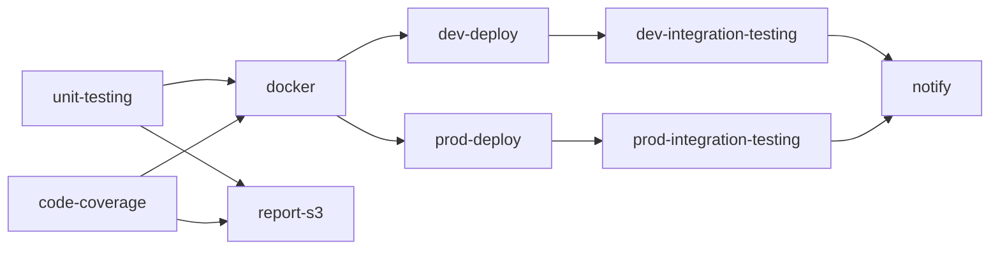
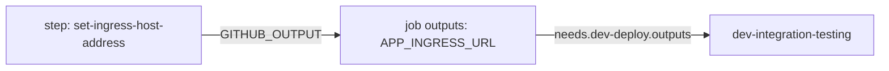
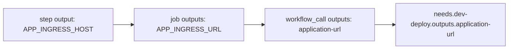

# 🚀 GitHub Actions — المذكرة الكاملة

> [!abstract] عن هذه المذكرة
> مذكرة دورة **GitHub Actions** (KodeKloud / DevOps Directive) مع مشروع **Solar System** التطبيقي.
> كل قسم مرتب كالتالي: ==لماذا؟ ← كيف تعمل؟ ← الكود الأساسي ← Workflow كاملًا داخل Toggle مطوي==.

## 🗺️ الخريطة النهائية للمشروع (Solar System Pipeline)



## 📑 الفهرس

- [[#1. Multiple Jobs|1) تشغيل Jobs متوازية]]
- [[#2. Multiple Jobs in Sequence|2) ترتيب الـ Jobs بـ needs]]
- [[#3. Artifacts|3) مشاركة الملفات بين الـ Jobs]]
- [[#4. Variables at Different Levels|4) المتغيرات والمستويات الثلاثة]]
- [[#5. Triggering a Workflow|5) تشغيل Workflow: cron و workflow_dispatch]]
- [[#6. Job Concurrency|6) منع التعارض بين التشغيلات]]
- [[#7. Timeout for Jobs and Steps|7) حد زمني للـ Jobs والـ Steps]]
- [[#8. Matrix Strategy|8) الاختبار على بيئات متعددة]]
- [[#9. Contexts|9) سياقات التشغيل]]
- [[#10. if Expressions in Jobs|10) التنفيذ الشرطي للـ Jobs]]
- [[#11. Workflow Event Filters|11) فلاتر الأحداث]]
- [[#12. Skipping Workflow Runs|12) تخطي التشغيل]]
- [[#13. Continuous Integration Node.js|13) أساسيات CI لمشروع Node.js]]
- [[#14. Using continue-on-error|14) تجاهل فشل خطوة]]
- [[#15. if Expressions with Step Contexts|15) الشروط مع نتيجة الخطوات]]
- [[#16. Dependencies Node Cache|16) تخزين الحزم مؤقتًا]]
- [[#17. Build and Push Image to Registry|17) بناء ورفع صورة Docker]]
- [[#18. Unit Testing with a Service|18) الاختبار مع Service]]
- [[#19. Code Coverage in a Container|19) التشغيل داخل حاوية]]
- [[#20. Replace Placeholder Tokens|20) حقن القيم في الملفات]]
- [[#21. Job Outputs for Integration Testing|21) تمرير المخرجات بين الـ Jobs]]
- [[#22. Reusable Workflows|22) إعادة استخدام Workflows]]
- [[#23. Reports to AWS S3 Storage|23) أرشفة التقارير على S3]]
- [[#24. Notifications|24) الإشعارات]]
- [[#25. Self-Hosted Runners|25) تشغيل على سيرفرك الخاص]]
- [[#المراجع References|📚 المراجع]]

---

## 1. Multiple Jobs

> [!question] لماذا؟
> Workflow الواحد قد يحتوي أكثر من Job (بناء، اختبار، نشر). افتراضيًا كل الـ Jobs تعمل ==بالتوازي== على Runners منفصلة، وهذا يقلل زمن التنفيذ عندما لا توجد اعتمادية بينها.

### ⚙️ كيف تعمل؟
1. كل Job تحت `jobs:` gets معرّف خاص به (`build_job_1` مثلًا).
2. كل Job تعمل على **Runner مستقل** (`runs-on: ubuntu-latest`).
3. لعدم وجود `needs` → الثلاثة تبدأ في نفس اللحظة ولا تنتظر بعضها.

### 🔑 الكود الأساسي
```yaml
jobs:
  build_job_1:
    runs-on: ubuntu-latest
    steps: ...
  test_job_2:
    runs-on: ubuntu-latest   # لا توجد needs → يعمل بالتوازي
    steps: ...
  deploy_job_3:
    runs-on: ubuntu-latest
    steps: ...
```

> [!example]- 📄 Workflow كاملًا — اضغط للفتح
> ```yaml
> name: Generate ASCII Artwork
> on: push
> jobs:
>   build_job_1:
>     runs-on: ubuntu-latest
>     steps:
>       - name: Install Cowsay Program
>         run: sudo apt-get install cowsay -y
>       - name: Execute Cowsay CMD
>         run: cowsay -f dragon "Run for cover, I'm a DRAGON ... RAWR" >> dragon.txt
>       - name: Sleep for 30 seconds
>         run: sleep 30
>   test_job_2:
>     runs-on: ubuntu-latest
>     steps:
>       - name: Sleep for 10 seconds
>         run: sleep 10
>       - name: Test File Exists
>         run: grep -i "dragon" dragon.txt
>   deploy_job_3:
>     runs-on: ubuntu-latest
>     steps:
>       - name: Read File
>         run: cat dragon.txt
>       - name: Deploy
>         run: echo Deploying .... .. .
> ```

---

## 2. Multiple Jobs in Sequence

> [!question] لماذا؟
> في الـ CI الحقيقي لا يمكن عمل Deploy قبل نجاح الـ Build والـ Test. نحتاج ==ترتيبًا إجباريًا==: build ← test ← deploy.

### ⚙️ كيف تعمل؟
1. نضيف `needs:` للـ Job التابع، ونضع فيها اسم (أو أسماء) الـ Jobs التي يجب أن تنجح أولًا.
2. `needs: build_job_1` → ينتظر job واحد.
3. `needs: [test_job_2, build_job_1]` → ينتظر أكثر من job.
4. لو فشل أي job مطلوب → التابع يتم **skip** تلقائيًا.

> [!warning] مشكلة ستظهر هنا
> كل Job تعمل على **VM جديدة نظيفة**، وملفات الـ Job السابقة تختفي بانتهائها. لذلك `grep dragon.txt` في job الاختبار سيفشل: الملف موجود فقط على جهاز الـ Build. الحل في [[#3. Artifacts|القسم التالي]].

### 🔑 الكود الأساسي
```yaml
test_job_2:
  needs: build_job_1          # ينتظر نجاح البناء
  runs-on: ubuntu-latest

deploy_job_3:
  needs: [test_job_2, build_job_1]   # ينتظر الاثنين معًا
  runs-on: ubuntu-latest
```

> [!example]- 📄 Workflow كاملًا — اضغط للفتح
> ```yaml
> name: Generate ASCII Artwork
> on: push
> jobs:
>   build_job_1:
>     runs-on: ubuntu-latest
>     steps:
>       - name: Install Cowsay Program
>         run: sudo apt-get install cowsay -y
>       - name: Execute Cowsay CMD
>         run: cowsay -f dragon "Run for cover, I'm a DRAGON ... RAWR" >> dragon.txt
>       - name: Sleep for 30 seconds
>         run: sleep 30
>   test_job_2:
>     needs: build_job_1
>     runs-on: ubuntu-latest
>     steps:
>       - name: Sleep for 10 seconds
>         run: sleep 10
>       - name: Test File Exists
>         run: grep -i "dragon" dragon.txt
>   deploy_job_3:
>     needs: [test_job_2, build_job_1]
>     runs-on: ubuntu-latest
>     steps:
>       - name: Read File
>         run: cat dragon.txt
>       - name: Deploy
>         run: echo Deploying .... .. .
> ```

---

## 3. Artifacts

> [!question] لماذا؟
> بما أن كل Job تعمل على جهاز منفصل ومؤقت، نحتاج طريقة ==لنقل الملفات بين الـ Jobs==: نرفع الملف من job البناء (Upload) وننزّله في job الاختبار والنشر (Download).

### ⚙️ كيف تعمل؟
1. `actions/upload-artifact@v4` يرفع الملف إلى تخزين GitHub المؤقت باسم مميز (`name`).
2. `actions/download-artifact@v4` ينزّل الملف بنفس الاسم داخل مجلد العمل للـ Job الحالية.
3. الـ Artifacts تظهر أيضًا في صفحة الـ run على GitHub ويمكن تنزيلها يدويًا.

### 🔑 الكود الأساسي
```yaml
# في job البناء — رفع
- uses: actions/upload-artifact@v4
  with:
    name: dragon-text-file
    path: dragon.txt

# في job الاختبار/النشر — تنزيل
- uses: actions/download-artifact@v4
  with:
    name: dragon-text-file
```

> [!tip] التحكم في مدة بقاء الـ Artifacts
> - على مستوى الـ Repository: **Settings → Actions → General → Artifact retention**.
> - على مستوى خطوة الرفع نفسها: `retention-days: 5` داخل `with`.

> [!example]- 📄 Workflow كاملًا — اضغط للفتح
> ```yaml
> name: Generate ASCII Artwork
> on: push
> jobs:
>   build_job_1:
>     runs-on: ubuntu-latest
>     steps:
>       - name: Install Cowsay Program
>         run: sudo apt-get install cowsay -y
>       - name: Execute Cowsay CMD
>         run: cowsay -f dragon "Run for cover, I'm a DRAGON ... RAWR" >> dragon.txt
>       - uses: actions/upload-artifact@v4
>         with:
>           name: dragon-text-file
>           path: dragon.txt
>   test_job_2:
>     needs: build_job_1
>     runs-on: ubuntu-latest
>     steps:
>       - uses: actions/download-artifact@v4
>         with:
>           name: dragon-text-file
>       - name: Test File Exists
>         run: grep -i "dragon" dragon.txt
>   deploy_job_3:
>     needs: test_job_2
>     runs-on: ubuntu-latest
>     steps:
>       - uses: actions/download-artifact@v4
>         with:
>           name: dragon-text-file
>       - name: Read File
>         run: cat dragon.txt
>       - name: Deploy
>         run: echo Deploying .... .. .
> ```

---

## 4. Variables at Different Levels

> [!question] لماذا؟
> القيم الثابتة (اسم الـ Registry، اسم الصورة، اسم المستخدم) تتكرر في أكثر من خطوة. تعريفها كمتغيرات ==يمنع التكرار ويسهّل التعديل==، والقيم الحساسة (كلمات المرور) يجب ألا تُكتب داخل الكود أبدًا.

### ⚙️ كيف تعمل؟
1. المتغيرات تُعرّف بـ `env` على ثلاثة مستويات: **Workflow** (كل الـ jobs) ← **Job** (كل خطواته) ← **Step** (الخطوة فقط).
2. عند التعارض: ==الأقرب يفوز== (Step > Job > Workflow).
3. القراءة داخل Expressions: `${{ env.NAME }}`، ومتغيرات الـ Repository: `${{ vars.NAME }}`، والأسرار: `${{ secrets.NAME }}`.
4. داخل أوامر الـ shell يمكن أيضًا استخدام `$NAME` مباشرة.

| النوع | مكان التعريف | مكشوف في Logs؟ | الاستخدام |
| --- | --- | --- | --- |
| `env` | داخل ملف الـ YAML | نعم | قيم غير حساسة |
| `vars` | Settings → Variables | نعم | قيم تتغير بين البيئات |
| `secrets` | Settings → Secrets | ==لا (masked)== | كلمات مرور وتوكنات |

### 🔑 الكود الأساسي
```yaml
env:                          # 1) مستوى Workflow
  CONTAINER_REGISTRY: docker.io
jobs:
  docker:
    env:                      # 2) مستوى الـ job
      IMAGE_TAG: latest
    steps:
      - name: Docker Build
        env:                  # 3) مستوى الـ step
          BUILD_LABEL: build-step
        run: echo "${{ env.CONTAINER_REGISTRY }} ${{ vars.DOCKER_USERNAME }} ${{ secrets.DOCKER_PASSWORD }}"
```

> [!example]- 📄 Workflow كاملًا — اضغط للفتح
> ```yaml
> name: Variables and Secrets
> on: workflow_dispatch
> env:
>   CONTAINER_REGISTRY: docker.io
>   IMAGE_NAME: github-actions-nginx
> jobs:
>   docker:
>     runs-on: ubuntu-latest
>     env:
>       IMAGE_TAG: latest
>     steps:
>       - name: Docker Build
>         env:
>           BUILD_LABEL: build-step
>         run: |
>           echo "$BUILD_LABEL"
>           echo docker build -t ${{ env.CONTAINER_REGISTRY }}/${{ vars.DOCKER_USERNAME }}/${{ env.IMAGE_NAME }}:${{ env.IMAGE_TAG }}
>       - name: Docker Login
>         run: echo docker login --username=${{ vars.DOCKER_USERNAME }} --password=${{ secrets.DOCKER_PASSWORD }}
>       - name: Docker Publish
>         run: echo docker push ${{ env.CONTAINER_REGISTRY }}/${{ vars.DOCKER_USERNAME }}/${{ env.IMAGE_NAME }}:${{ env.IMAGE_TAG }}
> ```

---

## 5. Triggering a Workflow

> [!question] لماذا؟
> ليس كل Workflow يجب أن يعمل مع كل push. أحيانًا نريد تشغيله ==بجدول زمني== (نسخ احتياطي ليلي، فحص دوري) أو ==يدويًا== عند الطلب فقط.

### ⚙️ كيف تعمل؟
1. `on: schedule` مع تعبير **cron** يشغّل Workflow تلقائيًا حسب التوقيت (**UTC دائمًا**).
2. `on: workflow_dispatch` يضيف زر **Run workflow** في تبويب Actions للتشغيل اليدوي.
3. يمكن الجمع بين أكثر من trigger في نفس Workflow.

| الحقل | القيم | مثال `"15 4,5 * * *"` |
| --- | --- | --- |
| دقيقة | 0–59 | 15 |
| ساعة | 0–23 | 4 و 5 |
| يوم الشهر | 1–31 | كل يوم |
| الشهر | 1–12 | كل شهر |
| يوم الأسبوع | 0–6 | أي يوم |

النتيجة: يعمل يوميًا الساعة ==4:15 و 5:15 صباحًا UTC==.

> [!tip] أدوات مفيدة
> - composing cron بسهولة: [crontab.guru](https://crontab.guru/)
> - قائمة كل الأحداث: [Events that trigger workflows](https://docs.github.com/en/actions/writing-workflows/choosing-when-your-workflow-runs/events-that-trigger-workflows#push)
> - أقل فاصل زمني مدعوم هو 5 دقائق، وقد يتأخر التنفيذ عند الضغط على الخدمة.

> [!example]- 📄 Workflow الجدولة (cron) كاملًا — اضغط للفتح
> ```yaml
> name: Generate ASCII Artwork
> on:
>   schedule:
>     - cron: "15 4,5 * * *"
> jobs:
>   build_job_1:
>     runs-on: ubuntu-latest
>     steps:
>       - name: Install Cowsay Program
>         run: sudo apt-get install cowsay -y
>       - name: Execute Cowsay CMD
>         run: cowsay -f dragon "Run for cover, I'm a DRAGON ... RAWR" >> dragon.txt
>       - uses: actions/upload-artifact@v4
>         with:
>           name: dragon-text-file
>           path: dragon.txt
>   test_job_2:
>     needs: build_job_1
>     runs-on: ubuntu-latest
>     steps:
>       - uses: actions/download-artifact@v4
>         with:
>           name: dragon-text-file
>       - name: Test File Exists
>         run: grep -i "dragon" dragon.txt
>   deploy_job_3:
>     needs: test_job_2
>     runs-on: ubuntu-latest
>     steps:
>       - uses: actions/download-artifact@v4
>         with:
>           name: dragon-text-file
>       - name: Read File
>         run: cat dragon.txt
>       - name: Deploy
>         run: echo Deploying .... .. .
> ```

> [!example]- 📄 Workflow التشغيل اليدوي (workflow_dispatch) كاملًا — اضغط للفتح
> ```yaml
> name: Generate ASCII Artwork
> on: workflow_dispatch
> jobs:
>   build_job_1:
>     runs-on: ubuntu-latest
>     steps:
>       - name: Install Cowsay Program
>         run: sudo apt-get install cowsay -y
>       - name: Execute Cowsay CMD
>         run: cowsay -f dragon "Run for cover, I'm a DRAGON ... RAWR" >> dragon.txt
>       - uses: actions/upload-artifact@v4
>         with:
>           name: dragon-text-file
>           path: dragon.txt
>   test_job_2:
>     needs: build_job_1
>     runs-on: ubuntu-latest
>     steps:
>       - uses: actions/download-artifact@v4
>         with:
>           name: dragon-text-file
>       - name: Test File Exists
>         run: grep -i "dragon" dragon.txt
>   deploy_job_3:
>     needs: test_job_2
>     runs-on: ubuntu-latest
>     steps:
>       - uses: actions/download-artifact@v4
>         with:
>           name: dragon-text-file
>       - name: Read File
>         run: cat dragon.txt
>       - name: Deploy
>         run: echo Deploying .... .. .
> ```

---

## 6. Job Concurrency

> [!question] لماذا؟
> لو وصل تعديلان متتاليان من الفريق، قد يعمل نسختان من نفس Workflow في نفس الوقت → ==تعارض في الـ Deploy أو إهدار للموارد==. نريد إما إلغاء التشغيل القديم أو جعل الجديد ينتظر.

### ⚙️ كيف تعمل؟
1. نحدد `concurrency.group` باسم يجمع التشغيلات المتنافسة (مثل `production-deployment`).
2. أي تشغيل جديد يدخل نفس الـ Group يتعامل مع التشغيل الجاري حسب `cancel-in-progress`:

| القيمة | السلوك |
| --- | --- |
| `true` | ==إلغاء== التشغيل الجاري والبدء فورًا بالجديد |
| `false` | الجديد ==ينتظر في طابور== حتى ينتهي الجاري |

3. توضع على مستوى **Job** (مثل deploy فقط) أو على مستوى **Workflow** كله.

### 🔑 الكود الأساسي
```yaml
deploy:
  needs: docker
  concurrency:
    group: production-deployment
    cancel-in-progress: true   # false = انتظار
```

> [!example]- 📄 Workflow كاملًا — اضغط للفتح
> ```yaml
> name: Variables and Secrets
> on: workflow_dispatch
> env:
>   CONTAINER_REGISTRY: docker.io
>   IMAGE_NAME: github-actions-nginx
> jobs:
>   docker:
>     runs-on: ubuntu-latest
>     steps:
>       - name: Docker Build
>         run: echo docker build -t ${{ env.CONTAINER_REGISTRY }}/${{ vars.DOCKER_USERNAME }}/${{ env.IMAGE_NAME }}:latest
>       - name: Docker Login
>         run: echo docker login --username=${{ vars.DOCKER_USERNAME }} --password=${{ secrets.DOCKER_PASSWORD }}
>       - name: Docker Publish
>         run: echo docker push ${{ env.CONTAINER_REGISTRY }}/${{ vars.DOCKER_USERNAME }}/${{ env.IMAGE_NAME }}:latest
>   deploy:
>     needs: docker
>     concurrency:
>       group: production-deployment
>       cancel-in-progress: true
>     runs-on: ubuntu-latest
>     steps:
>       - name: Docker Run
>         run: |
>           echo docker run -d -p 8080:80 ${{ env.CONTAINER_REGISTRY }}/${{ vars.DOCKER_USERNAME }}/${{ env.IMAGE_NAME }}:latest
>           sleep 600s
> ```

---

## 7. Timeout for Jobs and Steps

> [!question] لماذا؟
> خطأ في الكود أو أمر معلّق (انتظار إدخال مثلًا) قد يترك الـ Job تعمل ==حتى 6 ساعات (360 دقيقة افتراضيًا)== → استهلاك مجاني لـ Quota الدقائق وفواتير غير ضرورية. نضع حدًا زمنيًا واقعيًا.

### ⚙️ كيف تعمل؟
1. `timeout-minutes` على مستوى **Job**: يشمل كل خطواتها.
2. `timeout-minutes` على مستوى **Step**: يخص خطوة واحدة فقط.
3. عند تجاوز المدة يتم ==إلغاء== الـ Job/Step وتُحتسب كـ failure.

### 🔑 الكود الأساسي
```yaml
deploy:
  # timeout-minutes: 1        # على مستوى الـ Job كاملة
  runs-on: ubuntu-latest
  steps:
    - name: Docker Run
      timeout-minutes: 1      # على مستوى الخطوة فقط
      run: |
        echo docker run -d -p 8080:80 nginx
        sleep 600s            # سيتم إيقافها بعد دقيقة واحدة
```

> [!example]- 📄 Workflow كاملًا — اضغط للفتح
> ```yaml
> name: Variables and Secrets
> on: workflow_dispatch
> env:
>   CONTAINER_REGISTRY: docker.io
>   IMAGE_NAME: github-actions-nginx
> jobs:
>   docker:
>     runs-on: ubuntu-latest
>     steps:
>       - name: Docker Build
>         run: echo docker build -t ${{ env.CONTAINER_REGISTRY }}/${{ vars.DOCKER_USERNAME }}/${{ env.IMAGE_NAME }}:latest
>       - name: Docker Login
>         run: echo docker login --username=${{ vars.DOCKER_USERNAME }} --password=${{ secrets.DOCKER_PASSWORD }}
>       - name: Docker Publish
>         run: echo docker push ${{ env.CONTAINER_REGISTRY }}/${{ vars.DOCKER_USERNAME }}/${{ env.IMAGE_NAME }}:latest
>   deploy:
>     # timeout-minutes: 1    # بديل: حد زمني للـ Job كاملة
>     needs: docker
>     concurrency:
>       group: production-deployment
>       cancel-in-progress: true
>     runs-on: ubuntu-latest
>     steps:
>       - name: Docker Run
>         timeout-minutes: 1
>         run: |
>           echo docker run -d -p 8080:80 ${{ env.CONTAINER_REGISTRY }}/${{ vars.DOCKER_USERNAME }}/${{ env.IMAGE_NAME }}:latest
>           sleep 600s
> ```

---

## 8. Matrix Strategy

> [!question] لماذا؟
> لو أردت اختبار تطبيقك على أكثر من نظام تشغيل أو أكثر من إصدار Node، هل تكرر نفس الـ Job يدويًا لكل حالة؟ الـ **Matrix** تولّد ==نسخة من الـ Job لكل تركيبة تلقائيًا== وتعمل بالتوازي.

### ⚙️ كيف تعمل؟
1. تعرّف محاور تحت `strategy.matrix` (مثل `os` و `images`).
2. عدد النسخ = حاصل ضرب القيم: 3 أنظمة × 2 صور = ==6 Jobs متوازية==.
3. تقرأ قيم التركيبة الحالية بـ `${{ matrix.os }}` و `${{ matrix.images }}`.
4. أدوات التحكم الإضافية:

| الخيار | الوظيفة |
| --- | --- |
| `exclude` | حذف تركيبة معينة (alpine على windows مثلًا) |
| `include` | إضافة تركيبة أو قيم إضافية |
| `fail-fast: false` | ==لا تُلغى== بقية التركيبات إذا فشلت واحدة (الافتراضي true) |
| `max-parallel: 2` | أقصى عدد Jobs تعمل في نفس اللحظة |

### 🔑 الكود الأساسي
```yaml
strategy:
  matrix:
    os: [ubuntu-latest, ubuntu-22.04, windows-latest]
    images: [hello-world, alpine]
runs-on: ${{ matrix.os }}
steps:
  - run: docker run ${{ matrix.images }}
```

> [!example]- 📄 Workflow الأساسي كاملًا — اضغط للفتح
> ```yaml
> name: Configuration Matrix
> on:
>   push:
>   workflow_dispatch:
> jobs:
>   deploy:
>     strategy:
>       matrix:
>         os: [ubuntu-latest, ubuntu-22.04, windows-latest]
>         images: [hello-world, alpine]
>     runs-on: ${{ matrix.os }}
>     steps:
>       - name: Echo Docker Details
>         run: docker info
>       - name: Run Image on ${{ matrix.os }}
>         run: docker run ${{ matrix.images }}
> ```

> [!example]- 📄 النسخة المتقدمة (exclude / include / fail-fast) كاملة — اضغط للفتح
> ```yaml
> name: Configuration Matrix
> on:
>   push:
>   workflow_dispatch:
> jobs:
>   deploy:
>     strategy:
>       fail-fast: false
>       max-parallel: 2
>       matrix:
>         os: [ubuntu-latest, ubuntu-22.04, windows-latest]
>         images: [hello-world, alpine]
>         exclude:
>           - images: alpine
>             os: windows-latest
>         include:
>           - images: amd64/alpine
>             os: windows-latest
>     runs-on: ${{ matrix.os }}
>     steps:
>       - name: Echo Docker Details
>         run: docker info
>       - name: Run Image on ${{ matrix.os }}
>         run: docker run ${{ matrix.images }}
> ```

---

## 9. Contexts

> [!question] لماذا؟
> أثناء التشغيل تحتاج معلومات ديناميكية: من أطلق Workflow؟ على أي فرع؟ ما نظام الـ Runner؟ هل نجحت الخطوة السابقة؟ GitHub يوفر هذه المعلومات في كائنات جاهزة اسمها **Contexts** تُقرأ عبر `${{ }}`.

### ⚙️ كيف تعمل؟
1. كل سياق كائن يحتوي خصائص، مثل `github.ref` و `runner.os`.
2. لطباعة الكائن كاملًا في الـ Logs نستخدم الدالة `toJson()`.
3. أشهر السياقات:

| السياق | يحتوي على |
| --- | --- |
| `github` | معلومات الـ repo والحدث والـ commit والفرع |
| `job` | حالة الـ Job الحالية والـ Services |
| `steps` | نتائج ومخرجات الخطوات السابقة (تحتاج `id`) |
| `runner` | نظام التشغيل والمعمارية ومسارات الـ Runner |
| `strategy` | إعدادات `fail-fast` والـ Matrix |
| `matrix` | قيم التركيبة الحالية |
| `secrets` | الأسرار المعرّفة (تظهر masked في الـ Logs) |

### 🔑 الكود الأساسي
```yaml
- name: Dump GitHub context
  env:
    GITHUB_CONTEXT: ${{ toJson(github) }}
  run: echo "$GITHUB_CONTEXT"
```

> [!example]- 📄 Workflow كاملًا — اضغط للفتح
> ```yaml
> name: Context Testing
> on: push
> jobs:
>   dump_contexts_to_log:
>     runs-on: ubuntu-latest
>     steps:
>       - name: Dump GitHub context
>         env:
>           GITHUB_CONTEXT: ${{ toJson(github) }}
>         run: echo "$GITHUB_CONTEXT"
>       - name: Dump job context
>         env:
>           JOB_CONTEXT: ${{ toJson(job) }}
>         run: echo "$JOB_CONTEXT"
>       - name: Dump steps context
>         env:
>           STEPS_CONTEXT: ${{ toJson(steps) }}
>         run: echo "$STEPS_CONTEXT"
>       - name: Dump runner context
>         env:
>           RUNNER_CONTEXT: ${{ toJson(runner) }}
>         run: echo "$RUNNER_CONTEXT"
>       - name: Dump strategy context
>         env:
>           STRATEGY_CONTEXT: ${{ toJson(strategy) }}
>         run: echo "$STRATEGY_CONTEXT"
>       - name: Dump secrets context
>         env:
>           SECRET_CONTEXT: ${{ toJson(secrets) }}
>         run: echo "$SECRET_CONTEXT"
> ```

---

## 10. if Expressions in Jobs

> [!question] لماذا؟
> مرحلة الـ Deploy على Production يجب ألا تعمل من فرع تجريبي. نريد ==شرطًا على مستوى الـ Job==: يعمل فقط إذا كنا على `main`، وإلا يتم تخطيه.

### ⚙️ كيف تعمل؟
1. نضع `if:` مباشرة تحت اسم الـ Job مع تعبير منطقي.
2. `github.ref == 'refs/heads/main'` → يساوي المسار الكامل للفرع.
3. لو الشرط **false** → تظهر الـ Job بحالة ==Skipped== (وليست Failed) ويكمل الباقي طبيعيًا.
4. داخل `if` لا نحتاج `${{ }}` لأن التعبير يُقيَّم تلقائيًا.
5. بديل شائع للفروع المتعددة: `contains(github.ref, 'feature/')`.

### 🔑 الكود الأساسي
```yaml
deploy:
  if: github.ref == 'refs/heads/main'   # يعمل فقط من فرع main
  needs: docker
```

> [!example]- 📄 Workflow كاملًا — اضغط للفتح
> ```yaml
> name: Variables and Secrets
> on: workflow_dispatch
> env:
>   CONTAINER_REGISTRY: docker.io
>   IMAGE_NAME: github-actions-nginx
> jobs:
>   docker:
>     timeout-minutes: 1
>     runs-on: ubuntu-latest
>     steps:
>       - name: Docker Build
>         run: echo docker build -t ${{ env.CONTAINER_REGISTRY }}/${{ vars.DOCKER_USERNAME }}/${{ env.IMAGE_NAME }}:latest
>       - name: Docker Login
>         run: echo docker login --username=${{ vars.DOCKER_USERNAME }} --password=${{ secrets.DOCKER_PASSWORD }}
>       - name: Docker Publish
>         run: echo docker push ${{ env.CONTAINER_REGISTRY }}/${{ vars.DOCKER_USERNAME }}/${{ env.IMAGE_NAME }}:latest
>   deploy:
>     if: github.ref == 'refs/heads/main'
>     needs: docker
>     concurrency:
>       group: production-deployment
>       cancel-in-progress: true
>     runs-on: ubuntu-latest
>     steps:
>       - name: Docker Run
>         timeout-minutes: 1
>         run: |
>           echo docker run -d -p 8080:80 ${{ env.CONTAINER_REGISTRY }}/${{ vars.DOCKER_USERNAME }}/${{ env.IMAGE_NAME }}:latest
>           sleep 600s
> ```

---

## 11. Workflow Event Filters

> [!question] لماذا؟
> لا نريد تشغيل الـ CI مع كل حدث: تعديل `README.md` لا يستحق Build كاملًا، والـ Push على فرع تجريبي لا يجب أن يصل Production. الفلاتر تحدد ==متى بالضبط== يستجيب Workflow للحدث.

### ⚙️ كيف تعمل؟
1. `branches` أو `branches-ignore`: فلترة حسب الفرع — ==لا يمكن الجمع بينهما== في نفس الحدث.
2. `paths` أو `paths-ignore`: فلترة حسب الملفات المعدّلة (`docs/**` مثلًا).
3. `types` تحت `pull_request`: تحديد نوع النشاط (`opened`, `closed`, `synchronize`...).
4. نمط موجب واحد مثل `main` يستبعد تلقائيًا كل الفروع الأخرى.

### 🔑 الكود الأساسي
```yaml
on:
  push:
    branches: [main]
    paths-ignore:
      - 'README.md'
      - 'docs/**'
  pull_request:
    types: [opened, closed]
    branches: [main]
```

> [!example]- 📄 Workflow كاملًا — اضغط للفتح
> ```yaml
> name: Workflow Filters and Activities
> on:
>   # تشغيل يدوي من تبويب Actions
>   workflow_dispatch:
>   push:
>     # branches-ignore:
>     #   - feature/*      # feature/add-music , feature/updateImage
>     #   - test/**        # test/ui/index , test/checkout/payment
>     # ملاحظة: لم نستخدم branches-ignore لأننا نستخدم نمطًا موجبًا واحدًا (main)،
>     #         وهو يستبعد تلقائيًا كل الفروع الأخرى بما فيها feature/* و test/**.
>     #         كما أننا لا نستطيع الجمع بين branches و branches-ignore في نفس الحدث.
>     branches:
>       - main
>     paths-ignore:
>       - 'README.md'
>       - 'docs/**'            # كل مجلد التوثيق
>       - '**.md'              # أي ملف markdown في أي مكان
>       - '.github/CODEOWNERS'
>   pull_request:
>     types:
>       - opened
>       - closed
>     branches:
>       - main                 # PRs التي تستهدف main فقط
>     paths-ignore:
>       - 'README.md'          # يعمل فقط إذا كان الـ PR يعدّل ملفات غير README.md
> jobs:
>   hello:
>     runs-on: ubuntu-latest
>     steps:
>       - name: Print event type
>         run: echo "This step is executed for event type ${{ github.event_name }}"
> ```

---

## 12. Skipping Workflow Runs

> [!question] لماذا؟
> تعديل بسيط (تصحيح كلمة في التوثيق مثلًا) لا يستحق استهلاك دقائق CI. GitHub يسمح ==بتخطي التشغيل كليًا== من رسالة الـ Commit نفسها.

### ⚙️ كيف تعمل؟
1. اكتب إحدى الكلمات المفتاحية في **رسالة الـ Commit** (الـ HEAD commit):
   `[skip ci]` — `[ci skip]` — `[no ci]` — `[skip actions]` — `[actions skip]`
2. تعمل مع أحداث `push` و `pull_request` فقط.
3. لا تؤثر على `workflow_dispatch` أو `schedule`.

> [!example] مثال عملي
> ```bash
> git commit -m "docs: fix typo in README [skip ci]"
> git push
> # لن يعمل أي workflow مرتبط بالـ push لهذا الـ commit
> ```

---

## 13. Continuous Integration Node.js

> [!question] لماذا؟
> مشروع الدورة **Solar System** مبني بـ Node.js + MongoDB. قبل أتمتة الـ CI يجب فهم الأوامر التي سيشغلها Workflow يدويًا: تثبيت الحزم، الاختبار، التغطية، التشغيل.

### ⚙️ كيف تعمل؟

| الأمر | الوظيفة |
| --- | --- |
| `node -v` / `npm -v` | التحقق من التثبيت والإصدارات |
| `npm install` | تنزيل الحزم داخل `node_modules` حسب `package-lock.json` |
| `npm test` | تشغيل اختبارات **Mocha** → ينتج `test-results.xml` |
| `npm run coverage` | تقرير تغطية الكود → `coverage/cobertura-coverage.xml` |
| `npm start` | تشغيل التطبيق (منفذ 3000) |

### 🔑 الكود الأساسي
```bash
node -v
npm -v
npm install     # install node_modules
npm test        # mocha tests → test-results.xml
npm start       # start app
```

> [!info] كود المشروع
> التطبيق المستخدم في بقية الأقسام: [devops-directive-github-actions-course](https://github.com/sidpalas/devops-directive-github-actions-course)

---

## 14. Using continue-on-error

> [!question] لماذا؟
> انخفاض نسبة تغطية الكود (Coverage) مفيد معرفته لكنه ==ليس سببًا لإسقاط الـ Pipeline كله==. نريد أن تكمل Workflow حتى لو فشلت هذه الخطوة. وهنا أيضًا يظهر أول Workflow حقيقي للمشروع مع Matrix للاختبار على إصدارات وأنظمة متعددة.

### ⚙️ كيف تعمل؟
1. `continue-on-error: true` على **Step**: لو فشلت → تُعلَّم كتحذير وتكمل بقية الخطوات (الـ Job تنجح).
2. يمكن وضعها على **Job** كاملة: فشلها لا يُفشل Workflow.
3. الـ Matrix هنا: 3 إصدارات Node × نظامان = ==6 نسخ متوازية== من الاختبار.
4. اسم كل Artifact يجب أن يكون ==فريدًا داخل نفس الـ run==، لذلك نضيف قيم الـ Matrix للاسم.
5. بيانات الاتصال بـ MongoDB Atlas تأتي من `secrets` عبر `env` على مستوى Workflow.

### 🔑 الكود الأساسي
```yaml
- name: Check Code Coverage
  continue-on-error: true   # فشل التغطية لا يوقف الـ Job
  run: npm run coverage
- name: Archive Test Result
  uses: actions/upload-artifact@v4
  with:
    name: Code-Coverage-Result
    path: coverage
    retention-days: 5       # حذف تلقائي بعد 5 أيام
```

> [!example]- 📄 Workflow كاملًا — اضغط للفتح
> ```yaml
> name: Solar System Workflow
> on:
>   workflow_dispatch:
>   push:
>     branches:
>       - main
>       - 'feature/*'
> env:
>   MONGO_URI: 'mongodb://${{ secrets.USERNAME }}:${{ secrets.PASSWORD }}@cluster0.7x6u1mv.mongodb.net/superData'
>   MONGO_USERNAME: ${{ secrets.USERNAME }}
>   MONGO_PASSWORD: ${{ secrets.PASSWORD }}
> jobs:
>   unit-testing:
>     name: Unit Testing
>     strategy:
>       matrix:
>         nodejs_version: [18, 19, 20]
>         operating_system: [ubuntu-latest, macos-latest]
>     runs-on: ${{ matrix.operating_system }}
>     steps:
>       - name: Checkout Repo
>         uses: actions/checkout@v4
>       - name: Setup Node.js Version - ${{ matrix.nodejs_version }}
>         uses: actions/setup-node@v3
>         with:
>           node-version: ${{ matrix.nodejs_version }}
>       - name: Install Dependencies
>         run: npm install
>       - name: Unit Testing
>         run: npm test
>       - name: Archive Test Result
>         uses: actions/upload-artifact@v4
>         with:
>           name: Mocha-Test-Result-${{ matrix.nodejs_version }}-${{ matrix.operating_system }}
>           path: test-results.xml
>   code-coverage:
>     name: Code Coverage
>     runs-on: ubuntu-latest
>     steps:
>       - name: Checkout Repo
>         uses: actions/checkout@v4
>       - name: Setup Node.js Version - 18
>         uses: actions/setup-node@v3
>         with:
>           node-version: 18
>       - name: Install Dependencies
>         run: npm install
>       - name: Check Code Coverage
>         continue-on-error: true
>         run: npm run coverage
>       - name: Archive Test Result
>         uses: actions/upload-artifact@v4
>         with:
>           name: Code-Coverage-Result
>           path: coverage
>           retention-days: 5
> ```

---

## 15. if Expressions with Step Contexts

> [!question] لماذا؟
> افتراضيًا: لو فشلت خطوة الاختبارات ==تُتخطى كل الخطوات بعدها==، بما فيها رفع تقرير النتائج! ونحن نحتاج التقرير **خصوصًا عند الفشل** لنعرف السبب. الحل: شرط على خطوة الرفع يعتمد نتيجة خطوة الاختبار.

### ⚙️ كيف تعمل؟
1. نعطي خطوة الاختبار `id` لنشير إليها لاحقًا.
2. `steps.<id>.outcome` تحمل النتيجة الفعلية: `success` / `failure` / `cancelled` / `skipped`.
3. دوال الحالة الشهيرة:
   - `failure()` → true إذا فشل أي شيء سابق في الـ Job.
   - `always()` → تعمل دائمًا حتى عند الإلغاء.
   - `success()` → الافتراضي (كل السابق نجح).
4. الشرط المركب: `failure() && (outcome == 'failure' || outcome == 'success')` معناه: ارفع التقرير ==فقط إذا كانت خطوة الاختبار قد نفّذت فعلًا== (نجحت أو فشلت)، وليس إذا فشل `npm install` قبلها (وقتها لا يوجد ملف أصلًا).

> [!tip] outcome مقابل conclusion
> `outcome` = النتيجة الخام قبل تطبيق `continue-on-error`، بينما `conclusion` = النتيجة النهائية بعدها. للخطوات ذات `continue-on-error: true` استخدم `outcome` لمعرفة ما حدث فعلًا.

### 🔑 الكود الأساسي
```yaml
- name: Unit Testing
  id: nodejs-unit-testing-step
  run: npm test
- name: Archive Test Result
  if: failure() && (steps.nodejs-unit-testing-step.outcome == 'failure' || steps.nodejs-unit-testing-step.outcome == 'success')
  uses: actions/upload-artifact@v4
  with:
    name: Mocha-Test-Result-${{ matrix.nodejs_version }}-${{ matrix.operating_system }}
    path: test-results.xml
```

> [!example]- 📄 Workflow كاملًا — اضغط للفتح
> ```yaml
> name: Solar System Workflow
> on:
>   workflow_dispatch:
>   push:
>     branches:
>       - main
>       - 'feature/*'
> env:
>   MONGO_URI: 'mongodb://${{ secrets.USERNAME }}:${{ secrets.PASSWORD }}@cluster0.7x6u1mv.mongodb.net/superData'
>   MONGO_USERNAME: ${{ secrets.USERNAME }}
>   MONGO_PASSWORD: ${{ secrets.PASSWORD }}
> jobs:
>   unit-testing:
>     name: Unit Testing
>     strategy:
>       matrix:
>         nodejs_version: [18, 19, 20]
>         operating_system: [ubuntu-latest, macos-latest]
>     runs-on: ${{ matrix.operating_system }}
>     steps:
>       - name: Checkout Repo
>         uses: actions/checkout@v4
>       - name: Setup Node.js Version - ${{ matrix.nodejs_version }}
>         uses: actions/setup-node@v3
>         with:
>           node-version: ${{ matrix.nodejs_version }}
>       - name: Install Dependencies
>         run: npm install
>       - name: Unit Testing
>         id: nodejs-unit-testing-step
>         run: npm test
>       - name: Archive Test Result
>         if: failure() && (steps.nodejs-unit-testing-step.outcome == 'failure' || steps.nodejs-unit-testing-step.outcome == 'success')
>         uses: actions/upload-artifact@v4
>         with:
>           name: Mocha-Test-Result-${{ matrix.nodejs_version }}-${{ matrix.operating_system }}
>           path: test-results.xml
>   code-coverage:
>     name: Code Coverage
>     runs-on: ubuntu-latest
>     steps:
>       - name: Checkout Repo
>         uses: actions/checkout@v4
>       - name: Setup Node.js Version - 18
>         uses: actions/setup-node@v3
>         with:
>           node-version: 18
>       - name: Install Dependencies
>         run: npm install
>       - name: Check Code Coverage
>         continue-on-error: true
>         run: npm run coverage
>       - name: Archive Test Result
>         uses: actions/upload-artifact@v4
>         with:
>           name: Code-Coverage-Result
>           path: coverage
>           retention-days: 5
> ```

---

## 16. Dependencies Node Cache

> [!question] لماذا؟
> `npm install` يعيد تنزيل ==نفس الحزم في كل تشغيل== ومع كل نسخة Matrix → دقائق ضائعة في كل مرة. الـ Cache يحفظ `node_modules` ويعيد استخدامها، طالما لم تتغير الحزم.

### ⚙️ كيف تعمل؟
1. `actions/cache@v4` توضع **قبل** خطوة `npm install`.
2. `path`: المجلد المراد حفظه (`node_modules`).
3. `key` مبني على `hashFiles('package-lock.json')`:
   - نفس الـ Hash → ==Cache Hit== → استرجاع فوري.
   - تغيّرت الحزم → Hash جديد → ==Cache Miss== → تثبيت كامل ثم حفظ نسخة جديدة بعد انتهاء الـ Job.
4. نضيف `runner.os` للمفتاح لأن الحزم تختلف بين الأنظمة.

### 🔑 الكود الأساسي
```yaml
- name: Cache NPM dependencies
  uses: actions/cache@v4
  with:
    path: node_modules
    key: ${{ runner.os }}-node_modules-${{ hashFiles('package-lock.json') }}
```

> [!tip] طريقة بديلة أسطر
> `actions/setup-node` يدعم `cache: 'npm'` مباشرة — لكنها تخزّن مجلد `~/.npm` (الكاش الداخلي لـ npm) وليس `node_modules` نفسه.

> [!example]- 📄 Workflow كاملًا — اضغط للفتح
> ```yaml
> name: Solar System Workflow
> on:
>   workflow_dispatch:
>   push:
>     branches:
>       - main
>       - 'feature/*'
> env:
>   MONGO_URI: 'mongodb://${{ secrets.USERNAME }}:${{ secrets.PASSWORD }}@cluster0.7x6u1mv.mongodb.net/superData'
>   MONGO_USERNAME: ${{ secrets.USERNAME }}
>   MONGO_PASSWORD: ${{ secrets.PASSWORD }}
> jobs:
>   unit-testing:
>     name: Unit Testing
>     strategy:
>       matrix:
>         nodejs_version: [18, 20]
>         operating_system: [ubuntu-latest, macos-latest]
>     runs-on: ${{ matrix.operating_system }}
>     steps:
>       - name: Checkout Repo
>         uses: actions/checkout@v4
>       - name: Setup Node.js Version - ${{ matrix.nodejs_version }}
>         uses: actions/setup-node@v3
>         with:
>           node-version: ${{ matrix.nodejs_version }}
>       - name: Cache NPM dependencies
>         uses: actions/cache@v4
>         with:
>           path: node_modules
>           key: ${{ runner.os }}-node_modules-${{ hashFiles('package-lock.json') }}
>       - name: Install Dependencies
>         run: npm install
>       - name: Unit Testing
>         id: nodejs-unit-testing-step
>         run: npm test
>       - name: Archive Test Result
>         if: failure() && (steps.nodejs-unit-testing-step.outcome == 'failure' || steps.nodejs-unit-testing-step.outcome == 'success')
>         uses: actions/upload-artifact@v4
>         with:
>           name: Mocha-Test-Result-${{ matrix.nodejs_version }}-${{ matrix.operating_system }}
>           path: test-results.xml
>   code-coverage:
>     name: Code Coverage
>     runs-on: ubuntu-latest
>     steps:
>       - name: Checkout Repo
>         uses: actions/checkout@v4
>       - name: Setup Node.js Version - 18
>         uses: actions/setup-node@v3
>         with:
>           node-version: 18
>       - name: Cache NPM dependencies
>         uses: actions/cache@v4
>         with:
>           path: node_modules
>           key: ${{ runner.os }}-node_modules-${{ hashFiles('package-lock.json') }}
>       - name: Install Dependencies
>         run: npm install
>       - name: Check Code Coverage
>         continue-on-error: true
>         run: npm run coverage
>       - name: Archive Test Result
>         uses: actions/upload-artifact@v4
>         with:
>           name: Code-Coverage-Result
>           path: coverage
>           retention-days: 5
> ```

---

## 17. Build and Push Image to Registry

> [!question] لماذا؟
> بعد نجاح الاختبارات نريد تحويل التطبيق إلى ==صورة Docker قابلة للنشر== ورفعها إلى Registry. نستخدم اثنين: **DockerHub** (عام للفريق) و **GHCR** (مدمج مع GitHub وصلاحياته تُدار تلقائيًا).

### ⚙️ كيف تعمل؟
1. جوب `docker` يعتمد على `needs: [unit-testing, code-coverage]` → لا تُبنى صورة إلا بعد نجاح الاختبارات.
2. تسجيل الدخول عبر `docker/login-action@v3`: لـ DockerHub بـ Access Token، ولـ GHCR بـ `GITHUB_TOKEN`.
3. نبني أولًا بـ `push: false` → نشغّل الصورة محليًا ونختبر نقطة `/live` بـ `wget`.
4. ==بعد نجاح الاختبار فقط== نبني مجددًا بـ `push: true` إلى الـ Registries الاثنين.
5. التاق هو `github.sha` → كل صورة مرتبطة بالـ commit الذي أنتجها (تتبع كامل).

| Registry | العنوان | بيانات الدخول |
| --- | --- | --- |
| DockerHub | `docker.io` | `vars.DOCKERHUB_USERNAME` + `secrets.DOCKERHUB_TOKEN` |
| GHCR | `ghcr.io` | `github.repository_owner` + `secrets.GITHUB_TOKEN` |

> [!tip] ملاحظات مهمة عن GITHUB_TOKEN
> - يُولَّد ==تلقائيًا لكل run== وتنتهي صلاحيته بانتهاء Workflow — لا تحتاج إنشاءه يدويًا.
> - صلاحيته الافتراضية **قراءة فقط** → لذلك `permissions: packages: write` إلزامي للرفع على GHCR.
> - أسماء الصور في الـ Registries يجب أن تكون ==lowercase==.

### 🔑 الكود الأساسي
```yaml
docker:
  needs: [unit-testing, code-coverage]
  permissions:
    packages: write          # مطلوب للرفع على GHCR
  steps:
    - name: GHCR Login
      uses: docker/login-action@v3
      with:
        registry: ghcr.io
        username: ${{ github.repository_owner }}
        password: ${{ secrets.GITHUB_TOKEN }}
    - name: Build and push
      uses: docker/build-push-action@v6
      with:
        context: .
        push: false          # بناء للاختبار أولًا
        tags: ${{ vars.DOCKERHUB_USERNAME }}/solar-system:${{ github.sha }}
```

> [!example]- 📄 Workflow كاملًا — اضغط للفتح
> ```yaml
> name: Solar System Workflow
> on:
>   workflow_dispatch:
>   push:
>     branches:
>       - main
>       - 'feature/*'
> env:
>   MONGO_URI: 'mongodb://${{ secrets.USERNAME }}:${{ secrets.PASSWORD }}@cluster0.7x6u1mv.mongodb.net/superData'
>   MONGO_USERNAME: ${{ secrets.USERNAME }}
>   MONGO_PASSWORD: ${{ secrets.PASSWORD }}
> jobs:
>   unit-testing:
>     name: Unit Testing
>     strategy:
>       matrix:
>         nodejs_version: [18, 20]
>         operating_system: [ubuntu-latest, macos-latest]
>     runs-on: ${{ matrix.operating_system }}
>     steps:
>       - name: Checkout Repo
>         uses: actions/checkout@v4
>       - name: Setup Node.js Version - ${{ matrix.nodejs_version }}
>         uses: actions/setup-node@v3
>         with:
>           node-version: ${{ matrix.nodejs_version }}
>       - name: Cache NPM dependencies
>         uses: actions/cache@v4
>         with:
>           path: node_modules
>           key: ${{ runner.os }}-node_modules-${{ hashFiles('package-lock.json') }}
>       - name: Install Dependencies
>         run: npm install
>       - name: Unit Testing
>         id: nodejs-unit-testing-step
>         run: npm test
>       - name: Archive Test Result
>         if: failure() && (steps.nodejs-unit-testing-step.outcome == 'failure' || steps.nodejs-unit-testing-step.outcome == 'success')
>         uses: actions/upload-artifact@v4
>         with:
>           name: Mocha-Test-Result-${{ matrix.nodejs_version }}-${{ matrix.operating_system }}
>           path: test-results.xml
>   code-coverage:
>     name: Code Coverage
>     runs-on: ubuntu-latest
>     steps:
>       - name: Checkout Repo
>         uses: actions/checkout@v4
>       - name: Setup Node.js Version - 18
>         uses: actions/setup-node@v3
>         with:
>           node-version: 18
>       - name: Cache NPM dependencies
>         uses: actions/cache@v4
>         with:
>           path: node_modules
>           key: ${{ runner.os }}-node_modules-${{ hashFiles('package-lock.json') }}
>       - name: Install Dependencies
>         run: npm install
>       - name: Check Code Coverage
>         continue-on-error: true
>         run: npm run coverage
>       - name: Archive Test Result
>         uses: actions/upload-artifact@v4
>         with:
>           name: Code-Coverage-Result
>           path: coverage
>           retention-days: 5
>   docker:
>     name: Containerization
>     needs: [unit-testing, code-coverage]
>     permissions:
>       packages: write
>     runs-on: ubuntu-latest
>     steps:
>       - name: Checkout Repo
>         uses: actions/checkout@v4
>       - name: Dockerhub Login
>         uses: docker/login-action@v3
>         with:
>           username: ${{ vars.DOCKERHUB_USERNAME }}
>           password: ${{ secrets.DOCKERHUB_TOKEN }}
>       - name: GHCR Login
>         uses: docker/login-action@v3
>         with:
>           registry: ghcr.io
>           username: ${{ github.repository_owner }}
>           password: ${{ secrets.GITHUB_TOKEN }}
>       - name: Build and push
>         uses: docker/build-push-action@v6
>         with:
>           context: .
>           push: false
>           tags: ${{ vars.DOCKERHUB_USERNAME }}/solar-system:${{ github.sha }}
>       - name: Docker Image testing
>         run: |
>           docker images
>           docker run --name solar-system-app -d \
>             -p 3000:3000 \
>             -e MONGO_URI=$MONGO_URI \
>             -e MONGO_PASSWORD=$MONGO_PASSWORD \
>             -e MONGO_USERNAME=$MONGO_USERNAME \
>             ${{ vars.DOCKERHUB_USERNAME }}/solar-system:${{ github.sha }}
>           export IP=$(docker inspect -f '{{range .NetworkSettings.Networks}}{{.IPAddress}}{{end}}' solar-system-app)
>           echo $IP
>           echo Testing Image URL using wget
>           wget -q -O - http://127.0.0.1:3000/live | grep live
>       - name: Container Registry push
>         uses: docker/build-push-action@v6
>         with:
>           context: .
>           push: true
>           tags: |
>             ${{ vars.DOCKERHUB_USERNAME }}/solar-system:${{ github.sha }}
>             ghcr.io/${{ github.repository_owner }}/solar-system:${{ github.sha }}
> ```

---

## 18. Unit Testing with a Service

> [!question] لماذا؟
> اختبارات الوحدة تحتاج قاعدة بيانات حقيقية. استخدام كلاستر Atlas المشترك يعني: بطء، بيانات إنتاج معرّضة للخطر، واعتماد على الشبكة. الحل: ==حاوية MongoDB مؤقتة== تعمل بجانب الـ Job كـ **Service** ومعبأة مسبقًا ببيانات الاختبار.

### ⚙️ كيف تعمل؟
1. `services:` تحت الـ Job → GitHub يشغّل الحاوية **قبل** بدء الخطوات.
2. الصورة `siddharth67/mongo-db:non-prod` جاهزة ببيانات الاختبار (seeded).
3. `ports: - 27017:27017` يربط منفذ الحاوية بالـ Runner → الخطوات تصل إليها عبر `localhost:27017`.
4. `env` على مستوى الـ Job ==يتجاوز== قيم Workflow → الاختبارات تستخدم القاعدة المحلية بدل Atlas.
5. الحاوية تُدمَّر تلقائيًا بنهاية الـ Job → بيئة نظيفة في كل تشغيل.

> [!warning] لماذا قلّصنا الـ Matrix إلى Ubuntu فقط؟
> الـ Services هي حاويات **Linux**، ولا تعمل على Runners بنظام macOS أو Windows. لذلك أصبح `operating_system: [ubuntu-latest]` فقط.

### 🔑 الكود الأساسي
```yaml
unit-testing:
  services:
    mongo-db:
      image: siddharth67/mongo-db:non-prod
      ports:
        - 27017:27017
  env:                                   # يتجاوز env الخاص بWorkflow
    MONGO_URI: 'mongodb://localhost:27017/superData'
    MONGO_USERNAME: non-prod-user
    MONGO_PASSWORD: non-prod-password
```

> [!example]- 📄 Workflow كاملًا — اضغط للفتح
> ```yaml
> name: Solar System Workflow
> on:
>   workflow_dispatch:
>   push:
>     branches:
>       - main
>       - 'feature/*'
> env:
>   MONGO_URI: 'mongodb://${{ secrets.USERNAME }}:${{ secrets.PASSWORD }}@cluster0.7x6u1mv.mongodb.net/superData'
>   MONGO_USERNAME: ${{ secrets.USERNAME }}
>   MONGO_PASSWORD: ${{ secrets.PASSWORD }}
> jobs:
>   unit-testing:
>     name: Unit Testing
>     services:
>       mongo-db:
>         image: siddharth67/mongo-db:non-prod
>         ports:
>           - 27017:27017
>     env:
>       MONGO_URI: 'mongodb://localhost:27017/superData'
>       MONGO_USERNAME: non-prod-user
>       MONGO_PASSWORD: non-prod-password
>     strategy:
>       matrix:
>         nodejs_version: [18, 20]
>         operating_system: [ubuntu-latest]
>     runs-on: ${{ matrix.operating_system }}
>     steps:
>       - name: Checkout Repo
>         uses: actions/checkout@v4
>       - name: Setup Node.js Version - ${{ matrix.nodejs_version }}
>         uses: actions/setup-node@v3
>         with:
>           node-version: ${{ matrix.nodejs_version }}
>       - name: Cache NPM dependencies
>         uses: actions/cache@v4
>         with:
>           path: node_modules
>           key: ${{ runner.os }}-node_modules-${{ hashFiles('package-lock.json') }}
>       - name: Install Dependencies
>         run: npm install
>       - name: Unit Testing
>         id: nodejs-unit-testing-step
>         run: npm test
>       - name: Archive Test Result
>         if: failure() && (steps.nodejs-unit-testing-step.outcome == 'failure' || steps.nodejs-unit-testing-step.outcome == 'success')
>         uses: actions/upload-artifact@v4
>         with:
>           name: Mocha-Test-Result-${{ matrix.nodejs_version }}-${{ matrix.operating_system }}
>           path: test-results.xml
>   code-coverage:
>     name: Code Coverage
>     runs-on: ubuntu-latest
>     steps:
>       - name: Checkout Repo
>         uses: actions/checkout@v4
>       - name: Setup Node.js Version - 18
>         uses: actions/setup-node@v3
>         with:
>           node-version: 18
>       - name: Cache NPM dependencies
>         uses: actions/cache@v4
>         with:
>           path: node_modules
>           key: ${{ runner.os }}-node_modules-${{ hashFiles('package-lock.json') }}
>       - name: Install Dependencies
>         run: npm install
>       - name: Check Code Coverage
>         continue-on-error: true
>         run: npm run coverage
>       - name: Archive Test Result
>         uses: actions/upload-artifact@v4
>         with:
>           name: Code-Coverage-Result
>           path: coverage
>           retention-days: 5
>   docker:
>     name: Containerization
>     needs: [unit-testing, code-coverage]
>     permissions:
>       packages: write
>     runs-on: ubuntu-latest
>     steps:
>       - name: Checkout Repo
>         uses: actions/checkout@v4
>       - name: Dockerhub Login
>         uses: docker/login-action@v3
>         with:
>           username: ${{ vars.DOCKERHUB_USERNAME }}
>           password: ${{ secrets.DOCKERHUB_TOKEN }}
>       - name: GHCR Login
>         uses: docker/login-action@v3
>         with:
>           registry: ghcr.io
>           username: ${{ github.repository_owner }}
>           password: ${{ secrets.GITHUB_TOKEN }}
>       - name: Build and push
>         uses: docker/build-push-action@v6
>         with:
>           context: .
>           push: false
>           tags: ${{ vars.DOCKERHUB_USERNAME }}/solar-system:${{ github.sha }}
>       - name: Docker Image testing
>         run: |
>           docker images
>           docker run --name solar-system-app -d \
>             -p 3000:3000 \
>             -e MONGO_URI=$MONGO_URI \
>             -e MONGO_PASSWORD=$MONGO_PASSWORD \
>             -e MONGO_USERNAME=$MONGO_USERNAME \
>             ${{ vars.DOCKERHUB_USERNAME }}/solar-system:${{ github.sha }}
>           export IP=$(docker inspect -f '{{range .NetworkSettings.Networks}}{{.IPAddress}}{{end}}' solar-system-app)
>           echo $IP
>           echo Testing Image URL using wget
>           wget -q -O - http://127.0.0.1:3000/live | grep live
>       - name: Container Registry push
>         uses: docker/build-push-action@v6
>         with:
>           context: .
>           push: true
>           tags: |
>             ${{ vars.DOCKERHUB_USERNAME }}/solar-system:${{ github.sha }}
>             ghcr.io/${{ github.repository_owner }}/solar-system:${{ github.sha }}
> ```

---

## 19. Code Coverage in a Container

> [!question] لماذا؟
> بدل تشغيل الخطوات على الـ Runner ثم تثبيت Node بـ `setup-node`، يمكننا تشغيل ==الـ Job كلها داخل حاوية `node:18`==: بيئة نظيفة ومطابقة لما يعمل في الإنتاج، بدون أي تثبيت يدوي. والـ Service ينضم لنفس الشبكة فيُنادى بالاسم بدل `localhost`.

### ⚙️ كيف تعمل؟
1. `container: image: node:18` → كل خطوات الـ Job تنفَّذ **داخل الحاوية** وليس على الـ VM.
2. لا حاجة لخطوة `setup-node` إطلاقًا — Node موجود أصلًا في الصورة (لذلك عُلّقت في الكود).
3. حاوية الـ Job وحاوية الـ Service تعملان على ==نفس شبكة Docker== التي ينشئها GitHub → الاتصال يتم **باسم الحاوية**.
4. `options: --name mongo` يثبّت اسم حاوية الخدمة ليصبح العنوان `mongodb://mongo:27017/superData`.

| وضع التشغيل | عنوان قاعدة البيانات |
| --- | --- |
| Job على الـ Runner + Service ([[#18. Unit Testing with a Service\|القسم 18]]) | `localhost:27017` |
| Job داخل Container + Service (هذا القسم) | `mongo:27017` (اسم الحاوية) |

### 🔑 الكود الأساسي
```yaml
code-coverage:
  container:
    image: node:18            # الـ Job كلها تعمل داخل هذه الحاوية
  services:
    mongo-db:
      image: siddharth67/mongo-db:non-prod
      options: --name mongo   # اسم ثابت على شبكة Docker
  env:
    MONGO_URI: 'mongodb://mongo:27017/superData'   # بالاسم وليس localhost
    MONGO_USERNAME: non-prod-user
    MONGO_PASSWORD: non-prod-password
```

> [!example]- 📄 Workflow كاملًا — اضغط للفتح
> ```yaml
> name: Solar System Workflow
> on:
>   workflow_dispatch:
>   push:
>     branches:
>       - main
>       - 'feature/*'
> env:
>   MONGO_URI: 'mongodb://${{ secrets.USERNAME }}:${{ secrets.PASSWORD }}@cluster0.7x6u1mv.mongodb.net/superData'
>   MONGO_USERNAME: ${{ secrets.USERNAME }}
>   MONGO_PASSWORD: ${{ secrets.PASSWORD }}
> jobs:
>   unit-testing:
>     name: Unit Testing
>     services:
>       mongo-db:
>         image: siddharth67/mongo-db:non-prod
>         ports:
>           - 27017:27017
>     env:
>       MONGO_URI: 'mongodb://localhost:27017/superData'
>       MONGO_USERNAME: non-prod-user
>       MONGO_PASSWORD: non-prod-password
>     strategy:
>       matrix:
>         nodejs_version: [18, 20]
>         operating_system: [ubuntu-latest]
>     runs-on: ${{ matrix.operating_system }}
>     steps:
>       - name: Checkout Repo
>         uses: actions/checkout@v4
>       - name: Setup Node.js Version - ${{ matrix.nodejs_version }}
>         uses: actions/setup-node@v3
>         with:
>           node-version: ${{ matrix.nodejs_version }}
>       - name: Cache NPM dependencies
>         uses: actions/cache@v4
>         with:
>           path: node_modules
>           key: ${{ runner.os }}-node_modules-${{ hashFiles('package-lock.json') }}
>       - name: Install Dependencies
>         run: npm install
>       - name: Unit Testing
>         id: nodejs-unit-testing-step
>         run: npm test
>       - name: Archive Test Result
>         if: failure() && (steps.nodejs-unit-testing-step.outcome == 'failure' || steps.nodejs-unit-testing-step.outcome == 'success')
>         uses: actions/upload-artifact@v4
>         with:
>           name: Mocha-Test-Result-${{ matrix.nodejs_version }}-${{ matrix.operating_system }}
>           path: test-results.xml
>   code-coverage:
>     name: Code Coverage
>     container:
>       image: node:18
>     services:
>       mongo-db:
>         image: siddharth67/mongo-db:non-prod
>         options: --name mongo
>     env:
>       MONGO_URI: 'mongodb://mongo:27017/superData'
>       MONGO_USERNAME: non-prod-user
>       MONGO_PASSWORD: non-prod-password
>     runs-on: ubuntu-latest
>     steps:
>       - name: Checkout Repo
>         uses: actions/checkout@v4
>       # لا نحتاج setup-node لأن Node موجود داخل صورة node:18
>       # - name: Setup Node.js Version - 18
>       #   uses: actions/setup-node@v3
>       #   with:
>       #     node-version: 18
>       - name: Cache NPM dependencies
>         uses: actions/cache@v4
>         with:
>           path: node_modules
>           key: ${{ runner.os }}-node_modules-${{ hashFiles('package-lock.json') }}
>       - name: Install Dependencies
>         run: npm install
>       - name: Check Code Coverage
>         continue-on-error: true
>         run: npm run coverage
>       - name: Archive Test Result
>         uses: actions/upload-artifact@v4
>         with:
>           name: Code-Coverage-Result
>           path: coverage
>           retention-days: 5
>   docker:
>     name: Containerization
>     needs: [unit-testing, code-coverage]
>     permissions:
>       packages: write
>     runs-on: ubuntu-latest
>     steps:
>       - name: Checkout Repo
>         uses: actions/checkout@v4
>       - name: Dockerhub Login
>         uses: docker/login-action@v3
>         with:
>           username: ${{ vars.DOCKERHUB_USERNAME }}
>           password: ${{ secrets.DOCKERHUB_TOKEN }}
>       - name: GHCR Login
>         uses: docker/login-action@v3
>         with:
>           registry: ghcr.io
>           username: ${{ github.repository_owner }}
>           password: ${{ secrets.GITHUB_TOKEN }}
>       - name: Build and push
>         uses: docker/build-push-action@v6
>         with:
>           context: .
>           push: false
>           tags: ${{ vars.DOCKERHUB_USERNAME }}/solar-system:${{ github.sha }}
>       - name: Docker Image testing
>         run: |
>           docker images
>           docker run --name solar-system-app -d \
>             -p 3000:3000 \
>             -e MONGO_URI=$MONGO_URI \
>             -e MONGO_PASSWORD=$MONGO_PASSWORD \
>             -e MONGO_USERNAME=$MONGO_USERNAME \
>             ${{ vars.DOCKERHUB_USERNAME }}/solar-system:${{ github.sha }}
>           export IP=$(docker inspect -f '{{range .NetworkSettings.Networks}}{{.IPAddress}}{{end}}' solar-system-app)
>           echo $IP
>           echo Testing Image URL using wget
>           wget -q -O - http://127.0.0.1:3000/live | grep live
>       - name: Container Registry push
>         uses: docker/build-push-action@v6
>         with:
>           context: .
>           push: true
>           tags: |
>             ${{ vars.DOCKERHUB_USERNAME }}/solar-system:${{ github.sha }}
>             ghcr.io/${{ github.repository_owner }}/solar-system:${{ github.sha }}
> ```

---

## 20. Replace Placeholder Tokens

> [!question] لماذا؟
> ملفات الـ Kubernetes Manifests تحتوي قيمًا تتغير حسب البيئة والتشغيل: الـ Namespace، عدد الـ Replicas، اسم الصورة، وعنوان الـ Ingress. كتابتها يدويًا يعني ==نسخة مختلفة من الملفات لكل بيئة==. الحل: نترك مكانها **Tokens** ونحقن القيم الحقيقية قبل النشر.
> والمشكلة الثانية: عنوان الـ Ingress IP لا نعرفه إلا **أثناء التشغيل** من داخل الـ Cluster → نحتاج حفظه وتمريره للخطوة التالية.

### ⚙️ كيف تعمل؟
1. `echo "NAME=value" >> "$GITHUB_ENV"` داخل خطوة → ينشئ متغيرًا متاحًا ==لكل الخطوات التالية في نفس الـ Job== (وليس الخطوة الحالية، ولا Jobs أخرى).
2. نجلب الـ Ingress IP من الخدمة `ingress-nginx-controller` باستخدام `kubectl ... -o jsonpath`.
3. أكشن `cschleiden/replace-tokens@v1` يستبدل التوكنات داخل الملفات.
4. شكل التوكن = `tokenPrefix` + الاسم + `tokenSuffix` → مع `_{_` و `_}_` يصبح `_{_NAMESPACE_}_`.
5. بلوك `env:` تحت الأكشن يربط كل اسم توكن بالقيمة المطلوبة.
6. خطوة `cat` في النهاية للتأكد أن الاستبدال تم فعلًا قبل النشر.

| التوكن داخل الملف | القيمة المحقونة |
| --- | --- |
| `_{_NAMESPACE_}_` | `${{ vars.NAMESPACE }}` |
| `_{_REPLICAS_}_` | `${{ vars.REPLICAS }}` |
| `_{_IMAGE_}_` | `solar-system:${{ github.sha }}` |
| `_{_INGRESS_IP_}_` | `${{ env.INGRESS_IP }}` (من الخطوة السابقة) |

> [!tip] الفرق بين GITHUB_ENV و GITHUB_OUTPUT
> - `$GITHUB_ENV` → تمرير قيمة بين ==خطوات نفس الـ Job==.
> - `$GITHUB_OUTPUT` → إخراج قيمة من الخطوة إلى ==خارج الـ Job== (وهو موضوع [[#21. Job Outputs for Integration Testing|القسم التالي]]).

### 🔑 الكود الأساسي
```yaml
- name: Save Ingress IP as Environment Variable
  run: |
    echo "INGRESS_IP=$(kubectl -n ingress-nginx get services ingress-nginx-controller -o jsonpath='{.status.loadBalancer.ingress[0].ip}')" >> "$GITHUB_ENV"
- name: Replace Tokens in Manifest files
  uses: cschleiden/replace-tokens@v1
  with:
    tokenPrefix: '_{_'
    tokenSuffix: '_}_'
    files: '["kubernetes/development/*.yaml"]'
  env:
    NAMESPACE: ${{ vars.NAMESPACE }}
    REPLICAS: ${{ vars.REPLICAS }}
    IMAGE: ${{ vars.DOCKERHUB_USERNAME }}/solar-system:${{ github.sha }}
    INGRESS_IP: ${{ env.INGRESS_IP }}
```

> [!example]- 📄 Workflow كاملًا — اضغط للفتح
> ```yaml
> name: Solar System Workflow
> on:
>   workflow_dispatch:
>   push:
>     branches:
>       - main
>       - 'feature/*'
> env:
>   MONGO_URI: 'mongodb://${{ secrets.USERNAME }}:${{ secrets.PASSWORD }}@cluster0.7x6u1mv.mongodb.net/superData'
>   MONGO_USERNAME: ${{ secrets.USERNAME }}
>   MONGO_PASSWORD: ${{ secrets.PASSWORD }}
> jobs:
>   unit-testing:
>     name: Unit Testing
>     services:
>       mongo-db:
>         image: siddharth67/mongo-db:non-prod
>         ports:
>           - 27017:27017
>     env:
>       MONGO_URI: 'mongodb://localhost:27017/superData'
>       MONGO_USERNAME: non-prod-user
>       MONGO_PASSWORD: non-prod-password
>     strategy:
>       matrix:
>         nodejs_version: [18, 20]
>         operating_system: [ubuntu-latest]
>     runs-on: ${{ matrix.operating_system }}
>     steps:
>       - name: Checkout Repo
>         uses: actions/checkout@v4
>       - name: Setup Node.js Version - ${{ matrix.nodejs_version }}
>         uses: actions/setup-node@v3
>         with:
>           node-version: ${{ matrix.nodejs_version }}
>       - name: Cache NPM dependencies
>         uses: actions/cache@v4
>         with:
>           path: node_modules
>           key: ${{ runner.os }}-node_modules-${{ hashFiles('package-lock.json') }}
>       - name: Install Dependencies
>         run: npm install
>       - name: Unit Testing
>         id: nodejs-unit-testing-step
>         run: npm test
>       - name: Archive Test Result
>         if: failure() && (steps.nodejs-unit-testing-step.outcome == 'failure' || steps.nodejs-unit-testing-step.outcome == 'success')
>         uses: actions/upload-artifact@v4
>         with:
>           name: Mocha-Test-Result-${{ matrix.nodejs_version }}-${{ matrix.operating_system }}
>           path: test-results.xml
>   code-coverage:
>     name: Code Coverage
>     container:
>       image: node:18
>     services:
>       mongo-db:
>         image: siddharth67/mongo-db:non-prod
>         options: --name mongo
>     env:
>       MONGO_URI: 'mongodb://mongo:27017/superData'
>       MONGO_USERNAME: non-prod-user
>       MONGO_PASSWORD: non-prod-password
>     runs-on: ubuntu-latest
>     steps:
>       - name: Checkout Repo
>         uses: actions/checkout@v4
>       - name: Cache NPM dependencies
>         uses: actions/cache@v4
>         with:
>           path: node_modules
>           key: ${{ runner.os }}-node_modules-${{ hashFiles('package-lock.json') }}
>       - name: Install Dependencies
>         run: npm install
>       - name: Check Code Coverage
>         continue-on-error: true
>         run: npm run coverage
>       - name: Archive Test Result
>         uses: actions/upload-artifact@v4
>         with:
>           name: Code-Coverage-Result
>           path: coverage
>           retention-days: 5
>   docker:
>     name: Containerization
>     needs: [unit-testing, code-coverage]
>     permissions:
>       packages: write
>     runs-on: ubuntu-latest
>     steps:
>       - name: Checkout Repo
>         uses: actions/checkout@v4
>       - name: Dockerhub Login
>         uses: docker/login-action@v3
>         with:
>           username: ${{ vars.DOCKERHUB_USERNAME }}
>           password: ${{ secrets.DOCKERHUB_TOKEN }}
>       - name: GHCR Login
>         uses: docker/login-action@v3
>         with:
>           registry: ghcr.io
>           username: ${{ github.repository_owner }}
>           password: ${{ secrets.GITHUB_TOKEN }}
>       - name: Build and push
>         uses: docker/build-push-action@v6
>         with:
>           context: .
>           push: false
>           tags: ${{ vars.DOCKERHUB_USERNAME }}/solar-system:${{ github.sha }}
>       - name: Docker Image testing
>         run: |
>           docker images
>           docker run --name solar-system-app -d \
>             -p 3000:3000 \
>             -e MONGO_URI=$MONGO_URI \
>             -e MONGO_PASSWORD=$MONGO_PASSWORD \
>             -e MONGO_USERNAME=$MONGO_USERNAME \
>             ${{ vars.DOCKERHUB_USERNAME }}/solar-system:${{ github.sha }}
>           export IP=$(docker inspect -f '{{range .NetworkSettings.Networks}}{{.IPAddress}}{{end}}' solar-system-app)
>           echo $IP
>           echo Testing Image URL using wget
>           wget -q -O - http://127.0.0.1:3000/live | grep live
>       - name: Container Registry push
>         uses: docker/build-push-action@v6
>         with:
>           context: .
>           push: true
>           tags: |
>             ${{ vars.DOCKERHUB_USERNAME }}/solar-system:${{ github.sha }}
>             ghcr.io/${{ github.repository_owner }}/solar-system:${{ github.sha }}
>   dev-deploy:
>     name: Deploy to Development
>     needs: docker
>     runs-on: ubuntu-latest
>     steps:
>       - name: Checkout Repo
>         uses: actions/checkout@v4
>       - name: Install kubectl CLI
>         uses: azure/setup-kubectl@v4
>         with:
>           version: 'v1.26.0'
>       - name: Set Kubeconfig
>         uses: azure/k8s-set-context@v4
>         with:
>           method: kubeconfig
>           kubeconfig: ${{ secrets.KUBECONFIG }}
>       - name: Fetch Kubernetes Cluster Details
>         run: |
>           kubectl version --short
>           echo --------------------------------
>           kubectl get nodes
>       - name: Save Nginx Ingress Controller IP as a GITHUB Environment Variable
>         run: |
>           echo "INGRESS_IP=$(kubectl -n ingress-nginx get services ingress-nginx-controller -o jsonpath='{.status.loadBalancer.ingress[0].ip}')" >> "$GITHUB_ENV"
>       - name: Replace Tokens in Manifest files
>         uses: cschleiden/replace-tokens@v1
>         with:
>           tokenPrefix: '_{_'
>           tokenSuffix: '_}_'
>           files: '["kubernetes/development/*.yaml"]'
>         env:
>           NAMESPACE: ${{ vars.NAMESPACE }}
>           REPLICAS: ${{ vars.REPLICAS }}
>           IMAGE: ${{ vars.DOCKERHUB_USERNAME }}/solar-system:${{ github.sha }}
>           INGRESS_IP: ${{ env.INGRESS_IP }}
>       - name: Check files
>         run: |
>           cat kubernetes/development/*.yaml
> ```

---

## 21. Job Outputs for Integration Testing

> [!question] لماذا؟
> بعد النشر على Kubernetes نحتاج التأكد أن التطبيق ==يرد فعلًا== على `/live`. لكن رابط التطبيق (Ingress Host) لا نعرفه إلا داخل جوب الـ Deploy، وجوب الاختبار يعمل على **جهاز آخر منفصل**. الحل: إخراج الرابط كـ **Job Output** وقراءته عبر `needs`.
> ونريد أيضًا فصل مسارين: فرع `feature/*` → بيئة Development، وفرع `main` → بيئة Production.

### ⚙️ كيف تعمل؟
1. خطوة لها `id` تكتب النتيجة في `$GITHUB_OUTPUT`.
2. `outputs:` على مستوى الـ Job تنشر هذه القيمة خارج الـ Job.
3. الجوب التالي يقرأها بـ `${{ needs.dev-deploy.outputs.APP_INGRESS_URL }}`.
4. `environment:` يضيف ==رابطًا قابلًا للنقر== في واجهة GitHub، ويتيح قواعد الحماية (Approvals) وربط `vars`/`secrets` خاصة بكل بيئة.
5. التوجيه حسب الفرع: `contains(github.ref, 'feature/')` للتطوير، و `github.ref == 'refs/heads/main'` للإنتاج.
6. اختبار التكامل: `curl` على الرابط + `jq` لاستخراج الحقل `status` + `grep` للتأكد أنه `live`.



| الآلية | نطاق تمرير القيمة |
| --- | --- |
| `$GITHUB_ENV` | بين خطوات ==نفس الـ Job== |
| `$GITHUB_OUTPUT` + `outputs` | من خطوة إلى ==خارج الـ Job== |
| `needs.<job>.outputs.<name>` | قراءة مخرجات job سابقة في job لاحقة |

### 🔑 الكود الأساسي
```yaml
dev-deploy:
  if: contains(github.ref, 'feature/')
  environment:
    name: development
    url: https://${{ steps.set-ingress-host-address.outputs.APP_INGRESS_HOST }}
  outputs:
    APP_INGRESS_URL: ${{ steps.set-ingress-host-address.outputs.APP_INGRESS_HOST }}
  steps:
    - name: Set App Ingress Host URL
      id: set-ingress-host-address
      run: |
        echo "APP_INGRESS_HOST=$(kubectl -n ${{ vars.NAMESPACE }} get ingress -o jsonpath='{.items[0].spec.tls[0].hosts[0]}')" >> "$GITHUB_OUTPUT"

dev-integration-testing:
  needs: dev-deploy
  steps:
    - name: Test URL Output CURL and JQ
      env:
        URL: ${{ needs.dev-deploy.outputs.APP_INGRESS_URL }}
      run: curl https://$URL/live -s -k | jq -r .status | grep -i live
```

> [!tip] لماذا ننشئ الـ Secret بهذه الطريقة؟
> `kubectl create secret ... --dry-run=client -o yaml | kubectl apply -f -`
> تولّد الـ YAML محليًا ثم تطبّقه مباشرة → ==idempotent== (ينشئه أول مرة ويحدّثه بعدها) بدون أن يفشل لو كان موجودًا.

> [!example]- 📄 Workflow كاملًا — اضغط للفتح
> ```yaml
> name: Solar System Workflow
> on:
>   workflow_dispatch:
>   push:
>     branches:
>       - main
>       - 'feature/*'
> env:
>   MONGO_URI: 'mongodb://${{ secrets.USERNAME }}:${{ secrets.PASSWORD }}@cluster0.7x6u1mv.mongodb.net/superData'
>   MONGO_USERNAME: ${{ secrets.USERNAME }}
>   MONGO_PASSWORD: ${{ secrets.PASSWORD }}
> jobs:
>   unit-testing:
>     name: Unit Testing
>     services:
>       mongo-db:
>         image: siddharth67/mongo-db:non-prod
>         ports:
>           - 27017:27017
>     env:
>       MONGO_URI: 'mongodb://localhost:27017/superData'
>       MONGO_USERNAME: non-prod-user
>       MONGO_PASSWORD: non-prod-password
>     strategy:
>       matrix:
>         nodejs_version: [18, 20]
>         operating_system: [ubuntu-latest]
>     runs-on: ${{ matrix.operating_system }}
>     steps:
>       - name: Checkout Repo
>         uses: actions/checkout@v4
>       - name: Setup Node.js Version - ${{ matrix.nodejs_version }}
>         uses: actions/setup-node@v3
>         with:
>           node-version: ${{ matrix.nodejs_version }}
>       - name: Cache NPM dependencies
>         uses: actions/cache@v4
>         with:
>           path: node_modules
>           key: ${{ runner.os }}-node_modules-${{ hashFiles('package-lock.json') }}
>       - name: Install Dependencies
>         run: npm install
>       - name: Unit Testing
>         id: nodejs-unit-testing-step
>         run: npm test
>       - name: Archive Test Result
>         if: failure() && (steps.nodejs-unit-testing-step.outcome == 'failure' || steps.nodejs-unit-testing-step.outcome == 'success')
>         uses: actions/upload-artifact@v4
>         with:
>           name: Mocha-Test-Result-${{ matrix.nodejs_version }}-${{ matrix.operating_system }}
>           path: test-results.xml
>   code-coverage:
>     name: Code Coverage
>     container:
>       image: node:18
>     services:
>       mongo-db:
>         image: siddharth67/mongo-db:non-prod
>         options: --name mongo
>     env:
>       MONGO_URI: 'mongodb://mongo:27017/superData'
>       MONGO_USERNAME: non-prod-user
>       MONGO_PASSWORD: non-prod-password
>     runs-on: ubuntu-latest
>     steps:
>       - name: Checkout Repo
>         uses: actions/checkout@v4
>       - name: Cache NPM dependencies
>         uses: actions/cache@v4
>         with:
>           path: node_modules
>           key: ${{ runner.os }}-node_modules-${{ hashFiles('package-lock.json') }}
>       - name: Install Dependencies
>         run: npm install
>       - name: Check Code Coverage
>         continue-on-error: true
>         run: npm run coverage
>       - name: Archive Test Result
>         uses: actions/upload-artifact@v4
>         with:
>           name: Code-Coverage-Result
>           path: coverage
>           retention-days: 4
>   docker:
>     name: Containerization
>     needs: [unit-testing, code-coverage]
>     permissions:
>       packages: write
>     runs-on: ubuntu-latest
>     steps:
>       - name: Checkout Repo
>         uses: actions/checkout@v4
>       - name: Dockerhub Login
>         uses: docker/login-action@v3
>         with:
>           username: ${{ vars.DOCKERHUB_USERNAME }}
>           password: ${{ secrets.DOCKERHUB_TOKEN }}
>       - name: GHCR Login
>         uses: docker/login-action@v3
>         with:
>           registry: ghcr.io
>           username: ${{ github.repository_owner }}
>           password: ${{ secrets.GITHUB_TOKEN }}
>       - name: Build and push
>         uses: docker/build-push-action@v6
>         with:
>           context: .
>           push: false
>           tags: ${{ vars.DOCKERHUB_USERNAME }}/solar-system:${{ github.sha }}
>       - name: Docker Image testing
>         run: |
>           docker images
>           docker run --name solar-system-app -d \
>             -p 3000:3000 \
>             -e MONGO_URI=$MONGO_URI \
>             -e MONGO_PASSWORD=$MONGO_PASSWORD \
>             -e MONGO_USERNAME=$MONGO_USERNAME \
>             ${{ vars.DOCKERHUB_USERNAME }}/solar-system:${{ github.sha }}
>           export IP=$(docker inspect -f '{{range .NetworkSettings.Networks}}{{.IPAddress}}{{end}}' solar-system-app)
>           echo $IP
>           echo Testing Image URL using wget
>           wget -q -O - http://127.0.0.1:3000/live | grep live
>       - name: Container Registry push
>         uses: docker/build-push-action@v6
>         with:
>           context: .
>           push: true
>           tags: |
>             ${{ vars.DOCKERHUB_USERNAME }}/solar-system:${{ github.sha }}
>             ghcr.io/${{ github.repository_owner }}/solar-system:${{ github.sha }}
>   dev-deploy:
>     name: Deploy to Development
>     if: contains(github.ref, 'feature/')
>     needs: docker
>     environment:
>       name: development
>       url: https://${{ steps.set-ingress-host-address.outputs.APP_INGRESS_HOST }}
>     outputs:
>       APP_INGRESS_URL: ${{ steps.set-ingress-host-address.outputs.APP_INGRESS_HOST }}
>     runs-on: ubuntu-latest
>     steps:
>       - name: Checkout Repo
>         uses: actions/checkout@v4
>       - name: Install kubectl CLI
>         uses: azure/setup-kubectl@v4
>         with:
>           version: 'v1.26.0'
>       - name: Set Kubeconfig
>         uses: azure/k8s-set-context@v4
>         with:
>           method: kubeconfig
>           kubeconfig: ${{ secrets.KUBECONFIG }}
>       - name: Fetch Kubernetes Cluster Details
>         run: |
>           kubectl version --short
>           echo --------------------------------
>           kubectl get nodes
>       - name: Save Nginx Ingress Controller IP as a GITHUB Environment Variable
>         run: |
>           echo "INGRESS_IP=$(kubectl -n ingress-nginx get services ingress-nginx-controller -o jsonpath='{.status.loadBalancer.ingress[0].ip}')" >> "$GITHUB_ENV"
>       - name: Replace Tokens in Manifest files
>         uses: cschleiden/replace-tokens@v1
>         with:
>           tokenPrefix: '_{_'
>           tokenSuffix: '_}_'
>           files: '["kubernetes/development/*.yaml"]'
>         env:
>           NAMESPACE: ${{ vars.NAMESPACE }}
>           REPLICAS: ${{ vars.REPLICAS }}
>           IMAGE: ${{ vars.DOCKERHUB_USERNAME }}/solar-system:${{ github.sha }}
>           INGRESS_IP: ${{ env.INGRESS_IP }}
>       - name: Check files
>         run: |
>           cat kubernetes/development/*.yaml
>       - name: Create Mongo Secret
>         run: |
>           kubectl -n ${{ vars.NAMESPACE }} create secret generic mongo-db-creds \
>             --from-literal=MONGO_URI=${{ env.MONGO_URI }} \
>             --from-literal=MONGO_USERNAME=${{ env.MONGO_USERNAME }} \
>             --from-literal=MONGO_PASSWORD=${{ env.MONGO_PASSWORD }} \
>             --save-config \
>             --dry-run=client \
>             -o yaml | kubectl apply -f -
>       - name: Deploy to Dev ENV
>         run: |
>           kubectl apply -f kubernetes/development/*.yaml
>       - name: Set App Ingress Host URL
>         id: set-ingress-host-address
>         run: |
>           echo "APP_INGRESS_HOST=$(kubectl -n ${{ vars.NAMESPACE }} get ingress -o jsonpath='{.items[0].spec.tls[0].hosts[0]}')" >> "$GITHUB_OUTPUT"
>   dev-integration-testing:
>     if: contains(github.ref, 'feature/')
>     name: Dev Integration Testing
>     needs: dev-deploy
>     runs-on: ubuntu-latest
>     steps:
>       - name: Test URL Output CURL and JQ
>         env:
>           URL: ${{ needs.dev-deploy.outputs.APP_INGRESS_URL }}
>         run: |
>           echo $URL
>           echo "-------------------------"
>           curl https://$URL/live -s -k | jq -r .status | grep -i live
>   prod-deploy:
>     name: Deploy to Production
>     if: github.ref == 'refs/heads/main'
>     needs: docker
>     environment:
>       name: production
>       url: https://${{ steps.set-ingress-host-address.outputs.APP_INGRESS_HOST }}
>     outputs:
>       APP_INGRESS_URL: ${{ steps.set-ingress-host-address.outputs.APP_INGRESS_HOST }}
>     runs-on: ubuntu-latest
>     steps:
>       - name: Checkout Repo
>         uses: actions/checkout@v4
>       - name: Install kubectl CLI
>         uses: azure/setup-kubectl@v4
>         with:
>           version: 'v1.26.0'
>       - name: Set Kubeconfig
>         uses: azure/k8s-set-context@v4
>         with:
>           method: kubeconfig
>           kubeconfig: ${{ secrets.KUBECONFIG }}
>       - name: Fetch Kubernetes Cluster Details
>         run: |
>           kubectl version --short
>           echo --------------------------------
>           kubectl get nodes
>       - name: Save Nginx Ingress Controller IP as a GITHUB Environment Variable
>         run: |
>           echo "INGRESS_IP=$(kubectl -n ingress-nginx get services ingress-nginx-controller -o jsonpath='{.status.loadBalancer.ingress[0].ip}')" >> "$GITHUB_ENV"
>       - name: Replace Tokens in Manifest files
>         uses: cschleiden/replace-tokens@v1
>         with:
>           tokenPrefix: '_{_'
>           tokenSuffix: '_}_'
>           files: '["kubernetes/production/*.yaml"]'
>         env:
>           NAMESPACE: ${{ vars.NAMESPACE }}
>           REPLICAS: ${{ vars.REPLICAS }}
>           IMAGE: ${{ vars.DOCKERHUB_USERNAME }}/solar-system:${{ github.sha }}
>           INGRESS_IP: ${{ env.INGRESS_IP }}
>       - name: Check files
>         run: |
>           cat kubernetes/production/*.yaml
>       - name: Create Mongo Secret
>         run: |
>           kubectl -n ${{ vars.NAMESPACE }} create secret generic mongo-db-creds \
>             --from-literal=MONGO_URI=${{ env.MONGO_URI }} \
>             --from-literal=MONGO_USERNAME=${{ env.MONGO_USERNAME }} \
>             --from-literal=MONGO_PASSWORD=${{ env.MONGO_PASSWORD }} \
>             --save-config \
>             --dry-run=client \
>             -o yaml | kubectl apply -f -
>       - name: Deploy to PROD ENV
>         run: |
>           kubectl apply -f kubernetes/production/*.yaml
>       - name: Set App Ingress Host URL
>         id: set-ingress-host-address
>         run: |
>           echo "APP_INGRESS_HOST=$(kubectl -n ${{ vars.NAMESPACE }} get ingress -o jsonpath='{.items[0].spec.tls[0].hosts[0]}')" >> "$GITHUB_OUTPUT"
>   prod-integration-testing:
>     if: github.ref == 'refs/heads/main'
>     name: Prod Integration Testing
>     needs: prod-deploy
>     runs-on: ubuntu-latest
>     steps:
>       - name: Test URL Output CURL and JQ
>         env:
>           URL: ${{ needs.prod-deploy.outputs.APP_INGRESS_URL }}
>         run: |
>           echo $URL
>           echo "-------------------------"
>           curl https://$URL/live -s -k | jq -r .status | grep -i live
> ```

---

## 22. Reusable Workflows

> [!question] لماذا؟
> جوبا `dev-deploy` و `prod-deploy` في [[#21. Job Outputs for Integration Testing|القسم 21]] متطابقان بنسبة 90% — الفرق فقط في اسم البيئة ومجلد الـ Manifests. أي تعديل مستقبلي يجب نسخه مرتين ==وهذا مصدر أخطاء وصيانة مضاعفة==. الحل: نكتب منطق النشر **مرة واحدة** في ملف مستقل ونستدعيه بمعاملات مختلفة.

### ⚙️ كيف تعمل؟
1. الملف القابل لإعادة الاستخدام يبدأ بـ `on: workflow_call` بدلًا من `push`.
2. `inputs:` معاملات بأنواع محددة (`string` / `number` / `boolean`) مع `required` و `default`.
3. `secrets:` تُعلن في الملف المستقبِل وتُمرَّر ==صراحةً== من المستدعي (أو `secrets: inherit` لتمريرها كلها دفعة واحدة).
4. `outputs:` تمرر النتيجة عبر سلسلة: خطوة ← Job ← Workflow ← المستدعي.
5. المستدعي يكتب job فيه `uses:` فقط — ==بدون `runs-on` أو `steps`==.
6. نفس الملف يخدم البيئتين: الفرق فقط في قيم `environment` و `k8s-manifest-dir`.



| | inputs | secrets |
| --- | --- | --- |
| التعريف | `workflow_call.inputs` | `workflow_call.secrets` |
| القراءة داخل الملف | `${{ inputs.name }}` | `${{ secrets.name }}` |
| التمرير من المستدعي | `with:` | `secrets:` أو `inherit` |

> [!tip] لماذا نمرر كل شيء عبر inputs و secrets؟
> متغيرات `env` المعرّفة على مستوى Workflow **المستدعي** ==لا تنتقل تلقائيًا== إلى الملف القابل لإعادة الاستخدام — لذلك كل قيمة يحتاجها النشر تُمرر صراحةً، وتبقى القيم الحساسة masked لأنها تمر كـ secrets.

### 🔑 الكود الأساسي
```yaml
# المستدعي — solar-system.yml
dev-deploy:
  if: contains(github.ref, 'feature/')
  needs: docker
  uses: ./.github/workflows/reuse-deployment.yml
  secrets:
    k8s-kubeconfig: ${{ secrets.KUBECONFIG }}
    mongodb-username: ${{ secrets.USERNAME }}
    mongodb-password: ${{ secrets.MONGO_PASSWORD }}
  with:
    mongodb-uri: ${{ vars.MONGO_URI }}
    environment: development
    k8s-manifest-dir: kubernetes/development/

# المستقبِل — reuse-deployment.yml
on:
  workflow_call:
    outputs:
      application-url:
        value: ${{ jobs.reuse-deploy.outputs.APP_INGRESS_URL }}
```

> [!example]- 📄 الملف المستدعي solar-system.yml كاملًا — اضغط للفتح
> ```yaml
> name: Solar System Workflow
> on:
>   workflow_dispatch:
>   push:
>     branches:
>       - main
>       - 'feature/*'
> env:
>   MONGO_URI: 'mongodb://${{ secrets.USERNAME }}:${{ secrets.PASSWORD }}@cluster0.7x6u1mv.mongodb.net/superData'
>   MONGO_USERNAME: ${{ secrets.USERNAME }}
>   MONGO_PASSWORD: ${{ secrets.PASSWORD }}
> jobs:
>   unit-testing:
>     name: Unit Testing
>     services:
>       mongo-db:
>         image: siddharth67/mongo-db:non-prod
>         ports:
>           - 27017:27017
>     env:
>       MONGO_URI: 'mongodb://localhost:27017/superData'
>       MONGO_USERNAME: non-prod-user
>       MONGO_PASSWORD: non-prod-password
>     strategy:
>       matrix:
>         nodejs_version: [18, 20]
>         operating_system: [ubuntu-latest]
>     runs-on: ${{ matrix.operating_system }}
>     steps:
>       - name: Checkout Repo
>         uses: actions/checkout@v4
>       - name: Setup Node.js Version - ${{ matrix.nodejs_version }}
>         uses: actions/setup-node@v3
>         with:
>           node-version: ${{ matrix.nodejs_version }}
>       - name: Cache NPM dependencies
>         uses: actions/cache@v4
>         with:
>           path: node_modules
>           key: ${{ runner.os }}-node_modules-${{ hashFiles('package-lock.json') }}
>       - name: Install Dependencies
>         run: npm install
>       - name: Unit Testing
>         id: nodejs-unit-testing-step
>         run: npm test
>       - name: Archive Test Result
>         if: failure() && (steps.nodejs-unit-testing-step.outcome == 'failure' || steps.nodejs-unit-testing-step.outcome == 'success')
>         uses: actions/upload-artifact@v4
>         with:
>           name: Mocha-Test-Result-${{ matrix.nodejs_version }}-${{ matrix.operating_system }}
>           path: test-results.xml
>   code-coverage:
>     name: Code Coverage
>     container:
>       image: node:18
>     services:
>       mongo-db:
>         image: siddharth67/mongo-db:non-prod
>         options: --name mongo
>     env:
>       MONGO_URI: 'mongodb://mongo:27017/superData'
>       MONGO_USERNAME: non-prod-user
>       MONGO_PASSWORD: non-prod-password
>     runs-on: ubuntu-latest
>     steps:
>       - name: Checkout Repo
>         uses: actions/checkout@v4
>       - name: Cache NPM dependencies
>         uses: actions/cache@v4
>         with:
>           path: node_modules
>           key: ${{ runner.os }}-node_modules-${{ hashFiles('package-lock.json') }}
>       - name: Install Dependencies
>         run: npm install
>       - name: Check Code Coverage
>         continue-on-error: true
>         run: npm run coverage
>       - name: Archive Test Result
>         uses: actions/upload-artifact@v4
>         with:
>           name: Code-Coverage-Result
>           path: coverage
>           retention-days: 4
>   docker:
>     name: Containerization
>     needs: [unit-testing, code-coverage]
>     permissions:
>       packages: write
>     runs-on: ubuntu-latest
>     steps:
>       - name: Checkout Repo
>         uses: actions/checkout@v4
>       - name: Dockerhub Login
>         uses: docker/login-action@v3
>         with:
>           username: ${{ vars.DOCKERHUB_USERNAME }}
>           password: ${{ secrets.DOCKERHUB_TOKEN }}
>       - name: GHCR Login
>         uses: docker/login-action@v3
>         with:
>           registry: ghcr.io
>           username: ${{ github.repository_owner }}
>           password: ${{ secrets.GITHUB_TOKEN }}
>       - name: Build and push
>         uses: docker/build-push-action@v6
>         with:
>           context: .
>           push: false
>           tags: ${{ vars.DOCKERHUB_USERNAME }}/solar-system:${{ github.sha }}
>       - name: Docker Image testing
>         run: |
>           docker images
>           docker run --name solar-system-app -d \
>             -p 3000:3000 \
>             -e MONGO_URI=$MONGO_URI \
>             -e MONGO_PASSWORD=$MONGO_PASSWORD \
>             -e MONGO_USERNAME=$MONGO_USERNAME \
>             ${{ vars.DOCKERHUB_USERNAME }}/solar-system:${{ github.sha }}
>           export IP=$(docker inspect -f '{{range .NetworkSettings.Networks}}{{.IPAddress}}{{end}}' solar-system-app)
>           echo $IP
>           echo Testing Image URL using wget
>           wget -q -O - http://127.0.0.1:3000/live | grep live
>       - name: Container Registry push
>         uses: docker/build-push-action@v6
>         with:
>           context: .
>           push: true
>           tags: |
>             ${{ vars.DOCKERHUB_USERNAME }}/solar-system:${{ github.sha }}
>             ghcr.io/${{ github.repository_owner }}/solar-system:${{ github.sha }}
>   dev-deploy:
>     if: contains(github.ref, 'feature/')
>     needs: docker
>     uses: ./.github/workflows/reuse-deployment.yml
>     secrets:
>       k8s-kubeconfig: ${{ secrets.KUBECONFIG }}
>       mongodb-username: ${{ secrets.USERNAME }}
>       mongodb-password: ${{ secrets.MONGO_PASSWORD }}
>     with:
>       mongodb-uri: ${{ vars.MONGO_URI }}
>       environment: development
>       k8s-manifest-dir: kubernetes/development/
>   dev-integration-testing:
>     if: contains(github.ref, 'feature/')
>     name: Dev Integration Testing
>     needs: dev-deploy
>     runs-on: ubuntu-latest
>     steps:
>       - name: Test URL Output CURL and JQ
>         env:
>           URL: ${{ needs.dev-deploy.outputs.application-url }}
>         run: |
>           echo $URL
>           echo "-------------------------"
>           curl https://$URL/live -s -k | jq -r .status | grep -i live
>   prod-deploy:
>     if: github.ref == 'refs/heads/main'
>     needs: docker
>     uses: ./.github/workflows/reuse-deployment.yml
>     secrets:
>       k8s-kubeconfig: ${{ secrets.KUBECONFIG }}
>       mongodb-username: ${{ secrets.USERNAME }}
>       mongodb-password: ${{ secrets.MONGO_PASSWORD }}
>     with:
>       mongodb-uri: ${{ vars.MONGO_URI }}
>       environment: production
>       k8s-manifest-dir: kubernetes/production/
>   prod-integration-testing:
>     if: github.ref == 'refs/heads/main'
>     name: Prod Integration Testing
>     needs: prod-deploy
>     runs-on: ubuntu-latest
>     steps:
>       - name: Test URL Output CURL and JQ
>         env:
>           URL: ${{ needs.prod-deploy.outputs.application-url }}
>         run: |
>           echo $URL
>           echo "-------------------------"
>           curl https://$URL/live -s -k | jq -r .status | grep -i live
> ```

> [!example]- 📄 الملف القابل لإعادة الاستخدام reuse-deployment.yml كاملًا — اضغط للفتح
> ```yaml
> name: Deployment - Reusable Workflow
> on:
>   workflow_call:
>     inputs:
>       mongodb-uri:
>         required: true
>         type: string
>       kubectl-version:
>         description: Provide the required Kubectl version
>         default: v1.26.0
>         required: false
>         type: string
>       k8s-manifest-dir:
>         description: Directory containing kubernetes manifest files
>         default: kubernetes/
>         required: false
>         type: string
>       environment:
>         description: Provide the Deployment Environment
>         default: dev
>         required: false
>         type: string
>     outputs:
>       application-url:
>         description: The deployed application URL
>         value: ${{ jobs.reuse-deploy.outputs.APP_INGRESS_URL }}
>     secrets:
>       k8s-kubeconfig:
>         required: true
>       mongodb-username:
>         required: true
>       mongodb-password:
>         required: true
> jobs:
>   reuse-deploy:
>     environment:
>       name: ${{ inputs.environment }}
>       url: https://${{ steps.set-ingress-host-address.outputs.APP_INGRESS_HOST }}
>     outputs:
>       APP_INGRESS_URL: ${{ steps.set-ingress-host-address.outputs.APP_INGRESS_HOST }}
>     runs-on: ubuntu-latest
>     steps:
>       - name: Checkout Repo
>         uses: actions/checkout@v4
>       - name: Install kubectl CLI
>         uses: azure/setup-kubectl@v4
>         with:
>           version: '${{ inputs.kubectl-version }}'
>       - name: Set Kubeconfig
>         uses: azure/k8s-set-context@v4
>         with:
>           method: kubeconfig
>           kubeconfig: ${{ secrets.k8s-kubeconfig }}
>       - name: Fetch Kubernetes Cluster Details
>         run: |
>           kubectl version --short
>           echo --------------------------------
>           kubectl get nodes
>       - name: Save Nginx Ingress Controller IP as a GITHUB Environment Variable
>         run: |
>           echo "INGRESS_IP=$(kubectl -n ingress-nginx get services ingress-nginx-controller -o jsonpath='{.status.loadBalancer.ingress[0].ip}')" >> "$GITHUB_ENV"
>       - name: Replace Tokens in Manifest files
>         uses: cschleiden/replace-tokens@v1
>         with:
>           tokenPrefix: '_{_'
>           tokenSuffix: '_}_'
>           files: '["${{ inputs.k8s-manifest-dir }}*.yaml"]'
>         env:
>           NAMESPACE: ${{ vars.NAMESPACE }}
>           REPLICAS: ${{ vars.REPLICAS }}
>           IMAGE: ${{ vars.DOCKERHUB_USERNAME }}/solar-system:${{ github.sha }}
>           INGRESS_IP: ${{ env.INGRESS_IP }}
>       - name: Check files
>         run: |
>           cat ${{ inputs.k8s-manifest-dir }}*.yaml
>       - name: Create Mongo Secret
>         run: |
>           kubectl -n ${{ vars.NAMESPACE }} create secret generic mongo-db-creds \
>             --from-literal=MONGO_URI=${{ inputs.mongodb-uri }} \
>             --from-literal=MONGO_USERNAME=${{ secrets.mongodb-username }} \
>             --from-literal=MONGO_PASSWORD=${{ secrets.mongodb-password }} \
>             --save-config \
>             --dry-run=client \
>             -o yaml | kubectl apply -f -
>       - name: Deploy to Kubernetes
>         run: |
>           kubectl apply -f ${{ inputs.k8s-manifest-dir }}*.yaml
>       - name: Set App Ingress Host URL
>         id: set-ingress-host-address
>         run: |
>           echo "APP_INGRESS_HOST=$(kubectl -n ${{ vars.NAMESPACE }} get ingress -o jsonpath='{.items[0].spec.tls[0].hosts[0]}')" >> "$GITHUB_OUTPUT"
> ```

---

## 23. Reports to AWS S3 Storage

> [!question] لماذا؟
> تقارير الاختبار والتغطية مرفوعة كـ Artifacts، لكن ==مدة بقائها 4 أيام فقط== ([[#3. Artifacts|القسم 3]]) وهي مرتبطة بالـ run نفسه. لو أردنا **أرشيفًا دائمًا** لتقارير كل commit يمكن مشاركته مع الفريق برابط، نرفعه إلى **AWS S3**: تخزين رخيص ودائم ومنظم لكل تشغيل.

### ⚙️ كيف تعمل؟
1. جوب `report-s3` يعتمد على `needs: [unit-testing, code-coverage]` ويعمل ==بالتوازي== مع جوب `docker` (كلاهما ينتظر نفس الاختبارات).
2. `continue-on-error: true` على الـ Job → فشل الأرشفة لا يُسقط الـ Pipeline كاملًا.
3. تنزيل نتائج الاختبار بـ `pattern: Mocha-Test-Result-*` لأن كل تركيبة Matrix لها Artifact باسم مختلف — كل Artifact ينزل في ==مجلد فرعي باسمه== تحت `test-results/`.
4. الدمج: ننشئ مجلد `reports-<sha>`، ونعيد تسمية كل ملف اختبار باسم الـ Artifact الخاص به (لتجنب تعارض الأسماء)، ثم ننقل تقرير التغطية.
5. `jakejarvis/s3-sync-action` يزامن المجلد مع الـ Bucket، و `DEST_DIR` باسم الـ sha → ==أرشيف منفصل لكل commit==.
6. بيانات AWS كلها من **Secrets**.

| Secret | القيمة |
| --- | --- |
| `AWS_S3_BUCKET` | اسم الـ Bucket |
| `AWS_ACCESS_KEY_ID` | مفتاح الوصول |
| `AWS_SECRET_ACCESS_KEY` | المفتاح السري |

> [!tip] ملاحظات على خيارات المزامنة
> - `--delete` يحذف من الوجهة الملفات غير الموجودة في المصدر (مزامنة حقيقية وليس مجرد نسخ).
> - `--follow-symlinks` يتبع الروابط الرمزية داخل المجلد.
> - `AWS_REGION` اختياري وقيمته الافتراضية `us-east-1`.

### 🔑 الكود الأساسي
```yaml
report-s3:
  needs: [unit-testing, code-coverage]
  continue-on-error: true
  steps:
    - name: Download Mocha Test Artifacts
      uses: actions/download-artifact@v4
      with:
        pattern: Mocha-Test-Result-*
        path: test-results
    - name: Download Coverage Artifact
      uses: actions/download-artifact@v4
      with:
        name: Code-Coverage-Result
        path: coverage
    - name: Upload to AWS S3
      uses: jakejarvis/s3-sync-action@master
      with:
        args: --follow-symlinks --delete
      env:
        AWS_S3_BUCKET: ${{ secrets.AWS_S3_BUCKET }}
        AWS_ACCESS_KEY_ID: ${{ secrets.AWS_ACCESS_KEY_ID }}
        AWS_SECRET_ACCESS_KEY: ${{ secrets.AWS_SECRET_ACCESS_KEY }}
        AWS_REGION: 'us-west-1'
        SOURCE_DIR: 'reports-${{ github.sha }}'
        DEST_DIR: 'reports-${{ github.sha }}'
```

> [!example]- 📄 Workflow كاملًا — اضغط للفتح
> ```yaml
> name: Solar System Workflow
> on:
>   workflow_dispatch:
>   push:
>     branches:
>       - main
>       - 'feature/*'
> env:
>   MONGO_URI: 'mongodb://${{ secrets.USERNAME }}:${{ secrets.PASSWORD }}@cluster0.7x6u1mv.mongodb.net/superData'
>   MONGO_USERNAME: ${{ secrets.USERNAME }}
>   MONGO_PASSWORD: ${{ secrets.PASSWORD }}
> jobs:
>   unit-testing:
>     name: Unit Testing
>     services:
>       mongo-db:
>         image: siddharth67/mongo-db:non-prod
>         ports:
>           - 27017:27017
>     env:
>       MONGO_URI: 'mongodb://localhost:27017/superData'
>       MONGO_USERNAME: non-prod-user
>       MONGO_PASSWORD: non-prod-password
>     strategy:
>       matrix:
>         nodejs_version: [18, 20]
>         operating_system: [ubuntu-latest]
>     runs-on: ${{ matrix.operating_system }}
>     steps:
>       - name: Checkout Repo
>         uses: actions/checkout@v4
>       - name: Setup Node.js Version - ${{ matrix.nodejs_version }}
>         uses: actions/setup-node@v3
>         with:
>           node-version: ${{ matrix.nodejs_version }}
>       - name: Cache NPM dependencies
>         uses: actions/cache@v4
>         with:
>           path: node_modules
>           key: ${{ runner.os }}-node_modules-${{ hashFiles('package-lock.json') }}
>       - name: Install Dependencies
>         run: npm install
>       - name: Unit Testing
>         id: nodejs-unit-testing-step
>         run: npm test
>       - name: Archive Test Result
>         if: failure() && (steps.nodejs-unit-testing-step.outcome == 'failure' || steps.nodejs-unit-testing-step.outcome == 'success')
>         uses: actions/upload-artifact@v4
>         with:
>           name: Mocha-Test-Result-${{ matrix.nodejs_version }}-${{ matrix.operating_system }}
>           path: test-results.xml
>   code-coverage:
>     name: Code Coverage
>     container:
>       image: node:18
>     services:
>       mongo-db:
>         image: siddharth67/mongo-db:non-prod
>         options: --name mongo
>     env:
>       MONGO_URI: 'mongodb://mongo:27017/superData'
>       MONGO_USERNAME: non-prod-user
>       MONGO_PASSWORD: non-prod-password
>     runs-on: ubuntu-latest
>     steps:
>       - name: Checkout Repo
>         uses: actions/checkout@v4
>       - name: Cache NPM dependencies
>         uses: actions/cache@v4
>         with:
>           path: node_modules
>           key: ${{ runner.os }}-node_modules-${{ hashFiles('package-lock.json') }}
>       - name: Install Dependencies
>         run: npm install
>       - name: Check Code Coverage
>         continue-on-error: true
>         run: npm run coverage
>       - name: Archive Test Result
>         uses: actions/upload-artifact@v4
>         with:
>           name: Code-Coverage-Result
>           path: coverage
>           retention-days: 4
>   report-s3:
>     needs: [unit-testing, code-coverage]
>     name: AWS S3 - Upload Reports
>     runs-on: ubuntu-latest
>     continue-on-error: true
>     steps:
>       - name: Download Mocha Test Artifacts
>         uses: actions/download-artifact@v4
>         with:
>           pattern: Mocha-Test-Result-*
>           path: test-results
>       - name: Download Coverage Artifact
>         uses: actions/download-artifact@v4
>         with:
>           name: Code-Coverage-Result
>           path: coverage
>       - name: Merge Test files
>         run: |
>           ls -ltr
>           mkdir reports-${{ github.sha }}
>           for dir in test-results/*/; do
>             name=$(basename "$dir")
>             mv "$dir/test-results.xml" "reports-${{ github.sha }}/${name}.xml"
>           done
>           mv coverage/cobertura-coverage.xml reports-${{ github.sha }}/
>           ls -ltr reports-${{ github.sha }}/
>       - name: Upload to AWS S3
>         uses: jakejarvis/s3-sync-action@master
>         with:
>           args: --follow-symlinks --delete
>         env:
>           AWS_S3_BUCKET: ${{ secrets.AWS_S3_BUCKET }}
>           AWS_ACCESS_KEY_ID: ${{ secrets.AWS_ACCESS_KEY_ID }}
>           AWS_SECRET_ACCESS_KEY: ${{ secrets.AWS_SECRET_ACCESS_KEY }}
>           AWS_REGION: 'us-west-1'
>           SOURCE_DIR: 'reports-${{ github.sha }}'
>           DEST_DIR: 'reports-${{ github.sha }}'
>   docker:
>     name: Containerization
>     needs: [unit-testing, code-coverage]
>     permissions:
>       packages: write
>     runs-on: ubuntu-latest
>     steps:
>       - name: Checkout Repo
>         uses: actions/checkout@v4
>       - name: Dockerhub Login
>         uses: docker/login-action@v3
>         with:
>           username: ${{ vars.DOCKERHUB_USERNAME }}
>           password: ${{ secrets.DOCKERHUB_TOKEN }}
>       - name: GHCR Login
>         uses: docker/login-action@v3
>         with:
>           registry: ghcr.io
>           username: ${{ github.repository_owner }}
>           password: ${{ secrets.GITHUB_TOKEN }}
>       - name: Build and push
>         uses: docker/build-push-action@v6
>         with:
>           context: .
>           push: false
>           tags: ${{ vars.DOCKERHUB_USERNAME }}/solar-system:${{ github.sha }}
>       - name: Docker Image testing
>         run: |
>           docker images
>           docker run --name solar-system-app -d \
>             -p 3000:3000 \
>             -e MONGO_URI=$MONGO_URI \
>             -e MONGO_PASSWORD=$MONGO_PASSWORD \
>             -e MONGO_USERNAME=$MONGO_USERNAME \
>             ${{ vars.DOCKERHUB_USERNAME }}/solar-system:${{ github.sha }}
>           export IP=$(docker inspect -f '{{range .NetworkSettings.Networks}}{{.IPAddress}}{{end}}' solar-system-app)
>           echo $IP
>           echo Testing Image URL using wget
>           wget -q -O - http://127.0.0.1:3000/live | grep live
>       - name: Container Registry push
>         uses: docker/build-push-action@v6
>         with:
>           context: .
>           push: true
>           tags: |
>             ${{ vars.DOCKERHUB_USERNAME }}/solar-system:${{ github.sha }}
>             ghcr.io/${{ github.repository_owner }}/solar-system:${{ github.sha }}
>   dev-deploy:
>     if: contains(github.ref, 'feature/')
>     needs: docker
>     uses: ./.github/workflows/reuse-deployment.yml
>     secrets:
>       k8s-kubeconfig: ${{ secrets.KUBECONFIG }}
>       mongodb-username: ${{ secrets.USERNAME }}
>       mongodb-password: ${{ secrets.MONGO_PASSWORD }}
>     with:
>       mongodb-uri: ${{ vars.MONGO_URI }}
>       environment: development
>       k8s-manifest-dir: kubernetes/development/
>   dev-integration-testing:
>     if: contains(github.ref, 'feature/')
>     name: Dev Integration Testing
>     needs: dev-deploy
>     runs-on: ubuntu-latest
>     steps:
>       - name: Test URL Output CURL and JQ
>         env:
>           URL: ${{ needs.dev-deploy.outputs.application-url }}
>         run: |
>           echo $URL
>           echo "-------------------------"
>           curl https://$URL/live -s -k | jq -r .status | grep -i live
>   prod-deploy:
>     if: github.ref == 'refs/heads/main'
>     needs: docker
>     uses: ./.github/workflows/reuse-deployment.yml
>     secrets:
>       k8s-kubeconfig: ${{ secrets.KUBECONFIG }}
>       mongodb-username: ${{ secrets.USERNAME }}
>       mongodb-password: ${{ secrets.MONGO_PASSWORD }}
>     with:
>       mongodb-uri: ${{ vars.MONGO_URI }}
>       environment: production
>       k8s-manifest-dir: kubernetes/production/
>   prod-integration-testing:
>     if: github.ref == 'refs/heads/main'
>     name: Prod Integration Testing
>     needs: prod-deploy
>     runs-on: ubuntu-latest
>     steps:
>       - name: Test URL Output CURL and JQ
>         env:
>           URL: ${{ needs.prod-deploy.outputs.application-url }}
>         run: |
>           echo $URL
>           echo "-------------------------"
>           curl https://$URL/live -s -k | jq -r .status | grep -i live
> ```

---

## 24. Notifications

> [!question] لماذا؟
> الفريق لا يفتح تبويب Actions بعد كل Push ليعرف النتيجة. الأفضل أن ==تصل النتيجة إلى مكان تواجد الفريق==: Slack أو Telegram أو Discord — نجاحًا أو فشلًا — مع رابط التشغيل وتفاصيل الـ commit.

### ⚙️ كيف تعمل؟
1. جوب `notify` يُضاف في نهاية Workflow ويعتمد على `needs: [dev-integration-testing, prod-integration-testing]`.
2. `if: always()` **ضروري هنا**: على أي فرع سيكون أحد الجوبين ==Skipped== (dev على main، وprod على feature)، وبدون `always()` لن يعمل جوب الإشعارات إطلاقًا.
3. `continue-on-error: true` → فشل إرسال إشعار لا يُفشل الـ Pipeline.
4. `${{ job.status }}` تعطيك `success` / `failure` / `cancelled` → تُستخدم للون الرسالة ومحتواها.
5. كل القنوات تعتمد على **Webhook أو Token** محفوظ في Secrets — لا يُكتب أبدًا داخل الكود.

| القناة | الأكشن | المطلوب من Secrets |
| --- | --- | --- |
| Slack | `rtCamp/action-slack-notify@v2` | `SLACK_WEBHOOK` |
| Telegram | `proDreams/actions-telegram-notifier@main` | `TELEGRAM_BOT_TOKEN` + `TELEGRAM_CHAT_ID` |
| Discord | `stegzilla/discord-notify@v2` | `DISCORD_WEBHOOK_URL` |

> [!tip] always() مقابل failure()
> `always()` ترسل الإشعار في ==النجاح والفشل معًا==، بينما `failure()` ترسل عند الفشل فقط. اختر حسب سياسة فريقك. وللاطلاع على المزيد: [Notify Actions في Marketplace](https://github.com/marketplace?query=Notify&page=1&type=actions).

### 🔑 الكود الأساسي
```yaml
notify:
  if: always()
  name: Notification
  needs: [dev-integration-testing, prod-integration-testing]
  continue-on-error: true
  runs-on: ubuntu-latest
  steps:
    - name: Slack Notification
      uses: rtCamp/action-slack-notify@v2
      env:
        SLACK_WEBHOOK: ${{ secrets.SLACK_WEBHOOK }}
        SLACK_COLOR: ${{ job.status }}
```

> [!example]- 📄 جوب الإشعارات كاملًا (يُضاف لنهاية Workflow) — اضغط للفتح
> ```yaml
>   notify:
>     if: always()
>     name: Notification
>     needs: [dev-integration-testing, prod-integration-testing]
>     continue-on-error: true
>     runs-on: ubuntu-latest
>     steps:
>       - name: Slack Notification
>         uses: rtCamp/action-slack-notify@v2
>         env:
>           SLACK_CHANNEL: general
>           SLACK_COLOR: ${{ job.status }}   # أو لون محدد مثل 'good' أو '#ff00ff'
>           SLACK_ICON: https://github.com/rtCamp.png?size=48
>           SLACK_MESSAGE: 'Post Content :rocket:'
>           SLACK_TITLE: Post Title
>           SLACK_USERNAME: rtCamp
>           SLACK_WEBHOOK: ${{ secrets.SLACK_WEBHOOK }}
>       - name: Run Actions Telegram Notify
>         uses: proDreams/actions-telegram-notifier@main
>         with:
>           token: ${{ secrets.TELEGRAM_BOT_TOKEN }}
>           chat_id: ${{ secrets.TELEGRAM_CHAT_ID }}
>           status: ${{ job.status }}
>           notify_fields: "actor,repository,workflow,branch,commit"
>           message: "Test message."
>           footer: "Test footer"
>       - name: Send Discord notification
>         uses: stegzilla/discord-notify@v2
>         with:
>           webhook_url: ${{ secrets.DISCORD_WEBHOOK_URL }}
>           title: GitHub Actions Notification
>           message: "**${{ github.workflow }}**\n**Status:** ${{ job.status }}\n**Repo:** ${{ github.repository }}\n${{ github.server_url }}/${{ github.repository }}/actions/runs/${{ github.run_id }}"
>           include_image: true
>           avatar_url: https://github.githubassets.com/images/modules/logos_page/GitHub-Mark.png
>           username: GitHub Actions Notifier
> ```

---

## 25. Self-Hosted Runners

> [!question] لماذا؟
> الـ Runners المستضافة من GitHub لها ==حد دقائق شهرية== (في الـ Repos الخاصة)، ومواصفات ثابتة، وبيئة تُهدَم بعد كل Job، ولا تصل لشبكتك الداخلية (قاعدة بيانات خاصة، Cluster داخلي). الـ **Self-Hosted Runner** = جهازك أو سيرفرك أنت: مواصفات على كيفك، وصول للشبكة الداخلية، Cache دائم، وتكلفة = تكلفة السيرر فقط.

### ⚙️ كيف تعمل؟
1. احصل على التوكن: **Repo → Settings → Actions → Runners → New self-hosted runner** (صلاحيته ساعة واحدة).
2. السكربت يقوم بالآتي: تنزيل حزمة الـ Runner من releases الخاصة بـ `actions/runner` → فك الضغط → `config.sh --unattended` بالـ URL والتوكن والاسم والـ Labels → التشغيل بـ `run.sh`.
3. `RUNNER_ALLOW_RUNASROOT=1` ضروري عند التشغيل كـ root لأن `config.sh` يرفض root افتراضيًا.
4. للإنتاج: ثبّته كخدمة بـ `svc.sh install` ثم `svc.sh start` بدل `run.sh` في الواجهة الأمامية.
5. التوجيه بالـ **Labels**: الـ Job لا تذهب إلا لـ Runner يطابق ==كل== الـ Labels المطلوبة في `runs-on`.

| Label | المصدر |
| --- | --- |
| `self-hosted` | يضاف تلقائيًا لأي Runner مسجل ذاتيًا |
| `Linux` | يضاف تلقائيًا حسب نظام التشغيل |
| `prod` | مخصص — من `ADDITIONAL_LABELS` في السكربت |

> [!danger] تحذير أمني مهم
> ==لا تستخدم Self-Hosted Runner مع Repository عام==: أي شخص يفتح Pull Request من Fork يستطيع تنفيذ كود خبيث على جهازك. خصصها للـ Repos الخاصة، ويفضل أجهزة معزولة أو مؤقتة (ephemeral).

### 🔑 الكود الأساسي
```bash
chmod +x setup_runner.sh
./setup_runner.sh https://github.com/M0-3del/solar-system YOUR_NEW_TOKEN_HERE
```

```yaml
jobs:
  testing:
    runs-on: [self-hosted, Linux, prod]   # يطابق كل الـ Labels الثلاثة
```

> [!example]- 📄 سكربت التثبيت setup_runner.sh كاملًا — اضغط للفتح
> ```bash
> #!/bin/bash
> # Exit immediately if a command exits with a non-zero status.
> set -e
> # Treat unset variables as an error when substituting.
> set -u
> # Pipes fail if any command in the pipe fails
> set -o pipefail
> # --- Configuration ---
> DEFAULT_RUNNER_VERSION="2.325.0"
> RUNNER_NAME_PREFIX="prod-ubuntu-runner"
> ADDITIONAL_LABELS="prod,main"
> RUNNER_WORKDIR="_work"
> RUNNER_GROUP=""   # Empty means 'Default' group
> # --- Script Arguments ---
> if [[ $# -ne 2 ]]; then
>     echo "Usage: $0 <YOUR_GITHUB_REPO_URL> <YOUR_RUNNER_TOKEN>"
>     echo "Example: $0 https://github.com/your_user/your_repo AAAAxxxxxxxxxxxxYYYYzzzzzzzzzz"
>     echo "You can get the token from your repository's Settings > Actions > Runners > New self-hosted runner"
>     exit 1
> fi
> REPO_URL="$1"
> RUNNER_TOKEN="$2"
> # --- Determine Runner Architecture and OS ---
> RUNNER_ARCH="x64"
> RUNNER_OS="linux"
> # --- Runner Version ---
> # لجلب أحدث إصدار تلقائيًا بدل_version ثابت:
> # RUNNER_VERSION=$(curl -s https://api.github.com/repos/actions/runner/releases/latest | grep tag_name | cut -d '"' -f 4 | sed 's/v//')
> RUNNER_VERSION="${DEFAULT_RUNNER_VERSION}"
> # --- Runner Name ---
> # يمكن جعله فريدًا لكل تشغيل:
> # RUNNER_NAME="${RUNNER_NAME_PREFIX}-$(head /dev/urandom | tr -dc A-Za-z0-9 | head -c 5)"
> RUNNER_NAME="${RUNNER_NAME_PREFIX}"
> # --- Directory Setup ---
> echo "Creating and navigating to actions-runner directory..."
> mkdir -p actions-runner
> cd actions-runner
> # --- Check if runner is already downloaded/extracted ---
> TARBALL_NAME="actions-runner-${RUNNER_OS}-${RUNNER_ARCH}-${RUNNER_VERSION}.tar.gz"
> DOWNLOAD_URL="https://github.com/actions/runner/releases/download/v${RUNNER_VERSION}/${TARBALL_NAME}"
> if [ -f "./config.sh" ]; then
>     echo "Runner seems to be already extracted. Skipping download and extraction."
> elif [ -f "./${TARBALL_NAME}" ]; then
>     echo "Runner tarball ${TARBALL_NAME} already exists. Skipping download."
> else
>     echo "Downloading GitHub Actions Runner v${RUNNER_VERSION}..."
>     curl -o "${TARBALL_NAME}" -L "${DOWNLOAD_URL}"
> fi
> if [ ! -f "./config.sh" ]; then
>     echo "Extracting ${TARBALL_NAME}..."
>     tar xzf "./${TARBALL_NAME}"
> fi
> # --- Configure Runner ---
> # config.sh يرفض العمل كـ root إلا إذا ضبطنا هذا المتغير
> echo "Setting RUNNER_ALLOW_RUNASROOT=1 for configuration if needed..."
> export RUNNER_ALLOW_RUNASROOT="1"
> echo "Configuring the runner..."
> # --unattended untuk setup tanpa interaksi (non-interactive)
> # --replace لاستبدال إعداد سابق بنفس الاسم
> ./config.sh --unattended --url "${REPO_URL}" --token "${RUNNER_TOKEN}" \
>     --name "${RUNNER_NAME}" \
>     --labels "${ADDITIONAL_LABELS}" \
>     --work "${RUNNER_WORKDIR}" \
>     $( [[ -n "$RUNNER_GROUP" ]] && echo "--runnergroup \"${RUNNER_GROUP}\"" ) \
>     --replace
> echo "Configuration complete."
> # --- Run the Runner ---
> echo "Starting the runner..."
> echo "To run as a service in the background (recommended for production):"
> echo "  sudo ./svc.sh install"
> echo "  sudo ./svc.sh start"
> echo "For now, running in the foreground. Press Ctrl+C to stop it."
> ./run.sh
> ```

> [!example]- 📄 Workflow كاملًا — اضغط للفتح
> ```yaml
> name: Test self-hosted Runner
> on:
>   workflow_dispatch:
> jobs:
>   testing:
>     runs-on: [self-hosted, Linux, prod]
>     steps:
>       - name: Echo Content
>         run: |
>           echo OK
>           sleep 15s
> ```

### 🔍 استكشاف ملفات الـ Runner

بعد تشغيل Jobs على جهازك، هذه أهم المسارات التي تفحصها عند التشخيص:

| المسار | المحتوى |
| --- | --- |
| `_diag/` | لوجات الـ Runner (الاتصال والتحديث) والـ Worker (تنفيذ الـ Jobs) |
| `_work/` | مجلد عمل الـ Jobs وفيه يتم checkout الكود |
| `_work/_PipelineMapping/` | خريطة المجلدات لكل Repository |
| `_work/_temp/` | السكربتات المتولدة من خطوات `run` وملف الحدث وأوامر الملفات |

```bash
tree _diag/
# Runner_20231024-144833-utc.log   ← لوج الـ Runner نفسه
# Worker_20231024-152357-utc.log   ← لوج تنفيذ الـ Jobs

cat _diag/Runner_20231024-144833-utc.log
cat _diag/Worker_20231024-152357-utc.log

tree _work/
cat _work/_PipelineMapping/<owner>/<repo>/PipelineFolder.json
cat _work/_temp/<job-id>.sh                     # السكربت المتولد من خطوات run
cat _work/_temp/_github_workflow/event.json     # الحدث الكامل الذي أطلق Workflow
cat _work/_temp/_runner_file_commands/add_path_<uuid>
```

### 🗑️ إزالة الـ Self-Hosted Runner

```bash
# 1) أوقف الخدمة إن كنت ثبتّها كخدمة
sudo ./svc.sh stop
sudo ./svc.sh uninstall

# 2) أزل التسجيل من GitHub (توكن جديد من صفحة Runners)
./config.sh remove --token <REMOVE_TOKEN>
```

> [!info] التوثيق الرسمي
> [Removing self-hosted runners](https://docs.github.com/en/actions/hosting-your-own-runners/managing-self-hosted-runners/removing-self-hosted-runners) — وإن كان الجهاز مفقودًا نهائيًا، احذفه من واجهة Settings → Actions → Runners.

---

## المراجع References

**الدورة والمصادر:**
- [ملاحظات الدورة — KodeKloud](https://notes.kodekloud.com/docs/GitHub-Actions/Introduction/Course-Introduction)
- [كود المشروع — devops-directive-github-actions-course](https://github.com/sidpalas/devops-directive-github-actions-course)
- [المصدر الأصلي للملاحظات](https://github.com/MuhanedAhmed/Courses-Notes/blob/main/Notes%20on%20Git.pdf)
- [مقارنة مع Harness CI/CD](https://www.harness.io/why-harness)

**التوثيق الرسمي المستخدم في الأقسام:**
- [Events that trigger workflows](https://docs.github.com/en/actions/writing-workflows/choosing-when-your-workflow-runs/events-that-trigger-workflows#push)
- [Accessing contextual information (Contexts)](https://docs.github.com/en/actions/writing-workflows/choosing-what-your-workflow-does/accessing-contextual-information-about-workflow-runs)
- [Evaluate expressions in workflows](https://docs.github.com/en/actions/writing-workflows/choosing-what-your-workflow-does/evaluate-expressions-in-workflows-and-actions)
- [Passing information between jobs](https://docs.github.com/en/actions/writing-workflows/choosing-what-your-workflow-does/passing-information-between-jobs)
- [Skipping workflow runs](https://docs.github.com/en/actions/managing-workflow-runs-and-deployments/managing-workflow-runs/skipping-workflow-runs)
- [Cache Action — Marketplace](https://github.com/marketplace/actions/cache)
- [Removing self-hosted runners](https://docs.github.com/en/actions/hosting-your-own-runners/managing-self-hosted-runners/removing-self-hosted-runners)

**أدوات:**
- [crontab.guru — composing cron بسهولة](https://crontab.guru/)
- [Notify Actions — Marketplace](https://github.com/marketplace?query=Notify&page=1&type=actions)

> [!success] اكتملت المذكرة 🎉
> 25 قسمًا من الأساسيات حتى الـ Self-Hosted Runners. تنقّل من [[#📑 الفهرس]]، وكل قسم يحتوي: لماذا ← كيف ← الكود الأساسي ← Workflow كاملًا داخل Toggle مطوي.