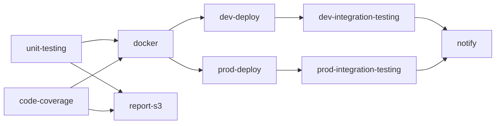

# 🚀 GitHub Actions Study Notes

A personal knowledge base of **Obsidian Flavored Markdown** notes covering GitHub Actions CI/CD, workflow jobs, artifacts, variables, triggers, concurrency, contexts, matrix builds, Node.js CI, Docker, AWS S3 reports, notifications, self-hosted runners, and the [Solar System pipeline project](https://github.com/OfficialMoAdel/solar-system).

> [!NOTE] Best viewed in Obsidian
> These notes use [Obsidian Flavored Markdown](https://help.obsidian.md/obsidian-flavored-markdown) (wikilinks, callouts, properties, embeds). They resolve links natively in [Obsidian](https://obsidian.md/). On GitHub, wikilinks (`[[Note]]`) appear as plain text — open the linked files below to read each note.


## 🗺️ Pipeline at a glance




## 📚 Notes

| # | Note | What it covers | Tags |
|---|------|----------------|------|
| 1 | [GitHub Actions — المذكرة الكاملة](Github%20action.md) | Complete GitHub Actions course notes (KodeKloud / DevOps Directive) built around a hands-on **Solar System** CI/CD pipeline project. Multiple jobs, sequencing with `needs`, artifacts, variables at different levels, triggers (`cron` / `workflow_dispatch`), job concurrency, timeouts, matrix strategy, contexts, `if` expressions, event filters, skipping runs, Node.js CI, `continue-on-error`, step contexts, dependency cache, Docker build/push, service containers, code coverage, placeholder tokens, job outputs, reusable workflows, S3 reports, notifications, self-hosted runners. | `#github-actions` `#ci-cd` `#devops` `#study-notes` `#solar-system` `#nodejs` `#docker` `#aws` `#s3` |

## 🗺️ How to use

### In Obsidian (recommended)

1. Clone this repo:
```bash
git clone <your-repo-url>
cd CI-CD
```
2. Open Obsidian → **Open folder as vault** → select the cloned folder.
3. Wikilinks (`[[Note Name]]`), embeds (`![[...]]`), callouts, and frontmatter properties resolve automatically.

### On GitHub

- Click any note name in the table above to view it on GitHub.
- Wikilinks and embeds are Obsidian-specific and do not render as links on GitHub; navigate via the file list instead.

## 🏷️ Tags used

`#github-actions` `#ci-cd` `#devops` `#study-notes` `#solar-system` `#nodejs` `#docker` `#aws` `#s3`

## 🤝 Contributing

This is a personal study repository. Issues and pull requests with corrections or additions are welcome.

## 🔗 Related

- [Obsidian Flavored Markdown](https://help.obsidian.md/obsidian-flavored-markdown)
- [Obsidian Help — Internal links](https://help.obsidian.md/links)
- [Obsidian Help — Callouts](https://help.obsidian.md/callouts)
- [Obsidian Help — Properties](https://help.obsidian.md/properties)
