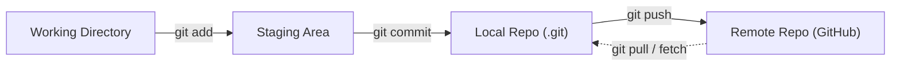
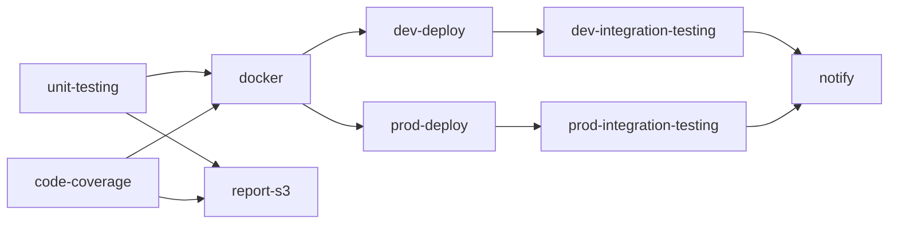

# 🚀 Git & GitHub Actions Study Notes


A personal knowledge base of **Obsidian Flavored Markdown** notes covering **Git** (from fundamentals and branching to recovery, QA workflows, troubleshooting, and interview prep) and **GitHub Actions CI/CD** (workflow jobs, artifacts, variables, triggers, concurrency, contexts, matrix builds, Node.js CI, Docker, Kubernetes, AWS S3 reports, notifications, self-hosted runners, and the [Solar System pipeline project](https://github.com/OfficialMoAdel/solar-system)).

> [!NOTE] Best viewed in Obsidian
> These notes use [Obsidian Flavored Markdown](https://help.obsidian.md/obsidian-flavored-markdown) (wikilinks, callouts, toggles, properties, embeds, Mermaid diagrams). They resolve natively in [Obsidian](https://obsidian.md/). On GitHub, wikilinks (`[[Note]]`) appear as plain text — open the linked files below to read each note.

## 🗺️ Pipeline at a glance







## 📚 Notes

| # | Note | What it covers | Tags |
| --- | --- | --- | --- |
| 1 | [Git — Complete Notes & Cheat Sheet](Git.md) | 18 sections from beginner to advanced: Git 4-layer architecture & lifecycle, setup & config, essential commands, full workflow, branching & naming conventions, Merge vs Rebase, remotes & upstream, undo & recovery (`restore`, `reset`, `revert`, `reflog`), stash/tags/`.gitignore`/`git rm --cached`, GitHub collaboration (Fork/PR/Code Review), Git for QA (Selenium/Playwright/API), Git with CI/CD (Jenkins/Webhooks), 6 common errors & fixes, advanced Git (`cherry-pick`, interactive rebase, squash, amend, `--force-with-lease`, branch cleanup), 18 interview questions (in collapsible toggles), best practices, and a one-page Ultimate Cheat Sheet. | `#git` `#version-control` `#cheatsheet` `#interview-prep` `#github` `#branching` `#troubleshooting` `#qa-automation` |
| 2 | [GitHub Actions — المذكرة الكاملة](Github%20Actions.md) | 30 sections combining Python CI basics (`pytest`, `Ruff`) and complete course notes (KodeKloud / DevOps Directive) built around a hands-on **Solar System** CI/CD pipeline project: multiple jobs, sequencing with `needs`, artifacts, variables & secrets, triggers (`cron` / `workflow_dispatch`), concurrency, timeouts, matrix strategy, contexts, `if` expressions, event filters, skipping runs, Node.js CI, `continue-on-error`, step contexts, dependency caching (`pip` & `npm`), Docker build/push (DockerHub & GHCR), service & container jobs, Kubernetes token replacement, job outputs, reusable workflows, S3 reports, Slack/Telegram/Discord notifications, and self-hosted runners. | `#github-actions` `#ci-cd` `#devops` `#study-notes` `#solar-system` `#nodejs` `#docker` `#kubernetes` `#aws` `#s3` |

## 🗺️ How to use

### In Obsidian (recommended)

1. Clone this repo:

```bash
git clone <your-repo-url>
cd CI-CD

```

2. Open Obsidian → **Open folder as vault** → select the cloned folder.
3. Wikilinks (`[[Note Name]]`), embeds (`![[...]]`), collapsible callouts/toggles, Mermaid diagrams, and frontmatter properties resolve automatically.

### On GitHub

* Click any note name in the table above to view it on GitHub.
* Wikilinks and embeds are Obsidian-specific and do not render as links on GitHub; navigate via the file list instead.

## 🏷️ Tags used

`#git` `#version-control` `#cheatsheet` `#interview-prep` `#branching` `#troubleshooting` `#qa-automation` `#github-actions` `#ci-cd` `#devops` `#study-notes` `#solar-system` `#nodejs` `#docker` `#kubernetes` `#aws` `#s3`

## 🤝 Contributing

This is a personal study repository combining hands-on notes with curated references and cheat sheets. Issues and pull requests with corrections or additions are welcome.

